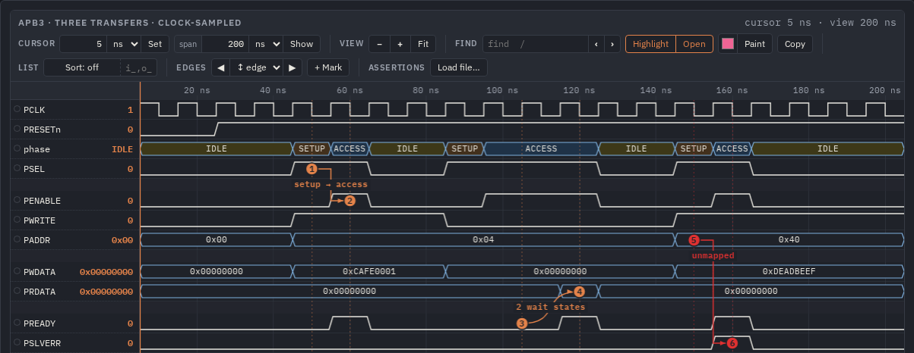

# wavefw — WaveDrom JSON → interactive waves

**Guides** (HTML with pictures; open them in a browser from a clone, `file://`, nothing to build):
[all guides](docs/guides/index.html) ·
[from a dump to a page](docs/guides/pages.html) ·
[the viewer](docs/guides/viewer.html) ·
[gaps](docs/guides/gaps.html) ·
[assertions (SVA)](docs/guides/sva.html) ·
[bus transactions](docs/guides/buses.html) ·
[WaveDrom](docs/guides/wavedrom.html) ·
[AI agents (MCP)](docs/guides/mcp.html)

wavefw draws **[WaveDrom](https://wavedrom.com) JSON** (the timing-diagram format of
[WaveDrom](https://github.com/wavedrom/wavedrom)) in two ways from one model: as an interactive canvas viewer (zoom,
cursors, find, a tree of the modules that keeps only the ones you pick, bookmarks, bus transactions) and as a static WaveDrom-style SVG for documents. A few Python tools turn a
simulator dump (VCD or FST) into one self-contained HTML page that you can mail or archive. One JavaScript file, one
stylesheet, no build step, no dependencies: the pages open from `file://`. SystemVerilog assertions bound to the waves
are checked over the dump and drawn next to the signals; an MCP server lets an AI agent ask questions of a dump and
mark up a page for a person — bookmarks with explanations, arrows, markers, groups, colours — live in their browser.
Whatever the viewer's buttons do, its [commands](docs/USAGE.md#commands-and-edits) do by name: from the console, a
script (`tools/viewedit.py` on a page's file) or an agent.



## Quick start

```sh
make examples                   # needs Verilator: APB, AXI-Lite and FSM pages in out/examples/<ex>/<ex>.html
make html WAVES=work/my.vcd     # your dump -> work/my.config.json (every signal, editable) + work/my.html
make html WAVES=work/my.fst SVA="checks/*.sv" BIND="a_req_ack@tb.dut"   # with assertions, evaluated and drawn
```

**In VS Code over Remote-SSH or WSL** (the dumps on a Linux host, VS Code on Windows): `make vsix`, then in a terminal
of the remote window `code --install-extension out/wavefw-*.vsix`; a `.vcd` / `.fst` → right click → *Open in wavefw*.
The extension carries the viewer and a static `sva`: nothing else is installed on the host ([USAGE](docs/USAGE.md#in-vs-code-over-remote-ssh-or-wsl)).

Open the `.html` in a browser from 2023 on (Chrome / Edge 111, Firefox 113, Safari 16.2). A VCD can also be opened
straight in the browser: `wavefw/viewer.html`, then drop the file on it. `make` alone lists the targets; build products
go to `BUILD` (default `out/` in the repository, git-ignored; `make BUILD=/tmp/wavefw …` is faster on a slow mount).

A WaveDrom diagram in your own page:

```html
<link rel="stylesheet" href="wavefw/wavefw.css">
<script src="wavefw/wavefw.js"></script>

<script type="application/wavedrom">          <!-- interactive viewer -->
{ "signal": [ { "name": "clk", "wave": "p....." }, { "name": "d", "wave": "x.34.x", "data": ["A", "B"] } ] }
</script>
<script type="WaveDrom"> {signal: [{name: 'req', wave: '01..0'}]} </script>   <!-- static SVG -->
```

Assertions from the command line, for CI:

```sh
sva eval --waves x.fst --scope tb.dut --sva checks.sva --report report.md --junit report.xml   # exit 1 on a failure
```

An AI agent with the tools (Claude Code; Codex: `codex mcp add …`), and a page marked up from a script:

```sh
claude mcp add wavefw -- python3 -I /path/to/wavefw/tools/wavemcp.py    # wave_* questions, sva_check, wave_page, view_*
python3 -I tools/viewedit.py out/examples/apb/apb.html --view exact \
    --ops '[{"op": "bookmark", "t": "60ns", "signal": "PSEL", "text": "setup"}, {"op": "group", "name": "ctl", "signals": "PSEL,PENABLE"}]'
```

## Prerequisites

By what you do (details in [DEVELOPMENT](docs/DEVELOPMENT.md)):

| To | You need |
|---|---|
| open the pages, run the tools | python3 ≥ 3.8 (standard library only) and a browser |
| build the examples | Verilator ≥ 5 (`make examples`) |
| build the assertion engine | cargo ≥ 1.82 and `rustup target add wasm32-unknown-unknown` (`make sva-build`); musl for `make dist-linux`, mingw-w64 for `make dist-windows` |
| run the tests and the pictures | `pip install playwright`, `python3 -m playwright install chromium` (`make smoke`, `make check`); `fonts-ibm-plex` (or the network) for `make shots`, `make guide-shots` |
| the SystemVerilog style | verible (`make fmt`) and Verilator (`make lint`) |

**FST dumps** are read through GTKWave's `fst2vcd` when it is installed, else through the `sva` CLI of this
repository: `sva vcd x.fst --out x.vcd` converts one (enum tables included) for anything that wants a VCD.

**Without compiling anything.** A clone works as it is: the pages and `wavefw/` need no build, the tools are Python
(standard library), the assertion engine is committed twice — `wavefw/sva.wasm.js` for the pages and the `sva` CLI for
the tools, `bin/linux-x86_64/sva` (static, any distribution); `tools/*.py` find it by themselves. On Windows the pages
and the tools work as they are; the CLI is built there by `make dist-windows` (needs mingw-w64), without it the
assertions are evaluated in the page. Without `make`:

```sh
python3 tools/mkconfig.py work/my.vcd --out work/my.config.json   # Windows: py tools\mkconfig.py work\my.vcd --out work\my.config.json
python3 tools/mkhtml.py --config work/my.config.json --out work/my.html --sva checks/my.sva --bind "a_req_ack@tb.dut"
```

## Build

```sh
make wavefw          # wavefw/wavefw.js from wavefw/src/*.js (after editing them)
make sva-build       # the SVA engine: the native CLI and wavefw/sva.wasm.js
make dist            # the prebuilt sva CLI: bin/linux-x86_64/sva (committed) and bin/windows-x86_64/sva.exe
make vsix            # the VS Code extension: out/wavefw-<version>.vsix (no node / npm needed)
make examples demo   # the example pages and the data of docs/index.html
make check           # the gate before a commit: the engine's tests, the unit tests, every page, smoke with nothing skipped
make shots guide-shots   # the pictures of this README (docs/img) and of the guides (docs/guides/img)
```

## Examples

[`apb`](examples/apb), [`axi_lite`](examples/axi_lite) and [`fsm`](examples/fsm) each have a testbench, a
hand-written config, assertions (one deliberately wrong, so a failure trace shows) and a README; `make example EX=<ex>`
(or `make examples`, all three) builds its VCD, FST and two pages: `<ex>.html` from the config and `<ex>_all.html` from
a config that `mkconfig.py` makes from the dump (the whole hierarchy). [`demo`](examples/demo) is the Manchester
transmitter behind [`docs/index.html`](docs/index.html) (`make demo`).
[`test_video`](examples/test_video) binds the checkers of a CoaXPress device IP (and a demo of the operators, with
deliberate failures) to its stream-video dump, which is not in git: with your `test_stream_video.fst` next to the
config, `make html WAVES=examples/test_video/test_stream_video.fst`.

## Documentation

| Document | What is in it |
|---|---|
| [`docs/guides/`](docs/guides/index.html) | the guides with pictures: dump → page, the viewer, gaps, assertions, bus transactions, WaveDrom, AI agents |
| [`docs/USAGE.md`](docs/USAGE.md) | the user's reference: every setting, key, option and format |
| [`docs/index.html`](docs/index.html) | the reference with live examples (open from `file://`): every attribute, setting and API function |
| [`docs/sva/LANGUAGE.md`](docs/sva/LANGUAGE.md), [`ENGINE.md`](docs/sva/ENGINE.md), [`STACK.md`](docs/sva/STACK.md) | the SVA subset, the evaluator's semantics and results JSON, the technology choice |
| [`docs/DEVELOPMENT.md`](docs/DEVELOPMENT.md) | the project layout, build and test (`make check`), measurements, the roadmap |
| [`docs/SV_STYLE.md`](docs/SV_STYLE.md) | the SystemVerilog style of the project |
| [`docs/reviews/`](docs/reviews) | the reviews of the stages with their findings and the commits that closed them |
| [`prompts/`](prompts/00-roadmap.md) | the roadmap as a series of prompts |
| [`CHANGELOG.md`](CHANGELOG.md) | every version (0.17 now; two numbers, each a tagged merge into `main`) |

## License

MIT. The third-party checkers in `tests/sva/third_party/` and stock WaveDrom in `tests/vendor/`
keep their own licences.
