# Using WaveLens

The user's guide: WaveDrom JSON in your own page, a dump to a page, the generated config, settings, themes, the static
SVG, assertions, the viewer's tools and keys, the command-line tools and the formats. The short overview is the
[README](../README.md); the reference with live examples is [`index.html`](index.html) (open it from `file://`); how the
project is built and tested is [DEVELOPMENT.md](DEVELOPMENT.md). The same features step by step, with pictures: the
[guides](guides/index.html) (the viewer, gaps, assertions, bus transactions, WaveDrom, AI agents).

Contents: [Use cases](#use-cases) · [Assertions (SVA)](#assertions-sva) · [The viewer](#the-viewer) ·
[Commands and edits](#commands-and-edits) · [AI agents (MCP)](#ai-agents-mcp) · [Tools](#tools) · [Formats](#formats)

## Use cases

### A dump straight in the browser

Open `wavelens/viewer.html` from the repository (`file://`, no build) and drop a VCD on it, or **Open…** in the **dump**
group of its bar (the last line; every viewer has it, a built page too). The VCD is read in the page: its signals by
scope (struct / union / interface scopes marked), exact transitions; a big one is cut to the `dumpBudget` setting (3 M
value changes: the scope levels nearest the top first; the toast says how many signals). **⟳** reads the file again
after a new simulation and keeps the view (window, cursor, folding, highlight, bookmarks): in Chromium the file is
picked through the File System Access API, so ⟳ reads what is on the disk now. An FST is binary: `sva vcd x.fst --out
x.vcd` (or GTKWave's `fst2vcd x.fst > x.vcd`), or a page with `make html WAVES=x.fst`. A saved state (`.view.json`) dropped on a viewer is loaded.

**The log** under the viewer says what the page did and what went wrong: a dump read (its signals, timescale, the time it
took; what the reader noticed, folded under one line with the line numbers), the types or sources taken (**Sources…**,
the VS Code tab's own: how many typed paths, the notes, the signals left as they are, another run), a state loaded or
saved, **Save page**, **Compare…**. A file that is not JSON (a types file cut short or edited by hand, a saved state) is
an error with its place: `name:line:column`, the line and a caret under the column (`svtypes.py` and `mkconfig.py` say
the same on the terminal). The log stays folded to one line (the last entry, **✖** errors and **⚠** warnings counted;
a click opens it), sticks to the foot of the window while the viewer is in sight, and opens by itself on an error;
open, **Problems** keeps the errors and warnings, **Copy** puts all of it on the clipboard as text, **Clear** empties
it. It shows up with the first thing done in the page (the setting `log`: `true` always, `false` never); a dump opened
again or **Sources…** keep it. In VS Code its errors go to *WaveLens: Show the log* too.

### In VS Code over Remote-SSH or WSL

The VS Code extension (`vscode/`) opens a dump in a tab with this viewer. It is a *workspace* extension: with Remote-SSH
or WSL it runs on the Linux host, where the dumps, the simulator and the agents are; the tab is drawn on your machine.
Nothing else is needed on the host: the package carries the viewer's files and the static `sva` (an FST is turned into
VCD text with it, kept in the extension's storage, 16 at most), and the extension runs in VS Code's own node.

```sh
code --install-extension bin/wavelens.vsix --force  # in a terminal of the remote window: installed on the host; the build of the version
make vsix                                           # the tree as it is now: out/wavelens.vsix + wavelens-<version>.vsix (tools/mkvsix.py: no node, no npm)
```

(or Extensions → … → *Install from VSIX…* while connected). A `.vcd` / `.fst` in the Explorer → right click → *Open in
WaveLens*, or *Open With… → WaveLens* (where you can make it the default for these files; it is an option, another viewer
may be the default). What the tab does differently from a page in a browser:

- **Convert to FST.** A `.vcd` in the Explorer → right click → *WaveLens: Convert to FST* (or the tab's title menu, or
  the palette) writes `tb.fst` beside `tb.vcd` with `sva fst` ([§ A VCD as an FST](#a-vcd-as-an-fst)): the FSM states of
  the VCD and of `tb.types.json` in it. Its notes go to the output channel *WaveLens* as they come, a failure opens it.
- **A large dump** (`wavelens.lazy`, auto: an FST of 4 MB or a VCD of 64 MB and more) opens with every module and
  signal at once — the top level open, its modules folded, no value read yet — as GTKWave and Surfer open one: open a
  module and the signals on the screen are read (`reading…` on their rows for a moment) from the dump's FST with
  `sva vcd --codes`; a VCD is made an FST once (`sva fst --no-types`, kept in the extension's storage, a few seconds for
  500 MB). What needs other signals reads them first: an assertion its signals, the FSM panel and `fsm_stats` the state
  machines, a picture its rows. Their values are the ones the whole dump gives (smoke `lazy_dump` holds it to that).
- **A new simulation.** The tab says when the dump changed on the disk (its size and time still for a second: polled,
  so an NFS home of the host works too); ⟳ in the bar, or *WaveLens: Read the dump again* (the editor's title), reads it
  with the view kept. `wavelens.autoReload`: at once.
- **Files are on the host.** Save state, PNG / SVG / WaveDrom and the assertions' report ask where to save on the host;
  Load…, the `.sv` files and Compare pick there (an FST to compare is converted too); Open… a dump opens a tab of its
  own. The state loaded last is the workspace's, whichever dump it was: Load… opens on that file, **Reload** (`r`) reads it in every tab,
  and a dump seen for the first time takes it at once (`wavelens.openLastState`, ctrl+Z undoes it); a dump with a view of its own keeps it. Bookmarks, groups, colours, radix, hidden rows and the assertion bindings are kept per dump in the workspace
  (they survive closing the tab and VS Code). The clipboard is yours (VS Code's).
- **Theme and keys.** `wavelens.theme`: `auto` (the viewer's light or dark by VS Code's), `vscode` (the colours of
  VS Code's theme: background, text, lines, accent, fonts), `light`, `white` or `dark`; **◐** in the bar (or *WaveLens:
  Choose the theme of the waves* in the editor's title) shows each on the open tabs as you move through the list. The
  viewer's keys (`?`) work in the tab and do not reach VS Code: the plain ones, and the ctrl / alt ones that mean there
  what they mean in VS Code (ctrl+F find, ctrl+C copy, ctrl+Z / ctrl+Y undo / redo, alt+C W R in the find field);
  `wavelens.keysToVSCode` (default `ctrl+G`, Go to Line) are left to VS Code — the list of your groups is `gl` then; the
  others (ctrl+P, F1, ctrl+tab, ctrl+shift+…) are VS Code's.
- **The version** in the bar's title line: `0.40 · dev@5470d89*` — the extension's branch and commit (`*`: changes not
  committed), so a tab of a development build says which one it is.
- **An agent** on the host (`tools/wavemcp.py`, below): when it starts its live link, every open tab connects (**●
  live**); `view_live` with `page` a `.vcd` / `.fst` and `open: true` opens it in the VS Code window that has the file
  in its folders, and `view_edit` / `view_get` with that `page` work on its tab (the tab only: a dump has no file to
  write the edits into). `wavelens.live: false`: tabs do not connect. The extension relays the link (the tab cannot
  reach the host's 127.0.0.1); nothing is forwarded.

- **State names.** A VCD has no enum tables (Questa writes none): the tab reads the design's types next to the dump
  (`tb.types.json` by `tb.vcd`, from Questa or Verilator: by path, *FSM state names* below) at each read and when the file
  is written again. Without them it reads the workspace's SystemVerilog sources
  (`wavelens.sources`: globs, default `**/*.sv`, `**/*.svh`; empty: none) at each read and names the state buses
  declared with a `typedef enum` there, by the variable's name (*FSM state names* below): the files that declare an enum
  or a packed struct and the files that use one of those types (a package and a module apart), each read again only when
  it changed; a file above 8 MB is left out and said in the output channel. **Sources…** in the bar picks other files:
  theirs win a name over the workspace's and stay over ⟳; names whose sources are gone go away at the next read.
- **The log.** Each read of a dump writes its parameters to the output channel *WaveLens* (size, `$version`, `$date`,
  `$timescale`, its time, scopes, signals, value changes) and what the reader noticed, as `path:line: warning: …` (a
  click opens the dump there): a value of a code no `$var` declares, a word that is no value change, more bits than
  the variable has, a `$timescale` it cannot read, a `$scope` left open, signals with no value, the cut of
  `dumpBudget`. The same notes are in the **Problems** panel (ctrl+shift+M) on their lines, until the tab closes; a
  dump it cannot read (the time goes back, no `$enddefinitions`, an FST `sva` cannot convert) is an error there and a
  message with *Open at the line*. An FST's notes name the line of its VCD text. *WaveLens: Show the log* (the editor's
  title) opens the channel, with the errors of the viewer's log (a types file that is not JSON: its line and column). The
  same notes are in the log under the viewer, and in a browser in the console (`WaveLens.vcdToWave(text).log`).

**Your configuration of the viewer.** *WaveLens: Open the configuration* (⚙ in the tab's title) opens a JSONC file of the extension (`wavelens.config.jsonc` in its global storage) made of the viewer's defaults, every key of `wavelens.config.js` with its comment; saved, it is checked and applied to every tab at once (not JSON: marked, the last good one stays; a wrong value or key: marked and left out, the rest applies — a key takes the kinds its comment names, `"log": false`, `"gapIdle": "2us"`; a key taken out (a colour too): its default; `theme` and `keysLeft` are VS Code's settings here). One that breaks the viewer: the defaults again, said. *WaveLens: Reset the configuration to the defaults* writes it anew.

**Links from a log.** A time in the terminal, a `.log` / `.txt` / `.out` file or a task's output — `@ 1234 ns`, `at 1.2 us`, `time=5ns`, a bare `1234 ns` (fs, ps, ns, us: "3 s" or "100 ms" in a log is no time of a dump) — is a link (ctrl+click): the dump's WaveLens tab (the one in sight, else the one used last, else a dump opened in this workspace before, picked) puts the cursor there and selects the line's `a.b.c` signal after the time (else the first; `top.gen[2].u.req` too; a logger's name — `cocotb.…`, `uvm_…` — is none; a name the dump has not got moves nothing); `dump.vcd#t=…&sel=…` (Copy link in the tab) opens that dump. `wavelens.logLinks`: more patterns, regular expressions with the groups `t`, `unit`, `sig`, tried first (no `unit`: ps; one that is no regex or has no `t` is said once in the WaveLens output).

Settings: `wavelens.logLinks`, `wavelens.theme`, `wavelens.sources`, `wavelens.autoReload`, `wavelens.openLastState`, `wavelens.lazy` (auto, always, never), `wavelens.live`, `wavelens.sva` (another sva program; the package carries the Linux one: a Windows host needs the path of `sva.exe`, which `make dist-windows` builds — without one the tab says so), `wavelens.verilator` (for *Make the types with Verilator*), `wavelens.keysToVSCode` (the keys left to VS Code, ctrl+G by default). A dump read whole (smaller than the `wavelens.lazy` sizes, or `never`) is cut to `dumpBudget`, and its whole VCD text crosses to your machine once per read.

### WaveDrom JSON in your own page

```html
<link rel="stylesheet" href="wavelens/wavelens.css">
<script src="wavelens/wavelens.js"></script>

<script type="application/wavedrom">          <!-- interactive viewer -->
{ "signal": [ { "name": "clk", "wave": "p....." }, { "name": "d", "wave": "x.34.x", "data": ["A", "B"] } ] }
</script>
<script type="WaveDrom"> {signal: [{name: 'req', wave: '01..0'}]} </script>   <!-- static SVG -->
<div data-wave="DEMO_WAVES.exact" data-lazy></div>                           <!-- from a data .js file, built on demand -->
```

Every element is upgraded when the page loads. `data-mode="svg"` picks the static renderer, `data-from` / `data-to` /
`data-cursor` / `data-title` set the window, `data-lazy` builds the viewer when its `<details>` opens (*lazy cards*, for
pages with many diagrams), `data-config='{"rowHeight": 30}'` sets any setting. JSON from files goes into a data script
with `tools/embed.py` (a page from `file://` cannot `fetch()` it). Attributes and the JavaScript API:
[`docs/index.html` § API](index.html#api).

### A dump to a page in one command

```sh
make html WAVES=work/my.vcd               # makes work/my.config.json if missing, then work/my.html
make html WAVES=work/my.fst               # FST (through fst2vcd, else sva vcd): FSM states named from the dump
make config WAVES=work/my.vcd             # after the dump changed: new signals added, gone ones dropped, edits kept
make html CONFIG=work/dump.config.json    # a config written by hand -> work/dump.html
```

Keep your dumps and configs under `work/`: the configs are tracked, the dumps and pages are ignored by git. The page has
every view of the config, each as a viewer or a static SVG; scopes become foldable groups.

### The generated config, and what you edit in it

`tools/mkconfig.py` lists every signal of the dump under its full path, one line each:

```json
"signals": {
    "tb_cxp_top.app_clk":    {"show": true,  "radix": "", "color": "#2f9e44", "style": "", "width": 1,  "changes": 32123},
    "tb_cxp_top.s_pix_data": {"show": true,  "radix": "", "color": "",        "style": "", "width": 16, "changes": 2189},
    "tb_cxp_top.cxp_device_top_i.cfg.run": {"show": false, "radix": "", "color": "", "style": "", "width": 1, "changes": 2}
}
```

Edit `show` (false = left out), `radix` (`auto hex dec signed bin oct ascii float`, fixed point `q8` / `sq15`), `color`, `style`
(`auto wavedrom questa square`), and add `alias`, `fill`, `enum` (`{"0": "IDLE"}`), `enumColors` (`{"IDLE": "#ffe066", "3": "c5"}`)
or `analog` (`true` or a number of rows: the bus as a step plot), `height` (the row's own height in px), or `fields` (`[{"name": "state", "msb": 15, "lsb": 13, "enum": {…}}, …]`:
a packed struct dumped as one vector, a row per field under a `{}` row with the whole value; a types file gives them, or
`mkconfig.py --sv` from `typedef struct packed`). A struct scope of the dump (an FST written with Verilator `--trace-structs`) is a
`{}` group by itself, its row the whole value when every field is shown; `""` takes the global value from
`"config"`. `width` and `changes` are information. A VCD's `real` (also `realtime`, `shortreal`, `real_parameter`) and
`string` variables become rows of texts (their numbers, `inf` `-inf` `nan` included, their strings; a real can be
`analog`), `event` variables are left out (no value to draw); VHDL's nine values are folded into `0 1 x z`. A vector
dumped in parts is one row: bit by bit (`err[0]`, `err[1]`, even two bits under one id code) or in ranges given apart
(`data [7:0]` and `data [15:8]` under two id codes: a 16-bit `data`), from its lowest declared index to its highest
(as wellen and `sva vcd` merge them; a bit not declared is `x`); the same range under two id codes is one signal. The
values are tokens apart by any white space (indented lines, tabs, a vector's id code on the next line). A vector written
without its `b` and glued to its id code, as Questa 2023 writes an integer (an enum variable's code: `00000000000000000000000000000001A&`
is 1 of `A&`), is read as the digits of a code declared that wide (the longest first), else of any declared code (an
enum declared at its own width, `reg [2:0]`, its value in 32 digits all the same: cut to its width); a note says it once: the page,
the tools and `sva fst`. `sva eval` and `sva vcd` read a VCD through wellen, which stops at the first one: they read an
FST of it written in the temporary directory instead (one line on stderr says so). A dump cut off at its end (the simulator still
writing it, not flushed: `vcd flush`, or quit `vsim`) is read up to the cut: a last value without its code, or a last
time cut short (`#1` after `#10`: back in time), is left out with a note, by every reader and `sva fst` (it wrote no
FST before); a time that goes back before the end is the error it is.

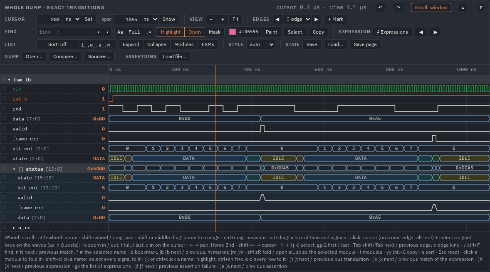

Next to `signals`: `"config"` (page settings, below), `"page"` (title,
intro), and `"views"` — named variants, each with its own `signals` (patterns such as `"tb.*_valid"`), `from` / `to`,
`clock` (one cell per clock) or `exact`, `group`, `also` (more rows by name or pattern: unlike `signals`, one the dump has not got is a lint
warning, `also-no-match`, not an error; a pattern adds 32 rows at most), `marker`, `bookmarks`, `arrows` and `render` (`view`, `svg`, `both`).
The starting values come from `tools/base.config.json` (`BASE=`): which scope depth starts shown, which paths are hidden,
how many value changes fit on a page, and rules by path pattern and width (`python3 -I tools/mkconfig.py --help`).
The example configs in [`examples/`](../examples) are written by hand and show every key.

### Lint: what the page would not show

`mkhtml.py` (and `vcd2wavedrom.py`) print a warning for what the page would draw otherwise than meant, or not at all,
with the config path of the entry; the page is still written:

```
mkhtml: lint: bookmark-outside-view: views.drop.bookmarks[0] (n 1): 1133.8us is outside the view 1.155ms…1.2ms: not drawn
```

For a script, `mkhtml.py --lint-json FILE` (`-`: stdout) writes them as JSON at every build, nothing to parse: `{"count", "warnings":
[{"code", "where", "message", "view", …}]}`, and what a warning is about where it says it: `"signal"` (a bookmark's or a span's, of
`bookmark-signal-missing`, `span-signal-missing`) or `"name"` (`expr-name-missing`), and `"rows"`, the rows of the view it may mean.
A build that fails (a bad config, a dump or a signal not there) writes the object too, with `"error"`: the message it prints, exit 1;
the warnings of the views built before the one that failed are in it.

**For CI.** `--junit report.xml`: the assertions of every view as JUnit XML (a testsuite per view, a testcase per binding, a failure
for one that failed; an error for one that could not run: `missing` — its signals are not in the dump — or `capped`, attempts
without verdict; skipped: a binding not evaluated — no such assertion in the sva files — or one with 0 attempts; never a pass for a
check that did not run; covers are not failures), `--png DIR` (`--png-theme light|dark|both`, `--png-width 1280`; `make html … PNG=DIR JUNIT=FILE`): a PNG of every view through
`tools/pageshot.py` (playwright; without it an error that says how to get it), a test each with `--marks-views tests`: one build gives
the page, the report and the pictures — `mkhtml.py --config x.config.json --marks run.marks.json --marks-views tests --out run.html
--junit artifacts/report.xml --png artifacts/`. The exit stays 0 once the page is written; the failures are in the XML and on the page.
A page of a view per test shares your markers between its views (`sharedMarkers`).

`mkhtml.py --config x.config.json --lint` checks without writing a page; `--strict` makes a warning an error (exit 1, no
page). The checks:

| Code | What |
|---|---|
| `bookmark-bad`, `arrow-bad` | an entry of `bookmarks` / `arrows` is not an object: left out |
| `bookmark-outside-view` | a bookmark's time is outside its view's window: not drawn (the list still has it) |
| `bookmark-signal-missing` | its `signal` is no row of the view: the circle goes on the time axis (a row is named by its full path, or as the config gave it, in a group too, or by its path in the dump; the warning names the row whose last part matches) |
| `bookmark-duplicate`, `bookmark-time`, `bookmark-key` | a number twice (arrows take the first), a `t` that is no time, an unknown key (`lable`) |
| `bookmark-link-missing` | a `link` to a view the page has not got |
| `arrow-end-missing`, `arrow-key` | an arrow from or to no bookmark of the view (not drawn), an unknown key |
| `also-no-match`, `also-cut` | an `"also"` name or pattern with no signal in the dump, a pattern past 32 rows |
| `marker-no-match`, `marker-key` | a marker's event matches nothing in the window, an unknown key |
| `expr-name-missing`, `exprs-no-engine` | an expression reads a name the page will not find (its row would stay empty and look like "never true"); expressions on a page without the engine (`--no-sva`, `"sva": false`) |
| `gap-view-off`, `setting-signal-missing` | `gapView` without `gaps` does nothing; `cycleClock`, `gapClock`, `gapSignals` or `gapAux` name no row of the view, with the cycles or the gaps on |
| `measure-no-match` | an end of a measure (an event) never happens in the window: a `to` leaves an open pair (one marker), a `from` leaves the measure out; a measure whose end comes before its start is taken in order |
| `measure-empty` | a measure whose two ends are one time (one event at both, a bookmark twice): a Δ of 0, measuring nothing |
| `cycle-zero-window` | a window (`--from`) with `cycleZero` before it: the page counts the edges before the window at the clock's period (its first edge in it: cycle 0 when the clock starts later than a period in), and the dump's own count differs (the clock stops or changes its period between): set `cycleZero` inside the window |
| `bind-unknown` | a binding to an assertion that is not in the files (`mc_fsm_gap` for `mc_fsm_from_gap`) |
| `svashow-no-match` | an `svaShow` name or pattern that matches no assertion |
| `bookmarks-close` | two circles on one row nearer than 16 px at 1000 px of the whole window: they overlap (a heuristic; `"lift": true` puts one in the lane above, `"below"` in the one under; the marks of a cocotb test at one time are put apart by themselves: § Marks from a cocotb test) |
| `span-outside-view`, `span-signal-missing`, `span-key` | a span outside the window (not drawn), on no row of the view, an unknown key |
| `span-every-no-match` | a span's `every` matches nothing in the window: no span |
| `compare-spans-cut` | a signal differs in more stretches than the page keeps (the first 1000) |
| `state-svg` | a view with `"render": "both"` and a `"state"`: the viewer opens with it, the static figure beside it draws the WaveJSON as it is (`"render": "svg"` with a `"state"` is an error) |
| `state-signal-missing` | a name in a view's `"state"` (`hidden`, `radix`, `analog`, `paint`, `groups[].signals`, `dups`, the markers' and bookmarks' `signal`) is no row of the view: the page leaves it out and says so in a toast and its log |
| `measure-no-clock` | a measure's `min` / `max` in cycles on a view with no clock to count them (no `cycleClock`, no row named clk / clock): the Δ is not checked, the page says "? no clock" and `measures` gives `ok: null` |
| `enum-colors-hex` | an `enumColors` fill in hex while the theme may be dark: it stays light there, under a light text (the tokens `c3`…`c9` follow the theme) |

### FSM state names: FST, or VCD + the design's types

An FST written by Verilator (`--trace-fst`) carries the enum tables of the design, so state buses show `IDLE`, `START`, …
straight from the dump. A VCD has none. Questa writes an enum on `logic [1:0]` as `reg [1:0]`, one on `int` as `integer`, a
packed struct as one vector, and its `wlf2vcd` loses the values of enums. The viewer and the tools show an `integer` (`int`,
`shortint`, `longint`, `byte`) without a table as a signed decimal number (`12`, not `0x0000000C`), so the state's code reads
at once; the names come from the design's types (guide: [State names and structs](guides/types.html)):

- **A types file** `tb.types.json` next to `tb.vcd`, keyed by path, written by the tool that elaborated the design:
  - **Questa**: `source tools/questa/wavelens_types.tcl` in `vsim` (`-voptargs=+acc`), then `wavelens_types tb.types.json
    [root]` after the design is loaded and **before** `run` (in a batch `vsim` the test's `$finish` ends vsim unless
    `-onfinish stop`, and a command after `run -all` is never run); `wavelens_vcd tb.vcd [root]` writes the VCD of the signals
    under root (`vcd file` + `vcd add -r`; or `$dumpfile` / `$dumpvars` in the testbench):
    `source …/wavelens_types.tcl; wavelens_types tb.types.json; wavelens_vcd tb.vcd /tb/u_dut; run -all`. A saved WLF too: `vsim -view old.wlf`, `wavelens_types old.types.json
    old:/tb`. The file keeps Questa's `describe` of every signal and the module of every instance. `make questa EX=fsm` does
    it for the FSM example (`BUILD/questa/fsm/`).
  - **Verilator**: `python3 -I tools/svtypes.py verilator --top tb --out tb.types.json -- -f files.f` (after `--`, the
    arguments Verilator takes: files, `+incdir+`, `+define+`, `-G…`): `--json-only`, its instances walked, every type followed;
    a package's variables too (`p.state`), unpacked arrays of any dimensions, escaped names as the VCD has them, enums up to 64 bits.
    `make examples` writes one for each example.
- A signal gets the type of **its own path** (a top scope the dump adds, `TOP.`, is skipped only when no root of the dump is
  one of the file's), and only when its width in the dump is the type's. Two modules' `state` get
  their own tables, a parameterised module's instances their own widths, a plain `logic [1:0] state` none. A nested struct
  gives dotted fields (`in.st`), a packed array of enums or structs a field per element (`two[1]`). A union, an enum over 32 bits
  from Questa (its `describe` keeps 32), or a text it does not read stays a number, with a note; a real of the design (an
  analog model's parameter: `Floating point type`) a number, without one. The width is the only check:
  a types file of a run with other parameters that keep the widths gives its labels as they are.
- **An enum on an integer.** A Questa VCD may write a variable of an enum type as `integer 32` (2023.3 does; 2021.1
  writes `reg [2:0]`), the enum's code its value: an `integer` (`int`, `shortint`, `longint`, `byte`) of the dump wider
  than the enum the types give it takes its labels by those codes, and is an FSM. The viewer's log says how many, and of
  each one a value that is no code of its enum (shown as a number: another design?) or only `x` in the dump (a VCD of
  `wlf2vcd`, which loses the values of enums: dump the VCD from `vsim`, `vcd file` / `vcd add -r /*`). A `reg` of 32 bits
  stays a number. `svtypes.py check` lists them (`an integer of 32 bits in the dump, an enum of 3 in the types`), and
  `sva fst` writes their tables into the FST on the integer's width.
- **Used by** `make html WAVES=tb.vcd` (`mkconfig.py` finds `tb.types.json` by its name; `--types FILE` / `TYPES=` another;
  a types file newer than the config updates it at the next `make html`. The config's `"typed"` lists what the file gave:
  `--update` replaces that with the file's of now, or takes it away; an `"enum"` you wrote or edited stays); the viewer's **Sources…** with the `.json`
  (the view kept, ⟳ keeps them); the VS Code tab, which reads it next to the dump (`tb.vcd` or `tb.fst`) at each read and
  offers ⟳ when it is written again; there *WaveLens: Make the types with Verilator* writes it too (a `.f` file of the
  workspace or the arguments typed, `rtl/*.sv` expanded, the top module; `wavelens.verilator`; no Python needed). `python3 -I tools/svtypes.py
  check tb.types.json tb.vcd` lists what each path gets and which signals of the dump get it.
- **Into an FST.** `sva fst tb.vcd` (or *Convert to FST* in VS Code, `wave_to_fst` of the MCP server) writes `tb.fst`
  with each state bus's names as the FST's own enum table, by the same rules (its path, its width; `--map` as here):
  GTKWave, Surfer and every reader of the FST show them without the types file ([§ A VCD as an FST](#a-vcd-as-an-fst)).
- **Another root.** The dump's scopes as the types name them: `"map": {"top.dut_i": "dut"}` in the types file, or
  `--types-map top.dut_i=dut` (`mkconfig.py`) / `--map` (`svtypes.py check`): the longest prefix is replaced before the lookup.
- **Which run.** The types and the dump are compared as far as both tell: written more than a day apart (Questa's types and
  its VCD come from one `vsim`), an instance of the types under a module the dump has but not in it. Either is a note
  (`mkconfig.py`, `svtypes.py check`'s `run:` lines, the viewer's log and **Type…**): the labels may be of another design or
  other parameters. The right button's **Type…** on a signal tells where its labels come from: the types file and the path
  there, a width that does not fit, a plain vector in the types, no entry (with the paths of its name the file has, and the
  `"map"` to write when they are under another root); the command `types` answers the same.
- **What the dump lacks.** Questa's types declare every signal (`describe` of each, unpacked arrays and parameters too):
  the ones the dump has not got are said in counts by why — `unpacked arrays` (a Questa VCD leaves them out),
  `under generate scopes` (a scope `name[k]` or `genblk…` it lacks: `vcd add` without `-r`), `in other scopes`, `not
  dumped` — with their first paths: `svtypes.py check`, `mkconfig.py`, `wave_info`'s notes, the viewer's log when it
  opens a dump with its types (§ *What a Questa VCD lacks*). Verilator's types name their typed signals only: the note
  says so.
- **Without a types file**, by the variable's name: `make html WAVES=x.vcd SV="rtl/*.sv"` (`mkconfig.py --sv`), **Sources…**
  with `.sv` / `.svh` files, the VS Code tab's `wavelens.sources` (default `**/*.sv`, `**/*.svh`) read `typedef enum {…}
  name_t;` and `typedef struct packed` and label the signals declared with those types (a table only where its values fit
  the width; an element of an array gets the array's). What is not guessed, with a note in the log (the VS Code tab's
  Problems, `mkconfig.py`'s stderr): a name declared with two different types (two modules with their own `state`, or one
  of them a plain vector) gets no labels, nor does an enum with a value it does not read (an expression such as `1 << 2`, a
  parameter, a negative number, labels by macro); function arguments and struct members are not signals. With a types file
  these are not used.
- Or write `"enum"` into an entry by hand. The FSM example builds both pages (the FST's names; the VCD's from its types).

From a script: `WaveLens.svTypes(text)` (a types file), `WaveLens.svTables(texts)` (sources),
`WaveLens.svApply(waveJson, tables)`, `view.setSources(files)`.

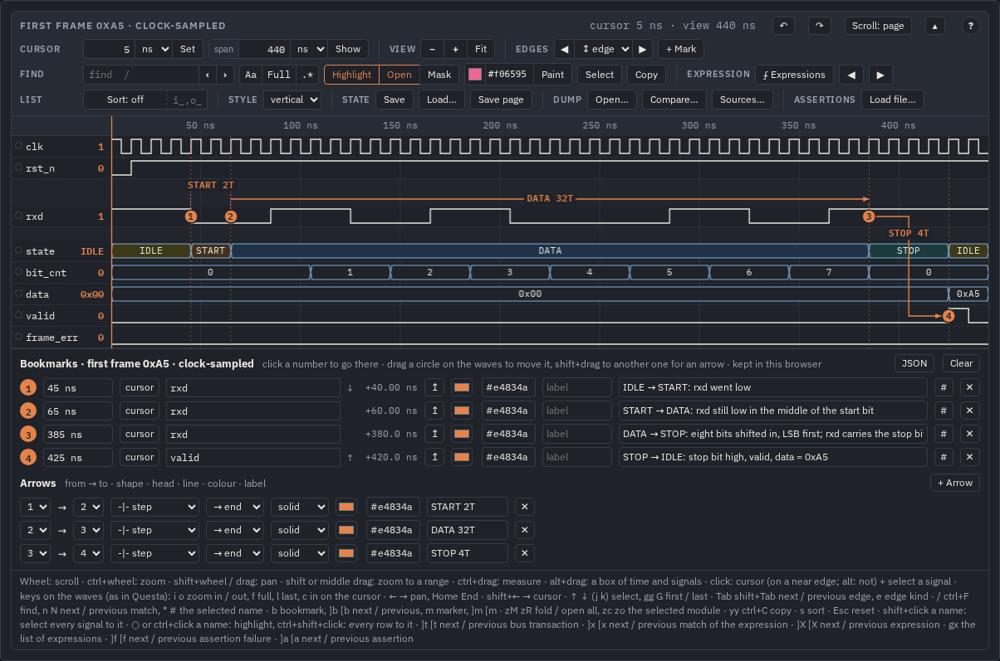

### Colours per signal, per group, per module

Colour is the quickest way to read a bus. Give every **channel** of a protocol its own colour — for AXI4-Lite the
address-write, write-data, write-response, address-read and read-data channels, for AXI4 the same plus the IDs and
bursts, for AXI-Stream the `TVALID TREADY TDATA TLAST` group of each port — or one colour per **module** of a generated
page. A group's colour goes to its signals (trace, bus outline, name) and to its name; a signal with its own colour keeps
it.

```json
"group":  { "aw": ["AWVALID", "AWREADY", "AWADDR"], "w": ["WVALID", "WREADY", "WDATA", "WSTRB"], "b": ["BVALID", "BREADY", "BRESP"],
            "ar": ["ARVALID", "ARREADY", "ARADDR"], "r": ["RVALID", "RREADY", "RDATA", "RRESP"] },
"config": { "groupColors": { "aw": "#339af0", "w": "#37b24d", "b": "#f59f00", "ar": "#ae3ec9", "r": "#1098ad" } }
```

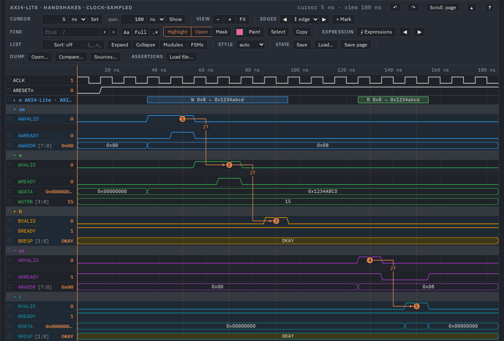

`groupColors` keys are group names, full paths or `*` patterns, and the nearest matching group wins:
`{"s_axis": "#339af0", "m_axis": "#37b24d"}` for two stream ports, `{"tb.dut.u_rx": "#37b24d", "*fifo*": "#f59f00"}`
for modules of a generated config (the hierarchy picture below). One signal: `"color"` in its entry of a generated config,
`"color"` / `"stroke"` and `"fill"` in WaveJSON. Many signals by name: a rule in `tools/base.config.json`, e.g.
`{"match": ["*_valid", "*_ready"], "width": 1, "color": "#f59f00"}`, colours them in every config `mkconfig.py` writes.
Interactively: find the signals and **Paint** them (see *Fuzzy find*). Every colour picker of the viewer (the bar's Paint, a signal's, a marker's, a bookmark's, a group's, a Δ's)
has its hex code beside it (`#c2255c`): select it to copy, type or paste a code (`#abc`, `C2255C` too) and Enter picks it
(a wrong one is marked and put back).

### Settings

Colours, sizes, fonts, line widths, sorting, folding and highlight are *settings*, merged in this order (later wins):

1. built-in defaults (`WaveLens.defaults`)
2. global: [`wavelens/wavelens.config.js`](../wavelens/wavelens.config.js) loaded before `wavelens.js` (every key with its default),
   or `WaveLens.configure({…})` at run time; for a generated page, the top-level `"config"` of the config file
3. the diagram's `"config"` object in the WaveJSON (a view's `"config"`)
4. the element: `data-config='{…}'`, `data-sort`, `data-theme`, `data-colors`, …, or the constructor options
5. the viewer's own, kept in this browser for that viewer: the edge style, the gaps, the cycles, where the rows scroll, the
   tools folded or hidden (picking the settings' own value drops it)

A key that is no setting (a typo: `rowHeigth`) is an error in the tools and a console warning in the page; the plugins
add theirs (`WaveLens.registerDefaults`).

| Key | Default | Meaning |
|---|---|---|
| `theme`, `colors` | auto, `{}` | `light`, `white`, `dark`; colour tokens (see *Themes*) |
| `rowHeight`, `groupHeight`, `spaceHeight`, `headerHeight` | 26, 22, 14, 24 | row heights, px |
| `nameWidth`, `fontSize`, `labelSize` | 200, 11.5, 11 | name column, name text, bus labels, px |
| `fontMono`, `fontBody` | IBM Plex | CSS font-family lists |
| `traceWidth`, `busWidth` | 1.4, 1.2 | line widths, px |
| `sort`, `sortIgnore` | `none`, `[]` (`wavelens.config.js`: `["i_", "o_"]`) | `none \| asc \| desc`; name prefixes skipped when sorting |
| `sortButton`, `hint` | true, true | show the Sort controls / the help line |
| `style` | `auto` | edges: `wavedrom` (slanted), `questa` (vertical, narrow bus crossings), `square`; `auto` slants wave strings and draws exact `tv` transitions vertically; the viewer's list in **style** changes it (kept in the browser) |
| `wheel` | `scroll` | the wheel scrolls the rows and ctrl+wheel zooms, as in Questa; `zoom`: the wheel zooms |
| `svaOpen` | false | the assertion list (`sva.js`) open when the page opens; folded: ▸ Assertions opens it |
| `exprsOpen` | false | the list of expressions (`sva.js`) open when the page opens and it has some; folded: ▸ Expressions opens it |
| `dumpBudget` | 3000000 | a VCD opened in the page (Open…, dropped on a viewer): the signals nearest the top up to this many value changes |
| `busDetect`, `buses` | true, none | bus transactions (`bus.js`): the ports found by their names; ports of your own `[{protocol, scope, prefix, map, clock, name}]` |
| `contextMenu` | true | the right button on the waves (a range and the viewer's menu) and on the names (the menu of that row); false: the browser's |
| `menuTipDelay` | 2000 | ms before a tooltip in that menu shows (the bar's: 350 ms) |
| `exprLibrary` | `[]` | the project's expressions, `[{"text": "PSEL && !PREADY", "label": "wait"}]` or texts: the expression editor offers them as you type (by label or text) and in **Library…** of the list of expressions |
| `sharedMarkers` | false | true: your markers and their Δ the same in every viewer of the page of the same dump (a marker made in one is in each; a page of a view per test, `mkhtml.py --marks-views tests`, sets it) |
| `keys` | `{}` | your keys: a key or a sequence → the viewer's key it stands for (`null`: none): `{"gx": "gm", "M": "m", "m": null, "ctrl+k": "ctrl+g"}`; a key is one character, a sequence of your own after `g z y [ ]` (its box lists it under **Your keys** with what it does), `ctrl+` or `ctrl+shift+` a key, or a named key (`ArrowUp` … `F12`); a key stands for one key of the viewer (no chain: `x` → `y` → `z` does not go on), alt+ a key is always the viewer's; `g z y [ ]` alone, Esc and `?` stay; key by key over the three layers (`data-keys='{…}'` on the element last); **?** lists them in place of the viewer's rows they take; a key it cannot take is said in the log when the setting is read, one standing for no key of the viewer when pressed (a toast too) |
| `keyHints` | 200 | ms after the first key of a sequence (`g z y [ ]`): a box says what can follow, to press or to click; `false`: never, and the second key within a second, as before |
| `cursorSnap` | 8 | px: a click on the waves puts the cursor on an edge of the signal under the pointer this near (alt+click: not); 0 = off |
| `showWidth` | true | a bus's width after its name (`[7:0]`, a field's `[msb:lsb]`; a click on it: the bus bit by bit), in the viewer and the pictures; false: none |
| `gapView` | false | with `gaps`: the viewer's waves themselves with the gaps cut out, every change of a gap setting shown at once (**Gaps ▸ on the waves**, `gv`); a picture saved cuts where the waves do; a range or the cursors measured through gaps count the time and the clocks hidden, the clock of the gaps said on any row, an end on a gap's column at the side nearer (alt: inside it) |
| `gaps`, `gapIdle`, `gapKeep` | false, 16, 2 | the pictures and WaveDrom saved from the viewer's menu (and static SVGs) leave out the stretches where no signal but a clock changes for `gapIdle`, all but `gapKeep` after the last change and before the next one, a break `\|` in their place; lengths in clock cycles (`16`) or a time (`"2us"`); the menu's **Gaps** rows change them (kept in the browser) |
| `gapSignals`, `gapClock`, `gapAux`, `gapOnly`, `gapCount`, `gapLine` | none, none, none, false, `clock`, `dashdot` | the signals the gaps follow (paths, names, `*` patterns; none: every signal drawn); the clock whose cycles `gapIdle`, `gapKeep` and the texts count (none: the selected clock, else the nearest `*clk*`); the signals counted in a gap (with any texts; none: with `edges` every one but those and the clock); the viewer's picture and WaveDrom of those three kinds alone; the texts of a gap: `clock` (under the axis the time left out and the clock's cycles), `edges` (also a thin row under each signal counted with its rising and falling edges in the stretch left out, a bus its changes; none marked: every one), `rise`, `fall`, `any` (that row with these edges alone, or any change), `off`; the line of a gap: `dashdot`, `wave`, `waves`, `zigzag`, `double` |
| `radix` | `auto` | bus values from `tv`: `auto` (≤ 6 bits decimal, else hex) `hex dec signed bin oct ascii`, `float` (IEEE 754 of a 16-, 32- or 64-bit bus), fixed point `q<F>` / `sq<F>` (unsigned / signed, F fraction bits: `q8`, `sq15`) |
| `enumColors` | none | the fill of a bus value by its label or number, every signal: `{"ACCESS": "#d0ebff", "3": "c5"}` (a colour, a token, 3–9); a signal's own `enumColors` wins |
| `fold` | none | groups folded at start: `true`, a nesting depth (`2`), or group paths |
| `groupOrder` | `file` | inside a group: `last` = signals first, then sub-modules; `first`; `file` |
| `onlyGroups` | true | Only keeps your groups whole, every signal of them whatever its module (the Modules panel's **Your groups whole**); false: their signals by module, as every signal |
| `moduleShading` | true | neighbouring instances alternate between two backgrounds, the panel and a pale blue (`band` in `colors`); module rows bold |
| `maxHeight` | none | e.g. `"80vh"`: the rows scroll inside the viewer (any number of rows; the box never taller than the window under the bar, 120 px at least); none: with the page, the bar sticking to the top (generated configs: `"80vh"`; the bar's **Scroll** button switches) |
| `toolsFolded` | false | the bar's tools folded to its title line (**▴** / **▾ tools** in the bar) |
| `toolsHidden` | `[]` | the bar's tool groups left out by their labels (`["style", "dump"]`; the right button on the bar) |
| `themeButton` | `auto` | **◐** in the bar's title line: the page's theme (auto, light, white, dark; kept in this browser; in VS Code its list, VS Code's colours too); `auto`: when the page has no theme button of its own (`viewer.html`, the VS Code tab) |
| `version` | true | the version in the bar's title line, and the build the page was made from (`0.40 · dev@5470d89*`: branch, commit, `*` changes not committed; `mkhtml.py` and the VS Code extension write it) |
| `keysLeft` | `[]` | keys the viewer leaves to its host: `["ctrl+G"]` (`ctrl+` is `cmd+` too, a letter by its place); the VS Code tab: `wavelens.keysToVSCode` |
| `log` | `auto` | the log under the viewer (§ A dump straight in the browser): `auto` from the first thing done in the page (a dump read, Sources…, Load…), `true` always, `false` never |
| `savePage` | true | the bar's **Save page**: this page as a `.view.html` with your view in it (§ Save and Load); false hides it and keeps no copy of the page's text |
| `cycles`, `cycleClock`, `cycleZero` | false, null, null | the clock cycles in a band under the time axis (§ Clock cycles): on, the clock counted (null: the `*clk*` found), the time of cycle 0 (`"50ns"` or ps; null: the first rising edge; before the waves begin, a window: counted at the clock's period) |
| `groupColors` | none | one colour per group: `{"aw": "#339af0", "tb.dut.u_rx": "#37b24d"}` (names, paths, `*` patterns) |
| `highlight`, `dim` | none, 0.3 | instances in front at start (paths, names, `*` patterns) and the opacity of the rest |
| `findHighlight`, `findOpen`, `findMask` | true, true, false | starting state of the find options **Highlight**, **Open**, **Mask** |
| `findCase`, `findWord`, `findRegex` | false | starting state of **Aa** (match case), **Full** (whole name; `a.b`: the end of the full path), **.\*** (a regular expression) |
| `bookmarkLeft` | 0.2 | going to a bookmark (`1`–`9`, `]b [b`, **Markers…**, a number in its list, the command's `go`): its time this far from the left of the waves (0 … 0.9; 0.5: the middle; not a number: 0.2) |
| `arrowLabels`, `laneHeight` | `lane`, 16 | arrow labels in a lane of their own between the signals, or `overlay` |
| `svaSignals`, `svaShow` | `view`, all | assertion groups: repeat the bound signals under the steps (`view`: in viewers, `true`: also in static SVGs, `false`); which assertions are drawn (labels, `*` patterns) |

### Themes

Three themes — `light` (warm paper), `white` (black traces, for print and slides) and `dark` — chosen by
`prefers-color-scheme` or set with `<html data-theme="white">`, `WaveLens.setTheme('dark')`, the page's theme button, or
`"config": {"theme": …}`. Every colour is a CSS custom property: `WaveLens.setColors({trace: '#c00', bus: 'navy'})` for all
waves, `data-colors` / `"config": {"colors": …}` for one wave, `"color"` / `"fill"` for one signal. Details:
[`docs/index.html` § Themes](index.html#themes). The pictures in this guide are dark; the same APB view in `light`:

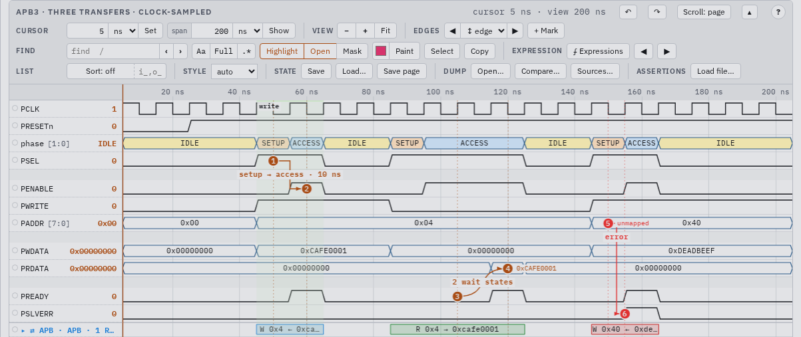

### Static SVG for documents

A view with `"render": "svg"` (or `data-mode="svg"`, `<script type="WaveDrom">`, `WaveSVG.toString(model)` for a file)
is drawn as an inline SVG in the WaveDrom look, with the same bookmarks and arrows and a legend of the bookmark texts.
It follows the page theme, or paints its own background when it has one.

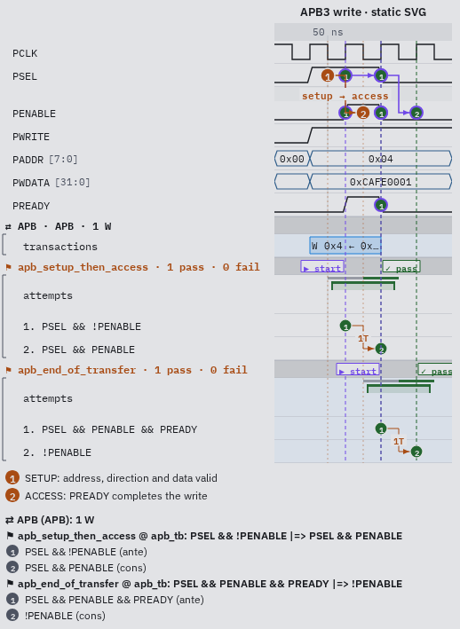

### Large dumps

`test_stream_video.vcd` (24 MB, 3520 signals in 214 scopes, 4.9 M value changes): the config in 2.7 s, a page with every
changing signal (1526 signals, all 9 scope levels) in 25 s and 6.3 MB; it opens in 2 s and redraws in 4 ms. The viewer's
canvas only covers the visible rows (the names column up to 4000 rows is one element per row, above that it holds the rows near the view: tens of thousands of rows make
folding and searching slower). Above `select.budget` value changes
(6 M) `mkconfig.py` hides the deepest levels first and says which depth it kept. A VCD opened in a page (Open…) is cut to
`dumpBudget` (3 M changes: the levels nearest the top, the rest named by the find); the VS Code tab reads a large one
as it is needed instead (*VS Code* above: every module at once, the signals you open read then; a VCD of 643 MB and 10 000
signals: an FST in 9 s once, then its modules in 0.3 s, a module opened in a moment).

## Assertions (SVA)

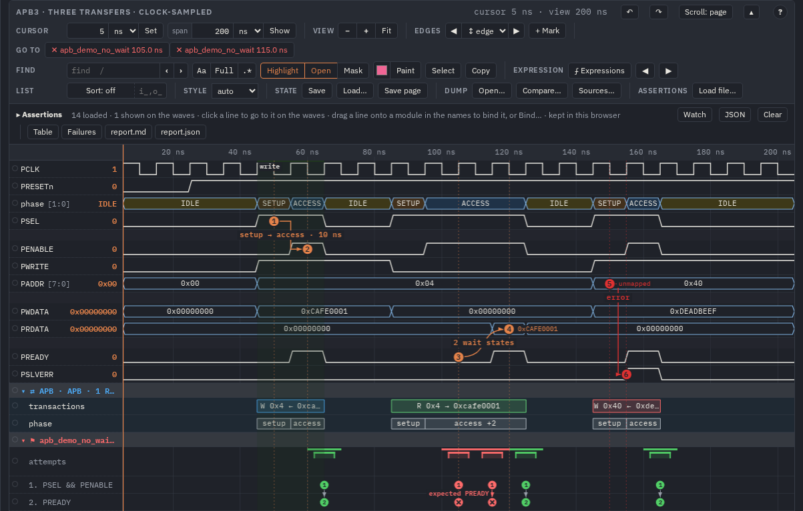

SystemVerilog assertions are checked against the waves of a page: bind an assertion to an instance of the waveform and
it is evaluated over the dump, in the page (WebAssembly) or when the page is built (the `sva` CLI, Rust). Every attempt
is drawn under that instance — a bar from its start to its end, a numbered circle per sequence step, arrows between the
steps, a red ✕ where it failed — and the panel above the waves counts them. The same numbers come out as Markdown,
JSON, JUnit XML or an HTML section for CI and documents.

**The subset.** Concurrent `assert` / `assume` / `cover property` with clocking (`@(posedge clk)`, `default clocking`),
`disable iff`, implications `|->` `|=>`, delays and ranges `##n` `##[m:n]` `##[m:$]`, repetitions `[*n]` `[*m:n]`
`[->n]` `[=n]`, `and or intersect within throughout first_match`, `not`, `if`/`else`, `nexttime always eventually
s_eventually`, the sampled-value functions (`$rose $fell $stable $past $changed`, `$onehot $onehot0 $isunknown
$countones`), named `sequence` / `property` with arguments, packages, enums, parameters, macros, `` `ifdef `` — in
modules, checkers, interfaces and programs. Values are 4-state; signedness is unsigned (with a warning). Not in it:
`until` and friends, local variables, multi-clock properties, `accept_on` / `reject_on`, immediate assertions. The
full list: [`docs/sva/LANGUAGE.md`](sva/LANGUAGE.md); the evaluator:
[`docs/sva/ENGINE.md`](sva/ENGINE.md).

**Load and bind.** List the files in the config and bind assertions to instances (`"assert"` may be a pattern):

```json
"sva": ["rtl/checks_pkg.sv", "checks/apb.sva"],
"bind": [{ "assert": "a_req_ack", "scope": "tb.dut.u_apb" }, { "assert": "apb_*", "scope": "tb.dut.u_apb" }]
```

or on the command line: `make html WAVES=x.vcd SVA="checks/*.sv" BIND="a_req_ack@tb.dut,apb_*@tb.u_apb"`.
A top-level `"bind"` is every view's; a view's own `"bind"` is drawn in that view. The page's printable **Assertions**
section has every binding of every view over the whole dump; `"report"` adds bindings to that section only, drawn in
no view — the full report of a page whose views each draw two or three assertions:

```json
"report": { "bind": [{ "assert": "*", "scope": "tb.dut" }] }
```

(or the list alone, `"report": ["*@tb.dut"]`; `mkhtml.py --report NAME@SCOPE`, repeatable; it needs the top-level `"sva"`
and `"waves"`; `"report": false`: no printable section). A view's bindings keep their sampled times once per clock
(`sva.cycles`), not once per binding: a page of six windows with 19 bindings is 2.8 MB instead of 6.8 MB.
`make config WAVES=x.vcd SVA="checks/*.sv"` (`mkconfig.py --sva`) writes the `"bind"` lines for you: one per assertion and
instance in which every signal resolves, `"show": true` when there is only one such instance (else choose); run again,
it keeps your choices, the lines and keys you wrote and the other files of `"sva"` (a mistyped `SVA=` stops `make`).
`mkhtml.py` parses the files (`sva parse --json`; errors become a note in the page, not a failed build) and evaluates
every binding over the dump, so the page opens with them bound and drawn. In the page every viewer has an **assertions**
group in its bar (**Load file…** reads more `.sv` / `.sva` files into this browser) and a panel under the bar: a table, two
lines per numbered assertion: its **name** and the instance it is **bound to** (*unbound*, the full path — `tb.dut.u_apb`
—, a long one wrapped after its dots) with its buttons, under them its **kind**, its **property** (wrapped at its
operators — `|->`, `|=>`, `##`, `intersect`, `throughout`, `and`, `or`, … — the lines after the first indented; its
tooltip: the file, the line and the signals it needs), the **results** (its counts, or *cannot bind* with what is
missing) and the binding's buttons; the path and the property copy as one line. With several bindings, one line each
under it: the instance, the results, the buttons. Drag a line onto a module in the names column (the modules that have all its
signals turn green; the others fade and say what they miss), or press **Bind…** for the list. Names resolve by one rule
everywhere (the page, `mkconfig.py --sva`, `sva eval --resolve scope`): the exact name in the instance, then the shown
name (`alias`), then the name without the `sortIgnore` prefixes (`valid` finds `s_valid`), `u_fifo.full` below it; only
the clock may come from a scope above; a select wider than the signal does not bind; two signals equal without the
prefixes (`i_valid`, `o_valid` for `valid`) are an error naming both, not a guess (the build passes the view's shown
names to `sva eval --alias`, so the three really agree). **Evaluate** runs it again (in a
Web Worker when it is long), **Unbind** and **✕** remove things. Loaded files, bindings and small results are kept in this
browser (**Clear** forgets them); the panel's **JSON** button gives the `"sva"` and `"bind"` lists for the config (the list of expressions' own **JSON**: its `"exprs"`). `"sva": false` or
`mkhtml.py --no-sva` leaves the engine (`sva.js` + `sva.wasm.js`, ~440 kB) out of a page and evaluates nothing. A
loaded file the engine cannot read is an error line in the panel and is not kept; the page's own assertions go on.

**Edit and run again.** Every line of the panel has **✎** and **⟳**, so you can change a check and see it on the waves
without building the page again:

- **✎** opens the assertion's statement (its label to the `;`, the `else $error(…)` with it) under its line. Change it
  and press **Apply** (ctrl+Enter): its file is parsed again in the page and only the bindings of the assertions whose
  text changed are evaluated again — the others keep their results; the attempts, steps and arrows on the waves follow.
  A text that does not parse is not applied: the editor keeps it and says where it stops. The edited file is this
  browser's copy (kept over a reload, marked **edited** on the lines that differ from the page's file);
  **Revert to the page's** in the editor, or **Clear**, brings the page's file back. Copy the text into your source
  when you are happy with it.
- **⟳** reads the assertion's file from the disk again. The first time the browser asks you to pick the file (Chrome /
  Edge keep it: after a reload of the page only the permission is asked again; Firefox and Safari have no such API and
  ask every time); its changed assertions are marked **changed** and evaluated again.
- **Watch** (in the panel's header, Chrome / Edge) checks every second the files read with ⟳: save one in your editor
  and the page parses it and evaluates its bindings again by itself.

The static SVG figures of a page keep the results the page was built with.

**On the waves**, every bound assertion is a group directly under its instance (the top of the diagram for the view's
own scope): **⚑ a_req_ack · 40 pass · 2 fail**, red when it fails, foldable, found by its name and step labels,
highlighted and copied (`a_req_ack@tb.dut`) like a module. Inside:

- **attempts**: a bracket per attempt, `┌──┐` from its first to its last cycle, so its start and end are plain — green
  pass; a failure green up to its last matched step and red from there to where it failed; grey disabled; an active
  (not ended) or capped one open at its end, striped; where attempts crowd, a bar; three rows, more merged with a count — under a thin strip with one mark per cycle, so failures are red
  ticks even with the whole dump in view. The value column shows the attempt at the cursor; a tooltip its start → end times, cycles and note.
- one row per **step** of the sequence (`1. req`, `2. ##[1:3] ack`): a numbered circle at every match (a dot where they crowd), a red ✕ where an
  attempt failed. The step's role (antecedent, consequent, condition) is in the static figure's legend.
- **arrows** along an attempt's steps with the cycles between them (`2T`), a dashed red one to the failure with the
  reason (`no ack within [1:3]`): for every attempt on screen when there are fewer than 20, else for the selected one; a long trace kept in part
  shows its cut as a grey dashed `… nT (trace cut)`.
- the **bound signals** again (`= req`; `"svaSignals": false` leaves them out).
- the **selected attempt on the signals**: its numbered circles (and the ✕) on the rows each step reads — the names in
  the step's label, `1. PSEL && PENABLE` on PSEL and on PENABLE — joined by arrows, on the bound signals of the
  instance and on their copies in the group; its **start and end** as dashed lines across the rows with flags in the
  group's band: `▶ start`, and how it ended — `✓ pass`, `✕ fail`, `… not ended` (still active at the end of the dump),
  `⊘ disabled`, `… capped` (one flag, `▶ ✓ pass`, when it starts and ends in one cycle).

**Click a line of the panel** to go to that assertion: its group opens on the waves with its first failure (else its
first pass) selected at the zoom you have, the attempt in the middle of the window; click again for its next one,
`]a` / `[a` on the waves for the next / previous assertion. Click a bar or a circle, a failure in the panel, one of the failure buttons in **go to** (at most six) or press `]f` /
`[f`: the attempt is **selected** — the cursor at its start, the view moved to it at the same zoom, its circles and arrows in front, the
signals it read highlighted; Esc clears it. With more than three assertions at one place the ones without failures
start folded; `"svaShow": ["apb_*"]` limits which are drawn (the panel says `19 loaded · 19 bound · 2 shown on the waves`;
its totals stay over every binding). A `"render": "svg"` view draws the same rows with every
attempt's arrows and a legend of the steps, and the first failure (else the first attempt) of each assertion on its
signals with its start and end flags.

**Why.** With an attempt selected the panel shows **Why**: the assertion's booleans (its steps, an `if` condition,
`disable iff`), each taken apart into its operands (`PSEL && PENABLE` → `PSEL`, `PENABLE`; `$rose(req)` → `req`), one
column per cycle of the attempt (at most 64) with the value of every part — 1 green, 0 grey, x red, buses in hex. A
cell where a step matched is ringed, the one where the attempt failed is red, so the operand that broke it is read off
directly. A cycle's header puts the cursor there; ✕ or Esc closes it.

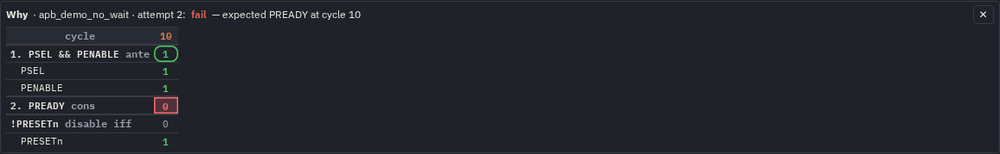

**Expressions** (the button **ƒ Expressions** in the bar, or `gx`, opens their list under the bar). Any expression of the
signals, written as in an assertion — `PSEL && !PREADY`, `state == pkg::WAIT && timeout`, `addr[7:4] == 4'h3`,
`$rose(req)`; `@(posedge PCLK) …` samples it at the clock's edges like an assertion, without a clock it is valued after
every change of its signals. Names are looked up from the module in **Names from** (a new one: the selected signal's)
up to the top, then in the one module at the top of the dump (or give a full path); package constants come from the
loaded files.
- **+ New** opens the editor: as many lines as it takes, the names offered as you type (↑ ↓, Tab or Enter takes one, Esc
  closes the list), checked as you type (`✓ 3 matches, first at 45 ns`, or what is wrong), a **Label**. **ctrl+Enter** or
  **Add** keeps it and goes to its first match, **Esc** cancels; ✎ on a line edits it (**Apply**).
- **A line** of the list: the tick (its marks on the waves), the colour, the label, the text, what it found (matches, the
  share of the time it holds, the first and last, the shortest and longest), ◀ `2/3` ▶ through its matches, how it marks,
  ✂, **ƒ row**, **|Δ|**, ≡ (its matches listed, a click goes to one), ✎, ✕.
- **|Δ| puts a marker at the start of each match** in the window (at most 200: a toast says how many more, narrow the
  window for them), in the expression's colour, labelled with its label (else `ƒ` and its number) and a number, each
  with its Δ to the next one of it, and turns **Δ between markers** on: the gaps between requests, the period of a frame,
  read off at once. Pressed again (or again after the window moved) its markers go first; undo takes the batch back in
  one step. The markers are yours like any other (the Markers list, the state with `"expr"`); the command is
  `expr_markers`.
- **The project's expressions** (the setting `exprLibrary`, `[{"text", "label"}]` or texts, in a config's `"config"`): the editor
  offers them as you type, by label or text (one taken: the whole field and its label), and **Library…** in the head of the list adds one.
- **Going through them.** A click on a line, ▶ or → goes to its next match from the cursor, ◀ or ← to the previous, round
  the ends, and the window follows; that expression is the one you are on: its signals highlighted (Esc: no more), its
  marks stronger, `]x` `[x` and the bar's ◀ ▶ step through it, `]X` `[X` to the next / previous expression. ↑ ↓ on the
  list move along it, space takes its marks on or off, **All on** / **All off** all of them.
- **On the waves** each expression that is ticked has a thin strip of its own at the top of the rows, in its colour (the
  colour of its place in the list until you pick one; **Auto colour** in the editor goes back to it), and its label at the
  start of a stretch, where the last one left room; over the rows **band** draws a pale band where it holds, **line** a
  line where it starts, **strip** nothing more. Hovering says which, the stretch and its length. Stretches nearer than a
  pixel are drawn as one. The static SVG and a saved picture draw the marks too.
- **ƒ row** draws it as a signal in the group **ƒ expressions** under the top (a bus when it is wider than a bit), named
  by its label, in its colour; a click on the row finds its line. A bookmark can sit on it as on any row.
- **A value wider than a bit is a bus.** `{PADDR[3:0], PWRITE}` (5 bits), `PADDR - 8'h10` (8 bits): its row ƒ shows the values, its width
  from the engine (a concatenation the sum, arithmetic the widest operand, a comparison one bit); the right button's radix and plot, or
  `expr … radix: "bin", analog: 3`, as a signal's; its marks are where it is not zero.
- **Undo** takes back the expressions (added, changed, deleted) and the assertions' bindings (Bind…, a drag, Unbind) as any edit.
- **✂ cuts the waves to its matches** (`c` on a line): the gaps on the waves (**Gaps ▸ on the waves**) with what an
  expression finds in place of the signals. On one line or several (their matches together): what lies between two matches
  for `gapIdle` or longer is left out from `gapKeep` after the one to `gapKeep` before the next, and so is what comes
  before the first and after the last, a gap's column with its texts each time. idle and keep are the gaps' own, on the bar
  while it cuts: `idle 1 keep 0` leaves the matches alone. The panel's head says what is left (`✂ 2 · 4 gaps · 120 ns of 205
  ns kept`); the window, the cursor, a jump, a range and a saved picture work as with any gaps, and an expression that
  never holds cuts nothing. While one has ✂ the gaps are on, on the waves, whatever your own settings say, and those come
  back with the last ✂ off; **✂ off** in the panel's head, ✕ on the bar, `gv` or turning the gaps off in the menu takes ✂
  off every line. Bookmarks stay in sight, as with the gaps of signals.
- The list is kept in this browser and in the viewer's saved state; **JSON** gives it as `"exprs"` for a config, and a
  config's `"exprs": ["…", {"expr": "…", "scope": "tb.dut", "label": "…", "color": "#c03030", "on": false, "row": false,
  "mark": "line", "gap": true}]` (or `vcd2wavedrom --expr`) puts them in the page. In a list a text alone, or an object without
  `"row"`, draws its row as it always did; one made in the panel or by the `expr` command has `"row": false` until asked.

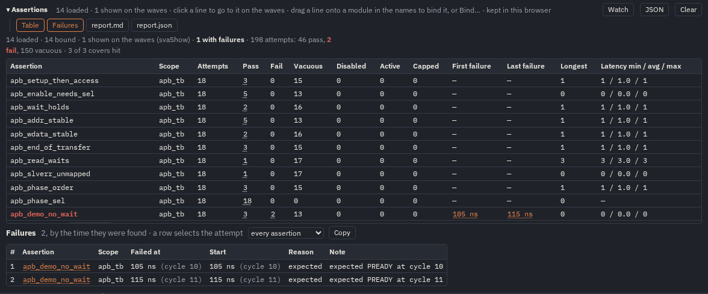

**Numbers.** The panel's totals line counts the view's bindings (loaded, bound — evaluated ones, with the ones that
cannot bind or failed —, with failures, attempts, pass, fail …).
**Table**: one row per binding — attempts, pass, fail, vacuous, disabled, active, capped, first and last failure (links),
the longest attempt and the antecedent → consequent latency (min / avg / max cycles over the passing attempts; what a
handshake check is about), cover hits, the notes (thread limit, values cut to 64 bits). **Failures**: every failed attempt by the time it was
found, with its reason, filtered by assertion, **Copy** as text; a row selects the attempt; the first 500 are listed
(the filter and the downloads have the rest). A click on a count (*2 fail*) shows only those attempts in the lane and
lists them under the line (the first 200). **report.md** and **report.json** download the tables and the results of every binding.

**Reports.** The page built by `mkhtml.py` ends with a printable **Assertions** section (the bindings over the whole
dump). From the command line:

```sh
sva eval --waves x.fst --scope tb.dut --sva checks.sva --report report.md --junit report.xml   # exit 1 on a failure
sva eval --waves x.fst --scope tb.dut --sva checks.sva --report nightly.json                   # results + meta
sva report report.json nightly.json --md report.md --junit report.xml --html report.html        # several runs
make sva-eval WAVES=x.fst SVA="pkg.sv checks.sva" SCOPE=tb.dut ARGS="--junit report.xml"         # a CI gate
```

`--report` writes Markdown (`.md`), HTML (`.html`), JUnit (`.xml`) or the results with the meta (`.json`, the form of a
page's report.json; `sva report --json` writes the summary) by its extension. JUnit has one test case per assertion:
a failure, an error when attempts had no verdict (capped: the thread limit, `--max-threads N`), skipped when not
evaluated or a cover never hit. The texts list at most 20 failures per assertion (`--max-failures N`, 0 = all; the
JSON has every one); over several files a Source column tells the runs apart. Exit status: 0 everything evaluated
passed, 1 a failure or an attempt without verdict, 2 nothing checked as asked (a syntax error, no assertion, a signal
or a file that is not there). Colours of the
drawing: `sva-pass`, `sva-fail`, `sva-disabled`, `sva-active`, `sva-capped`, `hl8` in `colors`. The results of a binding
are in `view.sva.bindings[i].results` (the results JSON of [`docs/sva/ENGINE.md`](sva/ENGINE.md)).

## The viewer

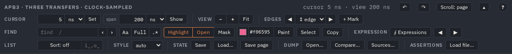

The bar has a title line (title, short messages, cursor and view span) and the tools, one line per kind of work.
Time: **cursor** (a time and its unit, **Set**; a span, **Show** = that window around the cursor), **view** (− + Fit),
**edges** (◀ edge kind ▶, + Mark), **go to** (marker jumps, the assertions' failures). Find: the field, **Aa Full .\***,
count, ‹ ›, Highlight / Open / Mask, colour + Paint (Unpaint when something is painted), Select, Copy. Expression (`sva.js`, on the same line): **ƒ Expressions** opens their list, ◀ ▶ through the matches of the one you are on. Rows and files:
**list** (Sort and the ignored prefixes, Expand / Collapse, Modules, FSMs, clear highlight, show the hidden rows, Only), **style** (the edges:
auto, slanted, vertical, square), **state** (Save, Load…, Reload, Save page), **dump** (Open…, Compare…, Runs… in VS Code, Sources…), **assertions** (Load file…). Keys work once the waves have the focus (a click on the
waves or on a name); with ctrl, alt or ⌘ held they stay the browser's (ctrl+S saves the page, it does not sort), except
ctrl+C, ctrl+F, ctrl+G (`gl` too: your groups), ctrl+Z / ctrl+shift+Z / ctrl+Y (undo, redo), alt+↑ ↓ and alt+shift+↑ ↓ (the order of your groups). Hover any button, field or list for what it does and its keys; **?** at the right of the title line
(key `?`) opens the box of all the keys and the mouse, the plugins' too.

**Scroll: window / page** in the title line switches where the rows scroll, on the fly (kept in this browser; the
`maxHeight` setting is the start): in a **window** of their own (`80vh` high unless the settings say otherwise, never
taller than the browser's window under the bar), the bar above them — the end of the rows does not scroll the page on,
and with the page scrolled past the viewer's top the wheel over the rows brings the bar and the time axis back first;
or with the **page**, the browser's scroll bar — the bar then sticks to the top of the window while its rows go by, the
time axis and the names' header right under it down to the last rows, and leaves with the viewer's end. **▴** folds the tools to
the title line (title, cursor, the buttons), **▾ tools** opens them again; `/` and ctrl+F open them for the find
field. The right button on the bar lists its tool groups (cursor, view, edges, go to, find, expression, list, style,
state, dump, assertions, a plugin's) with a tick each: a click leaves one out or brings it back (the menu stays open),
**Show all** / **Hide all** do all of them; a line left without a group goes (kept in this browser, the `toolsHidden`
setting is the start; a find left out still floats over the waves on `/`). Navigation follows Questa's wave window, the lists and the text vim: a sequence (`gg`, `zM`, `yy`,
`]f` …) is two keys within a second.

| Key | Action | Key | Action |
|---|---|---|---|
| wheel | scroll the rows (as in Questa; `"wheel": "zoom"`: zoom) | ctrl+wheel, pinch | zoom at the pointer by how far it turned (a notch ×1.22) |
| shift+wheel, a sideways swipe, drag, `← →` | pan | shift+drag, middle-button drag | zoom into the range dragged over |
| ctrl+drag | measure a range: its ends on the edges of the signal under the pointer, Δ on the axis and in the readout; ctrl+click clears it | right button (drag or click) | the same range, then the menu: zoom, bookmarks at its ends, copy Δ, copy / save the picture (PNG, SVG); the colour, radix, highlight, hiding, folding of the row under it; a click of the left button while the right one is down: a marker there at once (below) |
| `i` `+` / `o` `-` | zoom in / out | `f` / `l` | zoom full / last (the window before the last zoom) |
| `c` | zoom in on the cursor (half the span, the cursor in the middle) | `Home` / `End` | the start / end of the dump |
| click | cursor (on an edge of that signal within 8 px, else a round time at the zoom; alt+click: no edge) + select the signal | `↑ ↓`, `j k` | select the previous / next signal (in the names column: the arrows) |
| `gg` / `G` | select the first / last signal | `PgUp PgDn` | scroll the rows a page |
| `gv` | the waves with the gaps cut out, or in continuous time | `gx` | the list of expressions (`sva.js`) |
| `Tab` / shift+`Tab` | the next / previous edge of the selected signal (as in Questa; ◀ ▶, `]e [e`) | `e` | edge kind (any, rising, falling, **= value**, **X / Z**) |
| edge kind **= value** | a field: `0x40`, `'h40`, `8'd64`, `64`, `-3`, `'b101`, a literal with x / z compared bit for bit (`'b10x1`, `8'hx5`: x and z apart) or a text (an enum label: `ACCESS`); Enter / ◀ ▶ / Tab: the next / previous time the selected signal becomes it (none selected: any shown signal) | edge kind **X / Z** | the next / previous x or z (a bus with x / z bits too) of the selected signal or of any shown one: the first X after reset from the reset's edge |
| shift+`← →` | move the cursor a hundredth of the view | the pointer on a signal | its value there, the change into it and the next one (tooltip) |
| `/`, ctrl+F | find (the bar scrolled away: the find group floats over the waves; ✕ or Esc puts it back) | `n N`, `*` `#` | next / previous match; find the selected signal's name and go to its next / previous match |
| `b` | bookmark at the cursor | `]b [b` | the next / previous bookmark |
| `m` | marker at the cursor: its label asked (Enter) | `]m [m` | the next / previous marker |
| `r` | the last state loaded, read again (Reload) | `R` | the dump read again from the disk, the view kept (⟳) |
| `g` | a moment after it (`keyHints`) a box says what can follow, to press or to click, as long as it stays open (Esc, or a key it does not list: it closes, nothing else): go to `gg gl gt gT`, markers and bookmarks `gm gM gB gd gc`, the state `gs gL gr`, the dump `gO gR gC gu`, `gv`, `gp` | `z y [ ]` | the same box: fold, copy, next, previous |
| `gM` `gB` | a marker, a bookmark at the cursor (as `m`, `b`) | `gd` `gc` | the Δ between markers on / off; clear every bookmark, arrow and marker of yours |
| `gt` `gT` | the Modules panel, the state machines (as `t`, `T`) | `gs` `gL` `gr` | the state: Save, Load…, Reload |
| `gO` `gR` `gC` | the dump: Open…, ⟳, Compare… | `gp` | Save page |
| `gu` | the runs kept of the dump (VS Code: the Runs panel, *The runs kept of a dump*) | `]r` `[r` | B: compare A with the next (older) / previous run kept, over the same window |
| `]w` `[w` | A: the next (older) / previous run kept shown here (now among them), the view kept; with no B the walk through the runs | | |
| `yn` `yt` | copy the selected signal's name; the time of the cursor | `yl` | copy a link to here: the cursor and the selected signal ([§ A link to a moment](#a-link-to-a-moment)) |
| `gm` (the right button's **Markers…**) | the markers (the page's, yours) and the bookmarks in a list over the waves, by time (a line at its top filters them as you type, the list in its order, the others hidden; ↓ the first shown, Enter the best match; Enter with nothing typed closes it): `↓` the first (`↑` the last), then `↑ ↓` Home End step through them, a click picks one — the cursor on it and the waves at its time with the span they have: a marker in the middle, a bookmark as going to it does (below); Enter or Esc closes it there | `gl`, ctrl+G | your groups: a list (filtered as you type) |
| shift+click the waves | a second cursor (dashed, on an edge): Δ to the cursor in time, its frequency (`Δ 40 ns / 25 MHz`) and in cycles of the clock (the cycles band's when it is on, else the selected signal's, else the nearest `*clk*`) on the axis and in the readout; the value column says each row at both and the change, `0x04 · 0x40 · +0x3c` (a bus modulo its width, in hex or its radix — bin `+0b101`, oct, signed `−64`; a float or a fixed point `q8` the difference of the values, `+0.5`; ascii and an enum `IDLE → SETUP`; a bit ↑ ↓ =; x or z: ?; its title both forms, `+0xc0 (−0x40)`; the right button's **Copy A · B · Δ** copies them); `x` swaps the two; Esc clears it | `1` … `9` | go to that bookmark (each bookmark's line shows its Δ from the cursor; the bookmarks and markers at the cursor are marked in their lists) |
| `zM` / `zR` | fold / open every module | `zc` / `zo` / `za` | fold / open / toggle the module of the selected signal |
| `B`, a click on a bus's `[7:0]` | the selected bus bit by bit: a row per bit under it (§ below); again, or on one of its bits: folded | | |
| `t` | the Modules panel: the modules as a tree (§ below); again: the selected signal's module in it; `T`: the state machines | **Only: N modules ‖ ✕** in the bar | ‖ pauses Only (every module), ▶ resumes it, ✕ clears it |
| `yy`, ctrl+C | copy the selected signal (or the highlighted ones); while searching ctrl+C ends the search | `s` | sort off → A→Z → Z→A |
| ○ or ctrl+click a name | highlight the signal or instance; ctrl+shift+click: every row from the last one to it | Esc | reset: no search, highlight or selection |
| shift+click a name | select every signal from the last one clicked to it (selected, nothing dimmed; the tint inside bus values too) | alt+drag | a box: its time the range, the signals it touches selected, then the menu |
| `]f [f` | next / previous assertion failure (`sva.js`) | click a bar or circle | select an assertion attempt |
| `]x [x` | next / previous match of the expression you are on | `]X [X` | next / previous expression |
| `]a [a` | next / previous assertion: its first failure, else its first pass | click a line of the assertions panel (again: its next attempt) | go to an assertion |
| `d` / `D` | a dump compared: the other run / both over each other (*Which run the waves show*) | `]d [d` | next / previous difference |
| `]t [t` | next / previous transfer of the selected bus (`bus.js`) | `?` | the keys in a box |
| ctrl+Z / ctrl+shift+Z, ctrl+Y | undo / redo (bookmarks, spans, groups, colours, hidden rows, sort, the expressions, the assertions' bindings …) | alt+`↑ ↓` | a row of your group up / down (shift: the group) |

**Bus widths and bits.** A bus has its width after its name, as declared: `PADDR [7:0]` (a field of a packed struct its
place in the vector, `[15:13]`; a struct's row its whole value's; none on a bit, a real or a string; `"showWidth": false`
leaves them out, in the viewer and the pictures). A click on the width (or `B` on the selected bus, or the right button's
**Bits: N rows**) shows the bus bit by bit: a row per bit under it, the highest first, named `[7]` … `[0]` with the full
path `PADDR[7]`, each the 0 / 1 / x / z of its bit of the value; again (or `B` on one of its bits) folds them. The
buses shown so are kept in the browser and in the saved state (`"bits": ["PADDR"]`); a bit is a signal like any other —
selected, searched for its edges, bookmarked (`"signal": "PADDR[2]"`: going to it shows the bits), in the picture.

**Some bits of a bus as a row.** **Duplicate bits…** asks `msb:lsb` (`7:4`) and puts that slice of the bus under it, `PADDR[7:4]`: an address decode, a nibble,
a byte lane of a wide bus without a types file; a radix, a plot and a colour of its own, its bits by the bus's numbers (`B`), kept as a copy is (`duplicate … bits: [7, 4]`).

**One signal, two forms.** The right button's **Duplicate**, on a name or on the waves, puts the same signal again in a row under it, `PADDR #2`:
the same changes, with a radix, an analog form and a colour of its own, so a bus shows in hex and as a step plot at once. It starts as the row it
came from looks; an enum's copy shows the names until you give it a radix, then the numbers. Duplicate takes every row selected or highlighted;
**Remove the copy** takes it away, and a bookmark or a marker on it goes to its signal (Hide only leaves it out). A copy is named `PADDR#2` in
every command; it can go into your groups, be shown bit by bit, carry bookmarks; it is kept in the browser and in the saved state
(`"dups": ["PADDR#2"]`), and gaps, cycles, a compare and the state machines take it as its signal. A clock-sampled view gives the values as
texts: its rows have no radix, in a copy either; open the dump itself.

**Hierarchy and module shading.** With `"hierarchy": true` (generated configs) every scope is a group: module rows are
bold on a darker band, the signals of neighbouring modules alternate between two backgrounds, a click on a module folds
it, **Expand** / **Collapse** open or fold all. Hover a name for its full path. With `groupColors` each module has its
own colour (here `u_master`, `u_slave`, `u_regfile`; the clocks keep the green of a `*clk` rule).

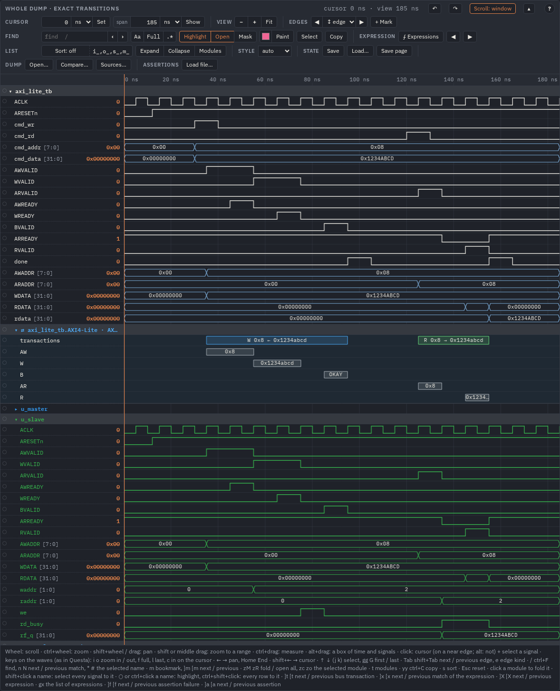

**The Modules panel and Only.** `t` (or **Modules** in the bar, **Modules…** in the right button's menu) opens the
page's modules as a tree over the viewer, without their signals: per module the signals of its own and with its
submodules (`12 / 2060`; a packed struct is one), ● at the module of the selected signal; a filter on top (fuzzy, as
the find). The tree folds on its own (▸ ▾, ← →); its header moves the panel, any edge or corner sizes it, never past
the window (a narrow screen: a drawer at the side, of its own size; not printed), and it opens again where it was, at
its size; a window made smaller brings it back in. A click anywhere in it keeps
the keys there: ↑ ↓ Home End go on in the tree (from a button too; the filter keeps its own). Two ways to use it:

- **A click on a name goes there**: the module and the ones above it are opened in the names column (shown again when
  hidden), its first signal — its own, else of a submodule — selected in the middle of the waves. Enter does the same,
  the filter's Enter goes to the first match.
- **A box drawn over names keeps Only those modules** on the waves: their signals and their submodules', the modules on
  the way to them as headers (their own signals go, the hierarchy stays as it is built), every other module gone; the
  tree still has them all. The modules the box names — the nested ones too, though the set keeps the outermost — open in
  the names column with the ones above them; the ones under them stay folded as they were (with the find's **Open** on,
  Open goes off, so the next search does not fold them again). Pause, resume and ✕ fold or open nothing. **ctrl+click** (Space) puts one module in or takes it out, **shift+click** (shift+↑ ↓) keeps
  a run, **Only matches** (shift+Enter in the filter) every module the filter finds; the right button on a name: **Go
  to waves**, **Only this subtree**, **Also include this subtree**, **Remove this subtree from Only**, **Expand /
  Collapse subtree**, **Copy scope path**. A module picked is marked in the tree, the ones under it lighter, the ones on
  the way in italics. **Only: N modules ‖** in the bar pauses it (every module again, the set kept: **▶** resumes it),
  **✕** clears it. A click on a module Only leaves out pauses it and goes there.

Only is a layer of its own: Hide stays as it is under it; a highlight of a row it takes away comes back with it; the
selection it takes away goes. **Your groups stay whole** under it, every signal of them whatever module it is of, folded
or open as you left them: pick signals of several modules into a group, then Only the modules you want, and the group
is still there in full. **Your groups whole** in the panel (the setting `onlyGroups`, true) turns it off: then a group
keeps only the signals of the modules Only keeps, as every row. The find counts the matches it leaves out (**no match · 8 outside Only**); the picture,
WaveDrom, Paint, `]d [d` and the assertions' steps take only what is in the view (a clock left out still gives
WaveDrom its cells; a signal of your group whole is in it, its module left out or not). It is in the saved state (`"only": {"modules": [...], "on": true}`,
`"groups"` when not the page's `onlyGroups`; a state with `"only"` and no `"groups"` sets the next set to the setting's too), Save page and undo, and not
kept in this browser: a page opened again starts with every module. The command [`only`](#commands-and-edits) does the
same from a script or an agent.

**The state machines.** `T` (or **FSMs** in the bar, **State machines…** in the right button's menu) opens the FSMs of the
waves — every signal with enum labels: an FST's tables, a types file, **Sources…**, a config's `"enum"` ([§ FSM state
names](#fsm-state-names-fst-or-vcd--the-designs-types)) — in the tree of the modules above them, as the Modules panel looks:
each FSM with its state at the cursor and how many of its table's states the waves reach (`4/5`; x and z are none). It
lists the ones named as a state machine (`state`, `fsm`, `cs` / `ns`, `…_q`; none so named: every one); **all enums** adds
the other signals with labels (a running disparity, a kind of packet). **fields** adds the fields of structs with labels
(a packed struct's state field). The panel stays open when **Sources…** or ⟳ reads the waves again; it moves, sizes and
keeps the keys as the Modules panel does. A click on an FSM goes there (opened, selected, in the
middle; one the view leaves out joins the layer below, a hidden one is shown again), on a module goes to the module;
**ctrl+click** (Space) picks an FSM, **shift+click** a run of them. Then, for the picked ones (none picked: every one the
filter lists):

- **Only FSMs**: the waves keep only them and the modules on the way to them (Hide stays; Only and the find's Mask are kept
  under it and come back when it goes) — **FSMs only: N ✕** in the bar;
- **+ Add to view**: the view as Hide, Only and the Mask leave it, and these FSMs in it too (a hidden one, one Only or the
  Mask leaves out) — **+ N FSMs ✕** in the bar.

Either opens the modules on the way to them; **✕** (or **Clear**) takes the layer away. It is in the saved state
(`"fsm": {"mode": "only" | "add", "signals": [...]}`), Save page and undo; the command [`fsm`](#commands-and-edits)
does the same (in a page: `tools/viewedit.py` keeps the key, the command needs the page's labels).

**An FSM's details.** A click on an FSM (or **d**, or **States and changes** in its right button's menu) shows it below
the tree, on three tabs:
- **States**: each state of its table with how many times the waves enter it, the share of the time it holds it and its
  first entry; one never reached in italics; a value not in its table (X, Z, a code without a label) in red;
- **Changes**: each change from one value to another with its count and first time, the most frequent first;
- **Diagram**: the states on a circle and an arrow per change seen, as thick as it is frequent (never reached: dashed;
  not in the table: red; the state at the cursor: filled).

A click on a state, a change or an arrow takes the cursor to the next time it happens after the cursor (**shift**: the
previous; round the end to the first), on the first time to that one; the keys do it too once a row of the details
has them (a click on it, or Tab from the tree): **↑ ↓ Home End** the rows of States or Changes, **Enter** the next time
(**shift+Enter** the previous), **← →** the tabs, **Esc** back to the tree. The right button on an FSM: go there, its details,
**Only this FSM**, **Add it to the view**, pick, copy the path; on a module: **Only its FSMs**, **Add its FSMs to the
view**, pick them. A box drawn over the tree picks the FSMs in it (ctrl: adds them). The commands
[`fsm_stats`](#commands-and-edits) (the same numbers), `fsm_go` (the cursor to a state or a change) and `fsm_panel` (the panel
open on an FSM's States, Changes or Diagram) do it from a script or an agent.

**Highlight.** The ○ mark in front of a name (or ctrl+click) puts that signal or whole instance in front (the mark
filled, the background as it was); the rest is dimmed but stays visible. Several instances at once; **Highlight: N ✕** or Esc clears it.
`"highlight": ["tb.dut.u_tx"]` in `"config"` starts a page that way.

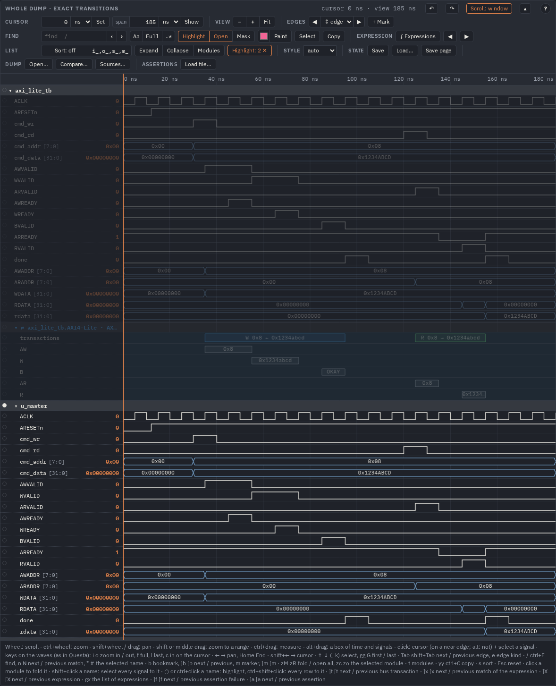

**Fuzzy find.** The find field (`/`) matches the typed letters in order anywhere in a name, as fzf does: `awvd` finds
`AWVALID`. A word with a `.` runs over the full path (`dev.fifo`), words separated by spaces must all match. Three
toggles next to the field change that, as in grep or VS Code: **Aa** (alt+C) the case matters; **Full** (alt+W) a word
is the whole name (`PSEL` finds `PSEL`, not `PSELx`; `u_slave.ready`: the end of a full path); **.\*** (alt+R) the query is a
regular expression (JavaScript, as `grep -E`: `^s_.*valid$`, `data\[3\]`, `\<ready\>` as in vim) tried on the name,
the dump's leaf and the full path (`tx_.*\.valid`); a bad one says so in the count. A signal of the dump the page left out
(`"show": false` in the config, or past the `dumpBudget` of a VCD opened in the page) is not lost silently: the count says
**no match · 1 not in the page**, and its tooltip names them and how to bring them in. Matched
letters are underlined; Enter, ‹ › or `n N` step through the matches, each scrolled to the middle of the waves. **Highlight** dims the rest, **Open** folds every
module without a match, **Mask** leaves only the found rows on the waves with the modules on the way to them (a found
module with what is in it; the search still runs over every row, and ending it brings them all back), **Select** selects
the found signals as shift+click does (ctrl+click: adds them to the selection), so the right button on one of them takes
them all (**New group of the N**, colour, radix, hide, the picture …), **Paint** colours the found signals and the highlighted ones (ctrl+click or the mark; a highlighted module: its signals; neither: the selected signal; kept in the browser; **Unpaint** gives them their own colours back), **Copy** copies their paths.

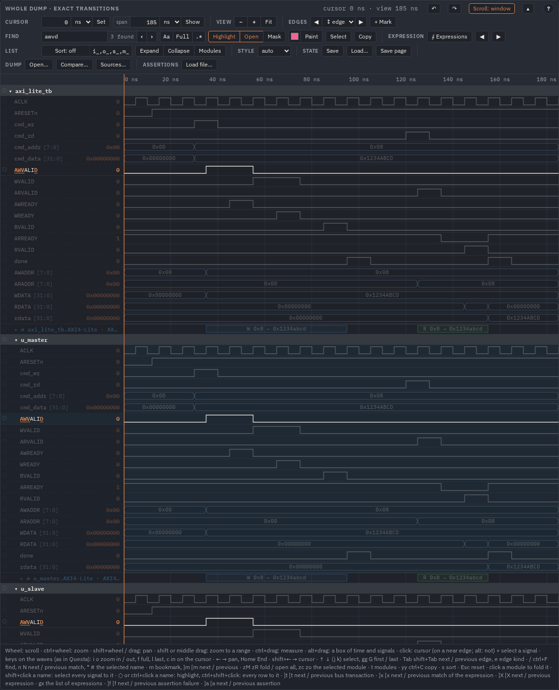

**Edges and the cursor fields.** Select a signal (click its name or its row), then ◀ ▶ (`[e ]e`, shift+Tab / Tab) jump to its previous /
next edge of the kind chosen between them (any, rising, falling; every value change on a bus). The cursor field takes a
time (`1.2us` wins over the unit list) and **Set** moves the cursor there; the span field and **Show** give a window of
that width around the cursor. Cycle diagrams count in cycles.

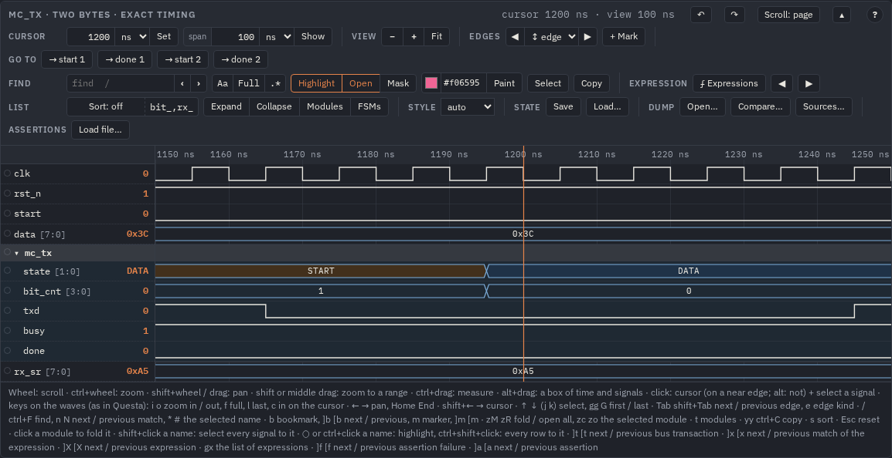

**Bookmarks and arrows.** **+ Mark** (`b`) puts a numbered bookmark on the selected signal at the cursor, snapped to an
edge. Below the waves each bookmark has a time, a signal, a colour and a text; drag a circle to move it, shift+drag from
one circle to another to draw an arrow (shape `- ~ -~ ~- -| |- -|-`, head, line, colour, label). Labels get a thin
lane of their own between the signals; an arrow between two bookmarks of one signal is a dimension line in that lane,
above the signal. A circle dragged onto the top quarter of its row (or **↥** in its line) is **lifted** into such a lane
above the signal, with a leader down to it, so it covers no value (`"lift": true` in the JSON); dragged lower, it is
on the row again. Bookmarks are kept in the browser (**Clear** forgets them and the arrows, your markers stay, **Clear all** in the Markers list takes those too; the page's own
come back on reload); **JSON** gives the `"bookmarks"` and
`"arrows"` lists to paste into a config, so the built page (and its static SVG) carries them. The AXI-Lite picture
above shows arrows between handshakes with the latency as the label.

**On the waves** (the viewer and the static SVG alike): `"lift": "below"` puts a circle into a lane **under** its
signal (`true`, or `"above"`, over it; **↥** in its line goes off → over → under → off, **↧** shows under; a circle
dragged onto the bottom quarter of its row goes under), for a row whose top already has arrow labels or other circles.
`"label": "CRC ≠ 0"` is a short text by the circle (the field next to the text in its line); the long `"text"` stays in
the list, the SVG's legend and the circle's tooltip (an old bookmark with `"to"` is an arrow, and its `"label"` the
arrow's). An arrow's label may hold placeholders filled at its ends: `{dt}` the time between them (`10 ns`; in a diagram
without time its cycles, `3T`), `{cycles}` the cycles of a clock-sampled view's clock, `{cycles:NAME}` the rising
edges of the row NAME (a full path or a name) between them, `?` where there is none — `"43 ticks"` written as
`"{cycles:clk_sampl_en} ticks"` stays right when the test changes, and an end moved by hand updates it.

**Spans** are coloured stretches of time: a frame's phases, a window of 43 ticks, frame 3. A view's `"spans"`:

```json
"spans": [{ "from": "45ns", "to": { "signal": "PREADY", "edge": "fall" }, "label": "write", "color": "c7" },
          { "from": { "bookmark": 3 }, "to": { "bookmark": 4 }, "signals": ["PREADY"], "label": "wait" }]
```

`from` / `to`: a time (a number in ps, or with a unit), an event as a bookmark's `"at"` (its first match, or `"nth"`),
or `{"bookmark": n}` (a bare number is a time, not a bookmark); `signals`: only those rows (full paths or names), else
every row; the colour a token (`c3`…`c9`, `acc`) or `#hex`. The label sits at its top left; the tooltip on the waves
gives it with its length. The `span` command adds or changes yours (kept in the browser, in a saved state, undone with
the rest). A span with **`"every"`** (an event, as above) instead of `from` / `to` is a span from each of its matches to
the next, the last to the end of the view: the test cases of a long run, `{"every": "tb_test", "label": "case {value}"}`
(`{value}`: the signal's value after the match, as the page shows it; `{n}`: the match's number from 1; a change of a
signal that has a value at the start of the view: that start is the first). None: lint `span-every-no-match`. To step
through them, a marker `{"on": "tb_test", "label": "case"}` and **Markers…** (`gm`), or the bar's **go to** (up to six markers).

**Measures** (the `"measures"` of a view or of the WaveJSON, `vcd2wavedrom.py --measures`; a cocotb test's `wl.measure` gives them):
`[{"label", "from", "to", "min"?, "max"?, "signal"?, "color"?}]`, each a pair of your markers on the page with the Δ between them on (the
first marker's `dmin` / `dmax`: red out of the bound, `"3 cycles"` counted on the clock of the cycles), a measure with no `to` one marker.
In a config `from` and `to` are what a span's ends take: a time, `{"bookmark": n}` or an event (a bookmark's `"at"` below), so a measure
written in a document moves with the next run: `{"label": "to DONE", "from": "posedge start", "to": {"signal": "u.state", "value": 5,
"from": "1300ns"}, "max": "20 cycles"}`; an event with no match in the view is an error that names the measure.

**A bookmark at an event.** In a config a bookmark may give `"at"` instead of `"t"`: the build finds its time in the
dump, so a test changed later moves it with the event (both `"t"` and `"at"` are an error). The forms are `wave_find`'s
and `bind`'s:

```json
{ "n": 6, "at": "posedge PSLVERR", "signal": "PSLVERR", "text": "the transfer failed" }
{ "n": 4, "at": { "signal": "r_state", "value": "FRAME_ERROR", "from": "800us" }, "signal": "r_state" }
{ "n": 3, "at": { "expr": "o_sat_data_eof && o_err_sat[1]", "clock": "i_clk_12m" } }
{ "n": 7, "at": { "assert": "mc_start_ends_in_eof", "result": "fail", "nth": 1 } }
```

- a text: a marker's event — `"posedge X"`, `"negedge X"`, `"edge X"`, `"X"` (any change);
- `{"signal", "value"}`: the signal becomes that value (an enum label of the config or the dump, a number, `'h40`,
  `'b10x1`); already that value at `from`: `from` is the match. `{"signal", "edge"}`: `rise`, `fall`, `change`;
- `{"expr", "clock"?, "scope"?}`: an SV expression or sequence sampled just before each edge of the clock (the view's by
  default; the sva engine, as `wave_find`): each match at its first cycle (`$rose(…)` for where a condition starts);
- `{"assert", "scope"?, "result"?, "point"?}`: an attempt of a binding over the whole dump — `result` `fail` (default)
  at its failing cycle, `pass` at its end; `point` `start`, `end` or `failed_at`; the scope of the assertion's one
  binding by default;
- `"nth"` (from 1), `"from"`, `"to"`: which match, and the window searched (the view's; the whole dump for `assert`).

The built page keeps the event next to the time it gave (the viewer's JSON too); moved by hand, a bookmark loses it.
A bookmark's `"link"` opens another view of the page: `"link": "crc"` (that section), `{"view": "crc", "bookmark": 3}`
(and its viewer goes to its bookmark 3) — the button `→ crc` in the bookmark's line (disabled when the page has no such
section; the viewer only: a static SVG has no buttons); `bookmark-link-missing` when the config has no such view.
No match is an error naming the bookmark: `views.gap.bookmarks[3] (n 4): no match for {"signal": "r_state", "value":
"FRAME_ERROR"} in 790us…842us`. A marker's `"on"` takes the same events: `{"on": {"signal": "state", "value": "ERR"},
"label": "err"}` puts a marker at every match (`"nth"`: that one; `"color"`: its colour, pale without it).

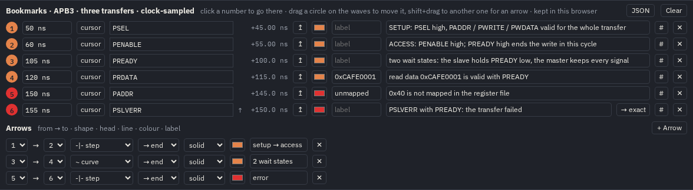

**Markers and your groups.** The right button's **Marker here** (`m`: at the cursor) draws a dashed line across every row with a label at
the top (yours, next to the page's own markers): a small box asks its label where you clicked — **Enter** (or **Add**)
puts it in, also empty, **Esc** or a click elsewhere leaves it out — and it goes into the Markers list under the waves,
edited there. A marker is pale until you give it a colour. **Its text goes on any line**: drag it (a marker without a text: by the top of its dashed line)
onto a signal and it sits on the thin line over that row (the upper half) or under it (the lower half), the line lifted bookmarks use, one line for all of them; the
drag also moves it along the time, on the edges of that signal (straight up or down, or with alt: the time stays), and up to the axis it goes back to the top. A click
on the text puts the cursor there with its label ready in the list; the right button on it: **Its text…**, **Colour**, **Pale again**, **Delete the marker**. The markers
of the page itself stay where the page puts them.

**Markers at once, with the mouse.** While the right button is down (drawing a range), each click of the left button puts a
marker where it is, asking nothing: its label is the next of `M1`, `M2` …, its time as the cursor's (on an edge of the
signal there; alt: not). Clicked on a signal's row, its text goes on the thin line over that row, or under it when over it
something is there already at that place (a text, a bookmark, a Δ; both taken: over it); clicked on such a line, on that
line; on the axis, at the top. Releasing the right button then opens no menu (the range stays); the labels, colours and Δ
bounds are filled in the Markers list under the waves. Each marker is one step of undo.

**The time between markers.** **Δ between markers** in the head of the list under the waves draws an arrow from each of your markers to the next in time, with
the time in its middle, on a line of its own over the rows; the list says the same beside each marker. Drag an arrow up or down: it goes to the line over or under
a signal, the lines of the markers' texts and the bookmarks, and stays there (back over the rows: drag it above the first one). The markers make its ends, so
moving one moves it. The option and the places are kept in the browser and in the saved state (`"deltas": true`, a marker's `dsignal`, `dlift`, `dto`, `dcolor`), and go into a picture.
With the cycles band on (**Cycles**, `cycles on`) each Δ says its clock cycles too, `40 ns · 4 cycles` (the rising edges of the band's clock between the two markers).

**A bound on a Δ.** A marker's `dmin` / `dmax` (the `marker` and `deltas` commands; `deltas` without `id` sets every marker's) is a time (`"150ns"`) or
cycles of the clock (`"3 cycles"`, kept as `{"cycles": 3}`, counted even with the band off): a Δ below `dmin` or over `dmax` is drawn red (the arrow, its
text, the picture), and the list says `✗ > 150 ns` beside it; `null` takes the bound off. A latency requirement drawn on the page. A bound in cycles
on a page with no clock to count them (no `cycleClock`, no row named clk / clock) is not checked: the arrow and the list say `? no clock`, `ok` is
null (the lint `measure-no-clock` says it at the build).
**Measurements**: the `measures` command, `view_get`'s `measures` and `tools/viewedit.py page.html --measure [--csv]` give every Δ as a table (from, to,
`dt`, the cycles in a page, the bound and `ok`); a page's own markers — its `measures`, a cocotb test's `wl.measure` pairs — too, before any marker by hand
(`view_get` flags them `page: true`).

An arrow can go to **any marker**, through the ones between. Each marker in the list has a **→** choice beside it (**next**, **none**, or a marker), or drag the dot at the arrow's far end along the waves: it snaps to the nearest
marker as you go (dragging that dot up and down moves the line, as anywhere else on the arrow). Each marker has one arrow: A → C through B takes the place of A → B, and the last marker in time, which has none, can go back (C → A, the third distance).
Arrows over the rows that cross in time take lines of their own. A marker that names another goes to it wherever they are moved; **→ next** is the neighbour in time again.

**Colour on the lines between the rows.** The right button on such a line has **This line**: **Colour** paints all that is on it — the Δ arrows, the markers' texts, the bookmarks, an arrow's label — and **Their own colours** takes that off; each keeps the colour
when it is moved. On a Δ arrow: its **Colour**, **Its own colour**, **No arrow from this marker**. (The bar's **Paint** stays for signals.)

**Hidden markers.** **hidden** beside a marker keeps it in the list and takes it off the waves, the pictures and `]m [m`, and out of the Δ: its neighbours' arrows go through it, one aimed at it is not drawn (`"hidden": true` in the state; still in **Markers…**).

**Clear all** in the head of the Markers list, and **Clear bookmarks and markers** at the end of the right button's menu, delete every bookmark, arrow and marker of yours (undo brings them back); the page's own markers stay.

**Markers…** (`gm`) lists them all over the waves to step through with ↑ ↓, the waves following; the waves stay where they are (**Bookmark here** asks a bookmark's text the same way).
### A link to a moment

A page's address can say a moment: `page.html#t=1234ns&sel=u_dma.req&view=crc&bm=2`, in any order and any part of it. Opened (or the
hash changed in an open page) the page shows the section `view` (the key of a view, the id of its title; a page of a view per test
shows that test), goes to its bookmark `bm`, puts the cursor at `t` (a time with a unit, or a number in ps) in the middle of the window
and selects the signal `sel` (a path, a name, the end of a path), its modules opened, in sight. It goes after the state this browser keeps
and the page's edits, and is not kept itself: reloaded, the page goes there again while the hash says so. A link that names what is not
there is said in a toast. **#** beside a bookmark in the list, **Copy link to here** in the right button's menu and `yl` copy one (in the
VS Code tab: the dump's name and the hash). The `goto` command does the same on a live page.

**Going to a bookmark** (`1`–`9`, `]b [b`, **Markers…**, a number in the list under the waves) shows the waves as they
were when it was made: its time `bookmarkLeft` (0.2) of the waves from the left, the span you have now, its signal
selected, and the rows scrolled so that the row that was at the top under the time axis is at the top again (`"top"`
in the bookmarks' JSON: a signal's or module's path; the other rows as they are now: what you hid or left out with
Only stays so); a module folded since is opened on the way to that row and to its signal. A bookmark without a `top`
(made before, or by the command without one), or whose row is no longer there, brings its signal into sight. The
list's **cursor** button moves a bookmark to the cursor and to the screen of now (its `top` the row at the top). The right button's **Groups ▸** submenu puts the signal (the highlighted or selected
ones) **Into** a group of your own or a **New group** — a folder at the top of the names with its signals in your order
(they stay in their modules too; their radix, colour and values are the signal's; bookmarks and highlight of a signal
show on its row in the group) —, takes them **Out**, **Deletes** the group on its header, and **Go to** any group.
**ctrl+G** on the waves lists your groups the same way: a click or Enter opens one, brings it to the middle and
selects its first signal. Their order is yours: **alt+↑ / alt+↓** move the selected signal (a run of them) one place
in its group, **alt+shift+↑ / ↓** the group among yours; a signal of a group, or a group's header, **dragged** in the
names goes where the line shows (into another group of yours too), and the right button on a name has **Move up / Move
down / To the top / To the bottom** (on a group's header: among yours) — each one step to undo. The right button on any
name opens the same menu as on the waves for that row, at the cursor (text selected in the names: the browser's menu). Under the waves the **Markers** list has each marker's time, signal (empty: the top; ↥ ↧ over it or under it), label, colour and **pale**, the
**Groups** list each group's name and colour (its signals get the colour). Both are kept in this browser and in a saved
state, as the bookmarks are; [commands](#commands-and-edits) make them too.

**Save and Load.** **Save** downloads what you did in the viewer as `<title>.view.json`: the time window and the
cursor, the order and its prefixes, the folded modules, the highlight, the paint, the selected signal, the search, the
bookmarks and arrows, your markers and groups, Only (the modules kept), the assertions (the files loaded or edited in the page, with their text,
and the bindings) and the expressions. **Load…** reads it back into a viewer — after a reload, in another browser, or on other waves (what they lack is
left out and counted in the bar). The last file loaded stays: **Reload** in the bar, or `r`, reads it again with no dialog, after a dump opened in the viewer too and, where the browser
keeps a file's handle (Chrome, Edge), in the next page (it may ask to read the file on the first click); Load… opens in its folder. A state says what is not there too (`"cursor2": null`, `"range": null`, the edge kind
`"edge": {"kind": "any", "value": ""}`): loaded, it clears them; a key it leaves out keeps the viewer's. Its `"config"`
(`style`, `maxHeight`, `toolsFolded`, `toolsHidden`, `sort`, `sortIgnore`, `fold`, `highlight`, `findHighlight`, `findOpen`, `findMask`, `findCase`, `findWord`, `findRegex`, the gaps' and the cycles' keys) pastes into a
config file as it is; times are model units (ps).
**Save page** downloads the page itself as `<page>.view.html` with your view in it: every viewer's state goes into the
page's edits (the block `tools/viewedit.py` writes, a new revision), so whoever opens that one file — another browser,
a colleague — sees your bookmarks, groups, colours, highlight, cursor and window, the assertions you loaded; the waves
are the page's as they were; the live link and its token are left out. It is there on a page that is all in itself (`make
html`, `mkhtml.py`); a page with `wavelens.js` beside it (`docs/index.html`), a dump opened in a page: Save keeps the view.
What you send has what you did in it — your assertion files' text, your notes, the search. The person who opens it gets
your revision once: what they change then stays theirs. `savePage: false` hides the button (and the page keeps no copy
of its text). `WaveLens.savePage()` / `WaveLens.pageText()` from a script.

**Compare two runs.** **Compare…** in the bar's dump group reads a second VCD — the same test after a change of the
RTL, another seed — over these waves, on the same time scale, signal by signal of the same path (else the same name under
the page's scope; one found by its short name only is said: *matched by name: tb.a.ready → tb.b.ready* in the toast, on
**≠ N ✕** and in its tooltip): where its value differs, a red band on the row; the name gets **≠**, a signal it lacks is struck; the
title line says how many differ and where the first one is; **]d / [d** step to the next / previous difference (of the
selected signal when it has some, else of all); **≠ N ✕** in the bar compares no more. Values are compared as values:
bit for bit (x and z apart; a bus of another width differs everywhere, and is not "the first difference", as in `sva diff`), a
real as a number (`inf`, `-inf`, `nan` apart), a string as text; a packed
struct by its whole vector (≠ on its group); the bits of a bus shown bit by bit (**b**) each by its own values (bands, ≠, ]d of
the bit), once B's values are here, else with the bus's bands. Over the time both dumps cover (the toast says it when that is
less). A result made elsewhere (a saved state, an agent's, another window's) is cut to the page's time: its stretches, the counts, the
first difference; one without `from` / `to` is of all of it. A dump with no signal in common compares nothing: said, and the
compare before it stays. The picture (PNG, SVG) draws the bands. It works on exact waves (a page of `--exact`, a dump opened in the page), not on a
clock-sampled view; an FST: `sva vcd x.fst --out x.vcd` (in VS Code the tab compares a VCD or an FST through `sva diff`
on the host, B never sent to the tab). B is read once and only for this page: its signals that could be the page's rows
and its changes over the page's time (a B of 13 MB and 2000 signals against a page of 7: 0.6 s), its progress in the
toast from 8 MB on; **≠ … ✕** in the bar stops a read (the compare before it stays). The compare is in the saved state
(`"compare"`: the result, below), so **Save page** and **Save** keep it and **Load…** brings it back.

**Which run the waves show.** With a dump compared the bar has **A B A+B**, and the time axis names the run shown, on its
colour (the name stays in sight with the bar folded, and goes into the picture):

- **A**: these waves, the bands over them.
- **B**: the second dump's values on these rows, in place: the rows that differ take its changes, a row it has not got is
  empty, and so is a row of another width or kind (its tooltip says what B has: `16 bits in b.vcd`), the others are the same. The cursor's values, the edges, the find, the FSM panel and the picture are of B; the
  colours stay, so **d** flipping to and fro moves only what differs. The assertions stay A's. The time B does not cover is
  shaded.
- **A+B**: both at once on the stretches that differ: a bit's B over its A in B's colour, a bus's row in two lanes, A above
  B, each with its value; the value column has `1 ≠ 0` (a long one: its tooltip), a tooltip on the waves says the other run. A row of another width has its bands only.

**d** flips between A and B, **D** turns the overlay on and off (back to the run before it); **]d [d** go on working in all
three. The view is in the saved state (`"compareShow"`), `compareView('a' | 'b' | 'overlay')` of a viewer sets it (the event
`wavelens:compare` says it), the command `compare` takes it as `show`.

A compare can also come made: the config's **`"compare"`** (top level or a view's) — `{"dump": "b.vcd", "map"?: {"tb_a":
"tb_b"}, "offset"?: "5ns", "segment"?: "tb_test", "align"?: true, "show"?: "overlay"}`, `dump` beside the config — runs `sva diff` (below)
of the view's dump and that one over the view's window and rows when the page is built, and the page carries the result,
the WaveJSON extension `"compare"` (`{name, from, to, compared, differ, first, signals: {row: {spans, b, other?, more?}},
missing, map, segments?, vcd?, shift?, show?}`, times in ps; a page from `file://` cannot read `b.vcd` by itself): it opens
with the bands, its static SVG draws them. `vcd` is the cut of B of the signals that differ (`sva vcd --signals-from`, at most
32 MB, else a note and bands only; none with `align`, which has no one offset), what **B** and **A+B** show, `shift` B's time
less A's, `show` the run the page opens with and its static SVG draws (a compare of a dump read in the page keeps B's values
for the session only: a saved one has the bands). A clock-sampled view with `"compare"` is an error; a signal with more than
1000 stretches that differ keeps the first 1000 (lint `compare-spans-cut`). The command **`compare`** gives a result
(`result`), none (`off`) or the run shown (`show`, also with `result` or `dump`); `tools/viewedit.py` and `view_edit` also take `dump` (with `a`, `map`, `offset`): `sva diff` of the page's
dump beside it and that one (a row named without the prefix its signals share is found by the prefix the most rows have),
live through the agent's server.

**Compare two runs from the shell.** `sva diff A B` (`make diff REF=A WAVES=B`) compares two dumps (VCD or FST, the two
kinds mixed too) change by change without a page and without either of them in memory: each is read as a stream in a
thread of its own and the two are merged by time, so two Questa VCDs of 288 MB take seconds, not the whole dump twice in
memory (*DEVELOPMENT.md* § Measured). The values compare as **Compare…** compares them (above). A signal of A pairs
with the one of B at its path; `--map A=B` (again for each pair) renames A's paths for B — a scope (`--map
tb.if_a=top.if_a`: the longest one that matches) or one signal's path (`--map tb.sensor_data=top.bif.sensor_data`: an
exact pair wins over a scope); two dumps with one top scope each, named apart (`au_psi5_tb`, `psi5_top_tb`), pair their
tops without a map. Nothing is matched by its short name only. `--signals` paths (under `--scope`, else the one path that
ends with the name) or `*` `?` patterns of A's paths; by default every signal of A that B has (the others are listed:
only in A, only in B; they change nothing). `--from` / `--to` the window in A's time, both ends included (default: the
time both dumps cover); `--offset T` (`-T`): B's time is A's time plus T — a run that starts later. `--segment SIGNAL`
the counts per segment, a segment from each change of that signal in A — a test case number (`tb_test`) gives a line
per case: `segment 4 (tb_test = 4): 4.783174 ms … 7.426132 ms: 207876 changes, 0 differ`; its value is the enum label
when A has the table, else a number. `--align` with it: segment k of B starts at the k-th change of the signal in B and
is compared with segment k of A on the length both have (the same case run alone and inside a group of cases); the rest
of a longer segment is not compared, the counts of segments say so. A change is a time a compared signal changes in A or
in B (both at once: one); it differs when the values differ after it, and so does the start of the window, or of a
segment, where they already differ. The text says the dumps, the pairs of the map, the counts, the first `--limit`
differences (20; 0: all) and the segments; `--json [FILE.json|-]` the result as JSON (a file by its `.json`, as the dumps can
follow; `-`: on stdout instead of the text; times in ps, `unit` says so): `{"wavelens": "diff", "version", "unit", "a", "b", "from", "to", "offset", "map", "signals_compared", "signals_differ",
"compared", "differ", "first", "differences", "more", "signals": [{"path", "b", "kind", "width", "changes", "differ",
"first", "other"}], "only_a", "only_b", "only_a_count", "only_b_count", "not_in_a", "segments": [{"n", "value", "from", "to", "changes", "differ", "first"}],
"notes"}` (`--spans N`: each signal's first N stretches that differ, `[from, to]`; `--align`: a segment's `b_from` and
`compared_to`; `a` and `b` say `read_from`, the time each was read from). A window from a later time (`--from`) of an FST
written in several blocks reads it from the block holding that time on, with the values at the block's start (the blocks
before not unpacked): the late window of a long run costs what an early one does; a VCD is read from its start, and an FST
when a real or a string is among the signals compared or with `--segment` (`sva vcd --from` the same). `--junit FILE` a JUnit report for CI: a test case per segment (none: one, `all`) failing with its first
differences, the signals of another width or kind one more. Exit status 0 equal, 1 they differ, 2 a usage error, a dump
that does not read, a signal asked for without its pair, no time in common — a golden-dump regression is `sva diff
golden.vcd run.vcd --junit diff.xml`. `--page`: the comparison in the shape a page takes it (`{name, from, to, compared,
differ, changes, first, signals: {path: {spans, b, other?, more?}}, missing, map, notes?, segments?}`, ps), with B's values of
the signals that differ over the window as `vcd` and `shift` (at most `--cut-bytes`, 32 MiB; else `cutError` says why; not with
`--align`) — what a config's `"compare"`, VS Code's Compare… and the Runs panel all take, made in one place.


**Who differed first.** `--rank [N]` (default 20) lists the signals by the time of their first difference, with the time from the first
one: `first to differ: tb.c at 10 ns; then tb.a (+8 ns), tb.b (+20 ns)`, and `"rank"` in the JSON (`signal`, `t`, `a`, `b`, `after_first_ps`).
Only the order in time: the dumps have no netlist to say what caused what. On a page, Compare… says the same in its toast (`first PSEL,
then PENABLE +10 ns`).

**The runs kept of a dump (VS Code).** The dump of a run is gone when the simulator writes the next one over it; to compare the
run of now with the ones before, keep them by hand: **Runs…** in the bar's dump group (`gu`, the command *WaveLens: The runs
kept of this dump*, `$(history)` in the tab's title) opens the Runs panel, and **Keep this dump…** keeps the dump as it is on the
disk with a name (the dump's by default), tags (a comma between them) and a comment: as an FST (a VCD converted as `sva fst`
does it, its `x.types.json` read; an FST copied) in `.wavelens-runs` beside the dump (`wavelens.runsDir`: another directory,
relative to the workspace folder or absolute), listed in its `runs.json`. A directory keep made, or one named `.wavelens-runs`,
gets a `.gitignore` of `*` (git leaves it out); another one without a `.gitignore` (a folder of yours named by
`wavelens.runsDir`) gets one of the runs' files only (`*.fst`, `*.part`, `runs.json*`), never more. The panel lists the dump of now first (the row **now**: its file, its time and size on the disk), then the runs of
this dump (by its file name; a shared `wavelens.runsDir` holds others, counted in the panel's header), newest first (#number,
name, tags, when kept — and "of a dump of 12:03" when the dump was written earlier than it was kept —, its size, the comment).
Two rows have a role, a letter on the left of the row, lit where it is (each row has both, as buttons): **A**, the waves
shown in the tab (now at first), and **B**, the run compared with A. Who is compared with whom is on the screen: the two
letters on the list, `A · name` and `B · name` on the time axis, both names in the status line (`A #3 golden ≠ B #1 golden:
4 of 40 signals differ over …`).

- **B**: a click on a row (Enter; ↑ ↓ Home End PgUp PgDn in the list: once they stop; its `B`) compares A with it over a
  window — **over** the waves in sight, or one of your spans (a test case's: `"every"` in a config, cocotb's marks): `sva runs
  diff --page` of the two over that window only, then B's values of the signals that differ there (at most 32 MB, as
  Compare… takes them), so a large run costs its window, not its size; the status says equal, or how many signals differ and
  the first, the rows B has not, and when B's values could not be loaded (too many changes in the window: bands only) why.
  A compare asked while another runs stops it. What follows is a compare as Compare… makes it: red bands, ≠ on the names,
  `]d [d`, A / B / A+B (`d`, `D`) — the view you had (B, A+B) is kept from one run to the next. `]r` `[r` make the next
  (older) and the previous run B, the panel open or not (the row lit follows). The compare dropped (the bar's ✕, `x` or
  **no B** in the panel, the `B` of the row B, `compare off`) is no B: nothing comes back by itself. The dump of now can be
  B while A is a run ("how far has #1 drifted from the file on disk"): `]r` and Δ all count it then. A file of Compare… compared
  when A moves is compared again with the new A.
- **A**: `w` on a row (its `A`) reads that run's waves into the tab — the run's FST read on the host as the dump is
  (converted once: a run's file does not change; a large one lazy) — and keeps the view: the window, the rows and their
  order, hidden, radix, paint, groups, Only, the markers, spans, the panels; B, if one is chosen, is compared with the new
  A. `]w` `[w` (anywhere) step A through the list — now, then the runs, wrapping. With no B, that is the walk through the
  runs: each one's waves in the same window, nothing compared; with a B, each step compares again. A run that has not got a
  row of yours (a signal added since): the toast says which, and the rows come back on the next waves that have them, with
  their colour, radix, places in your groups; what you change meanwhile on the other rows stays. A run shorter than the window: said
  (`it ends at 30 µs`). ⟳ (`R`) and a new simulation read the dump of now: A is now again (said).
- **Δ all** lists for every run how many signals differ from A in the window and the first difference (red: some,
  `= equal`: none, `not in this window`: the run does not cover it; numbers of another window or another A than the one now
  are greyed with theirs; the dump read again keeps them); ⟳ compares A with B again over the window as it is now.

Your span chosen is followed by what it is (deleted: the waves in sight again, said), and kept in a saved state with the
run compared (B, `compare.run`); the dump read again (⟳, a new simulation) keeps the panel and compares with B again; a run
kept meanwhile in a shell or by an agent is listed at once (`runs.json` watched); ✎ (`e`) changes a run's name, tags,
comment; ✕ (Delete) removes it and its file (asked first; B: the compare goes too; A: the dump of now shown again). The
runs are the same dump's runs: its signals by their paths, the same time (two runs of one test; a run of another length is
compared on the time both cover). **Test cases**: a run keeps its test cases — a name and a window each: the spans of
yours with a label when Keep this dump… keeps it (none: cocotb's `wavelens.marks.json` beside the dump) — listed on its row
("3 cases"). A span of yours whose name is a case of a run (its label without the `TC3 ` before it and the ` · PASS` after
it, as cocotb's marks label their spans; the window's choice says "· a case") is compared with that case of the run,
wherever it is in the run: B offset to it, over the shorter of the two (said), for a click, `]r [r` and Δ all (a run
without that case: an error on its row); a run that has cases but not this one is compared over the window as it is (said). Two runs whose earlier cases took longer still compare case by case. In a browser
there is no Runs panel: the runs are kept by `sva runs`.

**Slices: pieces of the waves compared with each other.** The right button over a range has **Slice ▸** (VS Code):
**Keep as a slice (Runs)** keeps the range of the waves shown — the dump, or the run that is A — as a run of its own, every
signal, **its times from 0**: its first sample (the range's start, on the edge the range snapped to) is 0. Its row says
`slice 120 ns … 145 ns, from 0`, its name by default `tb.vcd 120 ns–145 ns` (✎ renames it), no test cases. Two slices — of
one dump (two bursts, two packets, two calls of a task) or of two runs — compared as two runs are (one A, the other B: `w`,
a click, `]r`, Δ all) line up on their first samples, so a difference is a difference of behaviour, not of when it
happened; `]w` walks through them in one window. A slice compared with the dump or a whole run is read at its place in
it (B offset by the slice's start, said in the status: `B's 120 ns … 145 ns: a slice at its place`). While a slice is A the
view's times go with it: from the dump to its slice the window, the cursor, your markers, bookmarks and spans move by the
slice's start, and back again on now (slice to slice: both from 0, nothing moves). **Save as FST…**
writes the range as an FST file of its own, its times from 0, where the save dialog says (`sva fst --from --to --zero`).

**The runs kept, in the shell.** `sva runs keep DUMP [--name N] [--tags T,...] [--comment C]` keeps a run (a VCD as an FST
in blocks of 1 MiB of changes — a window late in it reads only the blocks from there; an FST copied as it is; the directory:
`--dir`, else a dump inside a directory of runs (a run's FST kept again) that directory, else VS Code's `wavelens.runsDir` of
the workspace folder above the dump (its `.vscode/settings.json`: the Runs panel's directory, relative to that folder), else
`.wavelens-runs` beside the dump — `wave_runs` without `dir` the same); `sva runs keep DUMP --from T --to T` keeps a slice
(that window alone, its times from 0, `slice: {from, to}` in `runs.json`; a run's FST as DUMP: a slice of that run, of its
dump at its time there); `sva runs [list] [DUMP | DIR]`
lists them (DUMP: its runs, the others counted; `--all` every one), `sva runs set RUN [DUMP] --name … --tags … --comment …`
changes one (RUN: its number, `3` or `#3`, or its name; an empty name refused), `sva runs rm RUN... [DUMP]` removes them
(every RUN found first: one not there removes none), `sva runs path RUN [DUMP]` prints its FST's path (for `sva diff`,
`sva vcd`); for set, rm and path the last word is DUMP when it is a file or a directory. A run's **test cases** (`cases`:
`[{name, from, to}]`, ps): `--cases FILE` (a marks file of `python/wavelens_cocotb.py`, a list `[{"name" or "label", "from",
"to"}]` with times in ps or with a unit, or `{"spans": [...]}`; `-` stdin; `none`: no cases), else `wavelens.marks.json` beside
DUMP when it is not older than DUMP by ten minutes (said on stderr; an older one is another run's: not taken); a name without
`TC<n> ` before it and ` · …` after it, the second of one name `name (2)`; `set RUN --cases FILE|-|none` changes them.
`sva runs diff DUMP --case NAME` compares each run's case NAME with the dump's case NAME (`--from`/`--to`: the dump's window
of it, else its cases as keep finds them, `--cases FILE`): B offset to the run's case (`--offset`), over the shorter of the
two; a run without the case: an error on its row; the JSON's `case` (the dump's) and each run's `case` (`from`, `to`,
`offset`, `note` when the lengths differ). `sva runs diff DUMP [--run RUN ...]
[--all] [--from T --to T] [--signals …|--signals-from FILE] [--json]` compares the dump with each of its runs (or those of
`--run`) as `sva diff` does over the window, holding the first difference only (its memory is `sva diff`'s, whatever the
run): per run how many signals differ, the first difference, the signals that differ (`--limit`, default 20; one of another
kind with its kind), the signals of one side only; a run that does not cover the window is "not in this window". A window
whose end is before its start, an empty `--signals-from`, a list of signals no run has: said once. An option of another verb
is refused; `--opt=value` is taken. **A run as A:** `--against RUN` compares that run's FST with the other runs of the dump
(`#1 golden against 2 runs over …`; or with the ones of `--run`: the run that is A, named there too, is skipped and said;
`now`, or no `--against`: the dump is A), the window in A's time, `--case NAME` A's case from that run's `cases`; `--run now`
is the dump itself as a B (with `--against` a run only); `--run 1,3` a comma list. `--page` writes one run's compare (one
`--run`, or the one run of the dump; more is a usage error) as `sva diff --page` writes it for a page, with `run` (B's number,
0 for now), `a` (A's number, null for the dump) and with `--case` a `case` `{name, from, to, offset, shorter}` (B's case;
`shorter` the length compared when the two cases differ, else null): the Runs panel's compare asks it so; `--cut-bytes`
passes on, `--quiet` says no notes. Exit status 0 every run equal, 1 one differs or does not cover the window, 2 a usage
error, a dump or run that does not read; 2 also when a run has an error row (a case it has not got: the other runs compared,
their rows in the output). `runs.json` is checked as it is read: a run's file a plain name in the directory, a
version this WaveLens reads. A keep killed leaves a `.part` file: the next keep or rm removes it after ten minutes. `--json` everywhere: the run (keep, set), the list (`{"wavelens": "runs", "others": N, "runs":
[{id, file, name, tags, comment, dump, source, source_mtime, kept, bytes, source_bytes, start, end, signals}]}`, times in ps;
`source_mtime` the dump's time on the disk at keep, ISO UTC as `kept`: the text list says `of a dump of 12:03` when it is
not the time kept; a run kept by an older sva has none), the comparison (`{"wavelens": "runs-diff", "against" ({id, name, file}
of A, null for the dump), "from", "to" (the window asked), "others", "notes"?, "runs": [{id, name, equal, outside?, from, to,
signals_compared, signals_differ, first, signals, more, only_a, only_b}]}`). `sva diff --limit` bounds the differences listed
and held; `only_a` and `only_b` are whole whatever it is.

**The assertions' results of two runs.** `sva diff --results A.json B.json` compares two results JSON of `sva eval --json`: an assertion
of A pairs with the one of B of its name and scope (`--map` renames A's scopes); their failed attempts pair by their start — a failure of
B with none of A at its start is **new**, one of A with none in B **gone**, a pair whose failure came at another cycle **moved**; as many
new as gone pair by their order and are moved (the same failures at other times). One name present twice in a scope (two files bind
one label) pairs by its order. A **cover** has no failures: its matches compare — one that matched in A and never in B is **lost** (a
coverage regression: exit 1, a failure in the JUnit), one that never matched in A and does in B **found** (exit 0). A table of the
assertions that changed and the covers lost or found, `--json` (`assertions [{name, scope, a, b, new, gone, moved, first_new, kind?,
lost?, found?}]` — a cover's `a` / `b` carry `matches` —, `new`, `gone`, `moved`, `lost`, `found`; times in ps), `--junit` (a test case
per assertion, a failure for new or moved ones and a lost cover; a gone one in its system-out). Exit 0: no failure new, gone or moved,
no cover lost; 1: some; 2: an error (a dump given with `--results` is one). `wave_diff` takes `results_a`, `results_b`.
**Undo and redo.** **ctrl+Z** (or **↶** in the bar's title line) takes back the last change of what you edit: bookmarks, arrows,
markers, your groups, colours, radix, analog and hidden rows, the copies of signals, the highlight, the edge style, the scroll and the folded
tools, the gaps and the cycles, the expressions and the assertions' bindings; **ctrl+shift+Z** / **ctrl+Y** (**↷**) redo. A step is what one action changed (a menu
item, a colour, a dragged bookmark, a batch of commands from a script or a live agent); the toast names it. The cursor,
the window, the selection, the search, a compare, the bus transfer selected and the assertion files read are not steps; a text typed is one step when its field is left, and in a text
field ctrl+Z is the field's. The keys go by their place on other layouts (ctrl+Я); cmd+Z / cmd+shift+Z on a Mac. 100
steps from the page as it opens; `view.undo(-1 | 1)` from a script.

**Ranges and the menu.** Shift+drag on the waves zooms into the range dragged over (as the middle button); ctrl+drag
measures a range: its ends snap to the edges of the signal under the pointer (alt: not), it is shaded with its Δ on the
axis and in the readout, counted on the signal it was measured on (else the selected one) — a bit: its rising edges, its
cycles (`Δ 20 ns / 50 MHz · 2 ↑ PCLK`: the length and the frequency of a period that long); a bus: its changes and the
values it took (`Δ 80 ns / 12.5 MHz · 7 changes of PADDR (4 values)`); a
ctrl+click or Esc clears it. The right button
does the same and opens a menu: **Zoom to the range**, **Bookmarks at its ends** (an arrow with the Δ between them),
**Copy Δ**, **Keep as span…** (a span of yours over the range, its label asked; undo takes it back), **Slice ▸** (VS Code: the
range kept as a run of its own from 0, or saved as an FST — *Slices* under the runs kept); on a span of yours, **As range** (it
measured as the range) and **Delete the span**; **Copy image** (PNG to the clipboard), **Save image as PNG / SVG** — the range (else the window) of the rows
on the screen, or of the highlighted rows when there are some, drawn as the viewer shows them (folding, colours,
bookmarks, cursor) with names and axis, the page's colours put in, so the SVG opens anywhere (a PNG stops at 16384 px a side: fewer rows, or SVG); **Save as WaveDrom** /
**Copy WaveDrom** — the same signals over the range as WaveJSON (`<title>.wavedrom.json`): one cell per cycle of their
clock (a 1-bit `*clk*` among them or in their modules, else the shortest time between changes; at most 2048 cycles —
a longer range is cut there, and the head, the foot and the toast say where), each cell the value
after the cycle's edge — what holds during the cycle, as `vcd2wavedrom.py --clock` writes it (the assertions and the
bus decoders read the value just before the edge, as a simulator samples: the same data, one cycle apart at a change
on the edge), buses as `=` with
their values in the radix shown, a group per module; **Save as WaveLens (JSON)** (exact waves only) — the same signals over the range as waves of their own
(`<title>.wavelens.json`): each signal's value at the range's start and its changes to its end, exact, with its width,
kind, enum and radix, in its modules, and your view of them (paint, radix, hidden, groups, Only) with the markers,
bookmarks and spans inside the range — not the page's style, tools or find: who opens it keeps theirs; Open… (or a drop, or
Load…, then `r` reads it again) opens it in any viewer, VS Code's *Open in WaveLens* in a tab (Load… of a piece in a VS Code
tab opens it in a tab of its own: the tab's waves are its dump's): a piece of a large dump to keep, send or look at again on its own; **Gaps ▸** (a submenu: a check box, *idle*, *keep*) — the picture and WaveDrom
leave out the stretches where none of their signals (the clocks aside) changes for *idle*, all but *keep* after the
last change and before the next one: a long range of rare transfers becomes its transfers side by side with a break
between them (the time axis goes on with the real time after each break), and in WaveDrom one `|` cell per break
in every wave, as stock WaveDrom draws its gaps; *idle* and *keep* are cycles of their clock (`16`, `2`) or times
(`2us`), the cycle of a change and the bookmarks are always kept, the row shows how many breaks the window has. The
gaps follow the changes of every signal drawn, or of the ones you pick: **By this signal** in the submenu (on a
selected run or the highlighted rows: all of them; again: **Not by this signal**) marks it `//` in the names, the third
row reads **by N signals ✕** (✕: every signal again; **✂ N expressions ✕** while [expressions](#assertions-sva) cut the waves, ✕ takes ✂ off) and offers **only them** — the picture and WaveDrom of those
signals alone, else of the rows as usual with the gaps by those few. **Count in cycles of this clock** on a 1-bit
signal makes it the clock the gaps count (`↑` in the names; one of several clocks, its own edges no change; **↑ name
✕** in the third row gives the clock found back). The break is a narrow column with a thin dash-dot line (a
bookmark's is dotted; `gapLine`), the rows'
backgrounds go on through it; under the axis a thin row says the time each gap leaves out and the clock's cycles in it
(`+89.0 ns · 89 clk`); a signal counted gets a thin row under it with, over each gap, what it did in the stretch
left out (`6↑ 7↓`; a bus its changes, `2×`): **Count its changes in a gap** marks it `+` (the signals the gaps follow
are the ones they keep, the clock is only counted, these are the ones watched along), counted with any texts (**time,
cycles, +**); with none marked, **+ changes in a gap** counts every signal but those two kinds; **no texts** leaves
them out. The marks `//`, `↑`, `+` stand between the name and the value, a bus's width or a long name never hides them. Each signal has one role; **only
them** takes the three kinds. Under the axis each part between the gaps has its clock cycles in its middle (`8 clk`,
when it has room). **Reset the gaps** at the bottom of the submenu puts every gap setting of the viewer back to the
settings (by default: no gaps). **on the waves** in the submenu (`gv`, setting `gapView`) cuts the viewer's waves
themselves: the parts side by side as in a picture, a real time on the axis, the gaps' texts in a band under it (a
signal counted: a tag on its row over the gap), `idle` and `keep` on the bar while it lasts. Every change of a gap
setting — *idle* and *keep* as they are typed, the signals they follow, a clock, a bookmark — shows at once; a pan
(shift+wheel, a drag, `← →`) keeps the scale, so a long dump is read through with the filter on; the cursor, the
bookmarks and the jumps stay in real time, a zoom stays at the pointer, the pointer over a gap says what it leaves
out, the readout how much is kept. The gaps are worked out over the whole dump from every signal drawn (not the rows
in sight), so the scroll of the rows moves none; a picture and WaveDrom taken from these waves cut where they do.
*only them* still applies to the pictures alone. Bookmarks
and arrows draw over the parts as usual (an arrow across a gap: the latency with the idle time cut out); a bookmark's
time is never cut out (settings `gaps`, `gapIdle`, `gapKeep`, `gapSignals`, `gapClock`, `gapAux`, `gapOnly`,
`gapCount`, `gapLine`, `gapView`; kept in the browser and in the saved state); for the signal under the pointer
**Colour** (**Its own colour**: the
paint taken off), **Radix** (a bus of the dump:
auto, hex, dec, signed, bin, oct, ascii, float, fixed q / sq with its fraction bits), **Analog** (the bus as a step plot
three rows high between its smallest and largest value, in its radix: signed, float, fixed; **As a bus** back), **Bits: N rows**
(the bus bit by bit, **Fold the bits** back; below), **Highlight**, **Hide**, **Fold its module**, **Bookmark here**,
**Second cursor here** (and **Clear the second cursor** when there is one), **Copy the path** (on a module: fold / open, highlight, hide it all); **Fold / Open every module** and **Show the hidden**;
**Modules…**, **Locate module in tree** (the row's module in the panel), **Pause / Resume Only** and **Clear Only**. On a
highlighted row (ctrl+click, ctrl+shift+click) the colour, the radix and Hide go to every highlighted row, on a row of
a selected run (shift+click a name, or **alt+drag** a box over time and rows) to every selected one; the picture and
WaveDrom then take the selected run (else the highlighted rows, else the screen's). Hidden
rows come back with **Hidden: N ✕** in the bar; the radix and the hidden rows are kept in the browser and in the saved
state. `"contextMenu": false` leaves the right button to the browser.

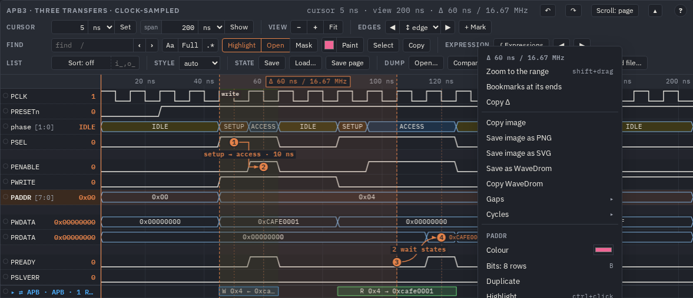

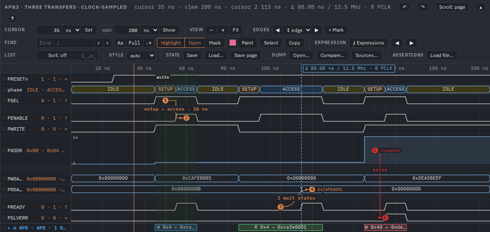

### Clock cycles

**Cycles ▸** in the right button's menu draws the cycles of a clock in a band under the time axis: a tick at each rising
edge, numbered from cycle 0 (every 1st, 2nd, 5th, 10th … as the zoom leaves room), the clock named in the header of the
names. **Show the cycles** counts the 1-bit `*clk*` / `*clock*` found, **Cycles of X** on a 1-bit row counts X, **Cycle 0 at
this edge** makes the rising edge at or before the time clicked cycle 0, **Reset the cycles** gives back the page's
settings (`cycles`, `cycleClock`, `cycleZero`). With the band on, the readout says the cursor's cycle (`cycle 6 ↑PCLK`, negative
before cycle 0) and the second cursor's Δ counts that clock. A `cycleZero` before the waves begin (a window cut out of a
long dump with `--from`) counts the edges before the window at the clock's mean period in it: the window's edges keep the
numbers of the whole dump, as `wave_sample`, `wave_find` and `sva_check` give them (a clock that stops or changes its period
between them: set `cycleZero` inside the window; a clock that starts later than a period into the window had no edge
before it: its first edge is cycle 0). `c147`, `cycle 147` or `c-3` in the cursor field go to that
cycle's rising edge (the band off: of the clock found). Kept in the browser and the saved state; the pictures and a static
SVG with `"cycles": true` draw the band; the command `{"op": "cycles", "on": true, "clock": "PCLK", "zero": "50ns"}`
(`view.run`, `viewedit.py`, `view_edit`).

**Bus transactions.** The page finds the bus ports of every module by their signal names — the signals of one port share
a prefix (`s_axi_awvalid`, `m_axis_tdata`, `wb_cyc_o`; none: `PSEL`), a trailing `_i` / `_o` / `_in` / `_out` is ignored — and takes them
apart into transfers, sampled at the rising edges of the port's clock (its prefix + `aclk` / `hclk` / `pclk` / `clk`, else
a clock of the module or above): **AXI4 / AXI4-Lite / AXI3** (a write is AW + its W burst + B, matched by ID; a read AR +
its R beats to `rlast`; reads answered out of order by ID; SLVERR / DECERR red), **AXI4-Stream** (packets to `tlast`),
**APB** (setup, wait states, access, PSLVERR), **AHB / AHB-Lite** (pipelined address and data phases, NONSEQ + SEQ
bursts, `HREADY` waits, ERROR), **Avalon-MM** (`waitrequest`, pipelined reads by `readdatavalid`, `burstcount`),
**Avalon-ST** (`startofpacket` / `endofpacket`), **Wishbone** classic (`cyc stb` to `ack` / `err` / `rty`) and pipelined
(`stall`, the acks in order), **OBI** (`req gnt`, `rvalid`). Each port is a group `⇄ name · protocol · 3 R · 9 W · 1
err` under its module, folded with its transfers on the header row (writes blue, reads green, errors red, one not
ended dashed); open, a row of transfers stacked where they overlap, with labels (`W 0x40 ← 0xCAFE ×4`), and a row per
channel (AW, W, B, AR, R; address / data; …) where a beat runs from its valid to the handshake, so a stall shows. The
tooltip has the fields, the cycles and the times; a click selects the transfer — the cursor at its start, its range
measured, the port's signals highlighted —, `]t` / `[t` go to the next / previous one. Names of your own: the setting
`"buses": [{"protocol": "axis", "scope": "tb.dut", "map": {"tvalid": "pix_valid", "tready": "pix_ready", "tdata":
"pix_data", "tlast": "pix_eol"}}]` (protocols `axi axis apb ahb avmm avst wb obi`; or a `prefix`; `clock`, `name`);
`"busDetect": false` keeps only those. The static SVG draws the groups with their transfers.

**The list of transfers.** Under the waves (after the bookmarks and markers) **Transactions** says how many ports and transfers the page
has; opened (▸), a row per transfer by time — start, end, port, kind (R W P, ✗ an error, in red), address, data, beats, cycles, its label
— the first 500 (a port or a kind narrows it, **every port** / **every kind**). A click on a row selects the transfer as on the waves, and
`]t [t` mark its row. **CSV** saves the rows of that port and kind (all of them) as `page-port.csv`: `t0_ns, t1_ns, port, kind, addr,
data, beats, cycles, err, label`. The `bus_list` command (a live page, `view_edit`) gives the same table to an agent or a script.

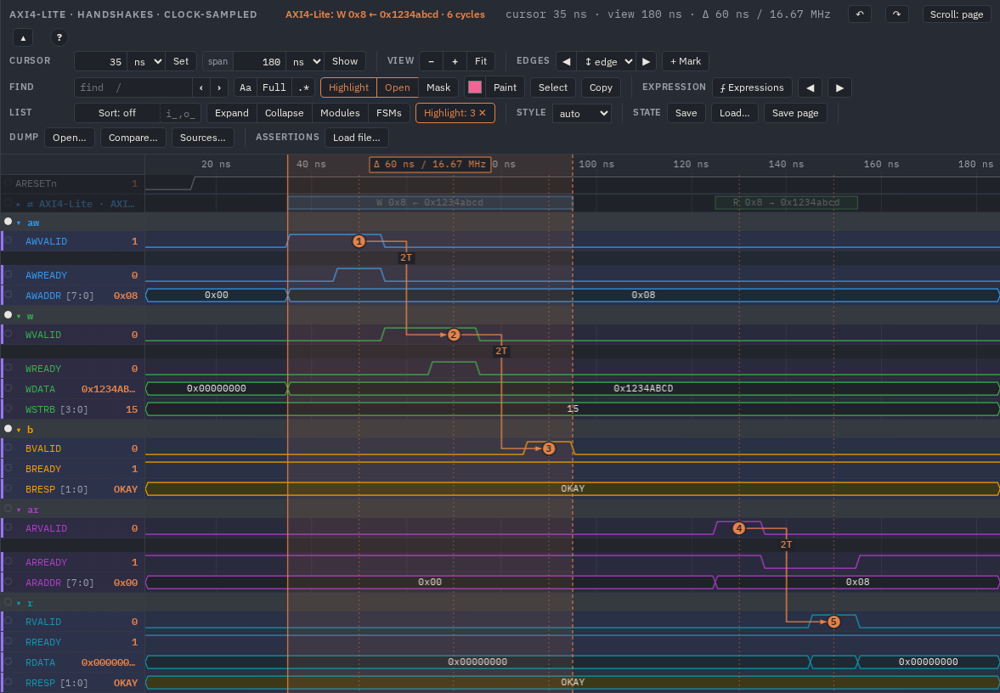

**Sorting.** **Sort** (`s`) cycles off → A→Z → Z→A; the prefixes in the field next to it (`i_,o_`) are skipped when
names are compared and drawn dimmed. Groups move as a block and are sorted inside.

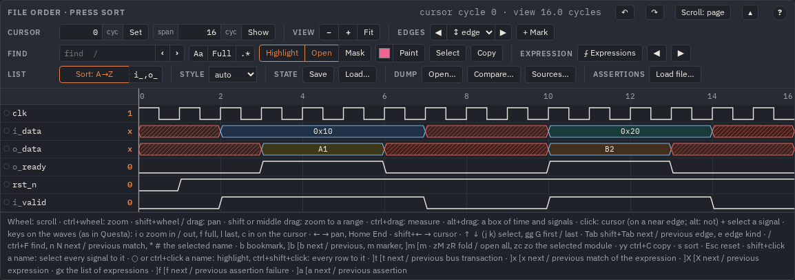

**Copying names and Esc.** Names selected with the mouse copy as full paths, one per line; the find group's **Copy**
copies the found rows. With no search running, ctrl+C on the waves copies the selected signal (or the highlighted
ones); during a search it ends the search. Esc anywhere in the viewer clears the search, the highlight and the
selection; the time window stays, and after a search with **Open** the modules are folded as they were before it, with
the way to the match you stepped to kept open and that row where it was on the screen (if you folded or opened a module
during the search, your folding stays instead).

**The cursor and the readouts.** The cursor reads exactly at any zoom (`cursor 1.234567 µs`), and a click puts it on an
edge of the signal under the pointer when one is within 8 px (`cursorSnap`; alt+click: never), else on a round time of
about a pixel at the zoom you have; bookmark times show every digit too. A long value (a 32-bit bus in
`bin`) is cut to half the names column, its tooltip has it all. **Print** draws every row of every viewer (not only the
part in view) with its title and cursor readout; the bar's tools are left out.

## Examples

Each directory in [`examples/`](../examples) has a testbench, a hand-written config and a README; `make example EX=<ex>`
builds its VCD, FST and two pages: `<ex>.html` from the config and `<ex>_all.html` from a config that `mkconfig.py` makes
from the dump (the whole hierarchy).

| Example | What it shows | Picture |
|---|---|---|
| [`apb`](../examples/apb) | APB3 write, read with two wait states, `PSLVERR` on an unmapped address; enum `phase`; a static-SVG view | [hero](img/hero.png), [light](img/light.png), [svg](img/svg.png), [range](img/range.png), [cursors](img/cursors.png), [why](img/why.png) |
| [`axi_lite`](../examples/axi_lite) | AXI4-Lite write (`AWREADY` a cycle late) and read; channel groups with a colour each, highlight from the config, latency arrows; three module levels in `_all` | [axi](img/axi.png), [hierarchy](img/hierarchy.png), [buses](img/buses.png) |
| [`fsm`](../examples/fsm) | UART receiver with `typedef enum` states in a package: names from the FST and, for the VCD, from its types file; questa edges | [fsm](img/fsm.png), [struct](img/struct.png) |
| [`cocotb_apb`](../examples/cocotb_apb) | an APB3 slave under five cocotb tests on Verilator or Questa, each marking up its own waves (`make cocotb`, `make cocotb SIM=questa`, [§ Marks from a cocotb test](#marks-from-a-cocotb-test)) | [guide](guides/cocotb.html) |
| [`demo`](../examples/demo) | the Manchester transmitter behind [`docs/index.html`](index.html) (`make demo`) | [cursor](img/cursor.png) |

## Marks from a cocotb test

A test says what it does, and the page of the run shows it on the waves: which test ran when, its phases, what it checked,
PASS or FAIL with the expected value, on Verilator and on Questa. The [guide](guides/cocotb.html) walks through it. `python/wavelens_cocotb.py` is
one file: put `python/` on `PYTHONPATH`; it needs nothing but cocotb ≥ 2.0. The example runs by one command, `python3 examples/cocotb_apb/run.py
[--sim verilator|questa] [--out DIR] [--views whole|tests|both] [--wavelens PATH] [--no-marks] [--test NAME]` (or `make cocotb [SIM=questa]`): its
directory can be copied, `HDL`, `TOP`, `MODULE` and `CONFIG` at the top of `run.py` are all it knows of the design.

```python
from wavelens_cocotb import Marks
wl = Marks()                                 # Marks(signal='TEST_CASE', step='TEST_STEP', path=None, logs=True, hide=())

@wl.test()                                   # cocotb.test(), the same arguments
async def test_read_back(dut):
    """The register keeps what was written."""  # the first line goes into the test's first bookmark
    await start(dut)
    with wl.phase('write'):                  # a named stretch of time
        await apb_write(dut, 0x08, 0xCAFE)
    wl.note('stretched by the slave', signal=dut.PREADY, label='wait')
    got = await apb_read(dut, 0x08)
    wl.check(got, 0xCAFE, 'DATA reads back', signal=dut.PRDATA)   # a bookmark; a mismatch fails the test
```

The testbench holds two variables for it, which nothing in the design reads:

```systemverilog
logic [15:0] TEST_CASE /* verilator public_flat_rw */;   // the running test's number
logic [15:0] TEST_STEP /* verilator public_flat_rw */;   // its phase's
```

The decorator writes the number of each test into `TEST_CASE`, `wl.phase` the number of its label into `TEST_STEP` (0 outside a
phase). So the run is in the dump itself: `sva diff --segment TEST_CASE` or a span with `"every": "TEST_CASE"` work without the
rest. Without `TEST_CASE` in the design the marks are still written (one warning says so); without `TEST_STEP` a phase is a span on the
test's row. Verilator needs the two to be public for cocotb and traces by itself. Questa takes the comment as a comment, needs `-voptargs=+acc`, and
writes the VCD from the testbench (cocotb's own `waves` gives a `.wlf`), so the testbench says it, and the build's directory must be the run's, where `vsim` finds its library:

```systemverilog
`ifndef VERILATOR
    initial begin
        $dumpfile("dump.vcd");
        $dumpvars(0, cocotb_apb_tb);
    end
`endif
```

Over the example the marks files of the two simulators are identical (checked on Questa 2021.1, Verilator 5.046), and their dumps agree up to the last time step.

| Call | Does |
|---|---|
| `@wl.test(…)` | `cocotb.test(…)` around the test: its number, a bookmark at its start, a span in the colour of its result, a bookmark at its end |
| `wl.phase(label, signals=None)` | `with`, not awaited: the time inside it is `label` on `TEST_STEP`; a phase inside a phase comes back to it; `signals`: a span on those rows instead |
| `wl.step(label, signals=None)` | the same phase in one line, until the next `step` or the end of the test: nothing to re-indent |
| `wl.note(text, signal=None, label=None, color=None)` | a bookmark now, on `signal` (a handle, a row's name, or a pattern, `"*fifo_full"`: the first row of the view it matches when the page is built, none: the bookmark on the time axis and `bookmark-signal-missing`; none given: the test's row); `label`: the short text by the circle |
| `wl.check(got, expected, text='', signal=None, show=None, why=None)` | a bookmark with both values; a mismatch is an `AssertionError`, which fails the test; every check is counted (`wave_tests`, the note of a test's view); a long value is short by its circle, whole in the list, and two lists say where they part (a list, a tuple, a set, a dict's values, a range in hex item by item, short or long); `why`: the text of a failure instead of `text`, a string or a function called only then; `show='fail'`: no bookmark when they agree, for a check in a loop (the default inside `wl.checks`; `show='all'` there: its own bookmark too) |
| `with wl.checks(text, signal=None):` (or `async with`) | the checks inside leave one bookmark at the end: "every word of the frame: 188 checks passed" (✓ 188 checks), or "17 of 18 checks passed" (✗ 1 of 18 failed) beside the failure's own; each check still counted; nested groups each count theirs; a group with no check inside leaves no bookmark |
| `wl.measure(label, min=None, max=None, signal=None, check=False)` | a time measured: `async with` / `with` around what takes it, or `m = wl.measure(…)`, `m.start()` … `m.stop()` (several: `label 1`, `label 2`); on the page a pair of markers on `signal`'s line (none: the test's row) with the Δ between them, red out of `min` / `max` (`"120ns"`, a number in ps, or `"3 cycles"`: the page counts the clock of its cycles); `ok` in the marks file when the bound is a time; a measure out of its bound fails nothing unless `check=True`; one not stopped by the test's end is kept with no end and said in the log |

`@wl.test(signals=["*fifo_full", "u_x.state"])` names the test's own rows, patterns too: with `--marks-views tests` its view has them after the template's (the `"also"` of the view: one the dump has not got is a lint warning, not an error; a pattern adds 32 rows at most). A docstring's first paragraph is the test's line, the whole of it its first bookmark and `wave_tests` of that test. The line of a failure is the last frame outside the library, past the files of `Marks(hide=["my_checks.py"])` (names or patterns) and any frame that sets `__tracebackhide__`.

Warnings and errors logged during a test are bookmarks too (`logs=False`: not). A test keeps 200 bookmarks; past that only failed checks
and errors, and its last bookmark says how many were left out. A phase in cocotb's `ReadOnly`, where no signal can be written, keeps its exact time: begun there it is a span on the `TEST_STEP` row instead of a value, ended there the row goes back at the test's next call. Nothing but `check` fails a test: outside a test the calls do nothing, a marks file that cannot be written is a
warning. A test's result is what cocotb says of it: `expect_fail` and `expect_error` count the same way (a test with `expect_fail`
that fails is **FAIL (expected)** in orange, red when it fails unexpectedly). A test stopped by a timeout or a failed task cannot see the reason from
inside: it is a FAIL that says what the log said last, even under an `expect_error` that names that reason.

**A test that also runs without WaveLens.** The calls can stay in a test wherever it runs. With `WAVELENS_MARKS=off` the test is plain
cocotb: no signal written, no file, the logs left alone. A tree without `wavelens_cocotb.py` takes the same calls from a few lines in
the tests' common module (they are in [`test_apb.py`](../examples/cocotb_apb/test_apb.py), to copy):

```python
try:
    from wavelens_cocotb import Marks
except ImportError:
    class Marks:
        def __init__(self, *args, **kw): pass
        def test(self, *args, signals=None, **kw): return cocotb.test(*args, **kw)
        def phase(self, *args, **kw): return contextlib.nullcontext()
        def step(self, *args, **kw): pass
        def note(self, *args, **kw): pass
        def measure(self, *args, **kw):
            m = contextlib.nullcontext(); m.start = m.stop = lambda: m; m.enter_result = m; return m
        def check(self, got, expected, text='', **kw):
            assert got == expected, f'{text}: got {got}, expected {expected}'
```

Either way `note`, `phase`, `step` and `measure` do nothing and **`check` still compares and fails the test**: a check that went quiet would pass anything.
`TEST_CASE` and `TEST_STEP` stay in the testbench, unwritten.

The dump is not finished while the test runs, so the page is built after the simulation. The run leaves the marks in
`WAVELENS_MARKS` (default `wavelens.marks.json`), written after each test, so a crash keeps the tests before it (the one
that crashed: **NOT FINISHED**):

```sh
python3 -I tools/mkhtml.py --config x.config.json --waves dump.vcd --marks wavelens.marks.json --out x.html
```

**All the tests on one waveform, or each apart.** `--marks-views` (the config's `"marksViews"`): `whole` (default) is the run on one
waveform; `tests` makes a view of each test from the first view that takes the marks (its signals and settings, what it marks by hand stays out): only that
test's window, marks, and its doc and failure under the title, with its checks, its measures and its steps (`4 steps, longest reset 1.2 us`); the page has a button per test with its result and shows **one test at a time**
(`page.html#tc3` opens that one, a print has them all); `both` adds the whole run as a first button. Each view holds its own window, so `tests` is
about the size of `whole`, `both` twice that. A test's window goes a little past its end, for its last bookmark's text: that bit is the start of the next test, unmarked.

**The colours of the marks.** The config's top-level `"marksColors"` sets them: `{"pass", "fail", "xfail", "run", "note", "warning",
"log"}` (a result's span, its last bookmark and a check's circle; a note and a test's start; a logged warning; another log line), each
`"#2f9e44"`, a token of the theme (`"c3"`…`"c9"`, `"hl1"`…`"hl8"`, `"fg"`, `"acc"`, …: it follows dark and light), a CSS variable
`"--my-mark"` or a CSS colour name (`"orange"`); another word is an error. A key left out keeps its colour. The buttons of
`--marks-views tests` take them too.

**Marks of one time.** A test's bookmarks at one instant on one row (checks made in one cycle; `PWDATA` and `tb.PWDATA` are one row when the view has one of them, and so is a pattern, `*PWDATA`, that matches that row alone) take a lane each: on the row, above it,
under it, beside the ones that chose theirs; more than that, the last lane holds one circle `+k` (red when one of them failed) whose
text lists the rest. On the time axis, with no lanes, they are one circle. `with wl.checks(…)` keeps many to one in the first place.

**Phases as markers.** `--marks-phases` (the config's `"marksPhases": true`; not a boolean: an error): a labelled marker at the start of each phase of a test
(`wl.phase`, `wl.step`) as well, the phases to step through with `]m` / `[m` and to measure from; a phase of no time has none. A
marker of a config may be at a time too: `{"t": "1.2us", "label": "x"}` (outside the window: none, without a word).

`--marks` (or the config's top-level `"marks"`, a path beside it) goes into every view; a view's `"marks": false` stays out, one with
a window takes what is in it. A view gets a span per test, the bookmarks, a jump button per test (**go to**, up to six; beyond that `gm`): these are the
changes of `TEST_CASE` in the dump, so a marks file of another run shows at once. `enum` names the tests and the phases on their rows, the line
under the view's title counts the results, and a view with no `"to"` goes a little past the last test: a failure is where a dump ends.
A signal is named from the top of the test (`dut.u_x.sig`: `u_x.sig`); a view's row is found by that end of its path, also in a config
`mkconfig.py` made from the whole dump. `make cocotb` is the example: [`examples/cocotb_apb`](../examples/cocotb_apb).

## Commands and edits

What the buttons, the menus and the lists of a viewer do, a script, an agent or you from the browser's console do by
name: `view.run([{op, …}, …])` runs commands in order and returns a Promise of their results (`{op, …}`, or `{op,
error}` for one that could not run; the others still do), one redraw at the end (a command that reads the rows laid out —
`picture`, `edge`, `rows` — sees what the ones before it in the list did: a picture after a `hide` is without that row), one
step to undo. The viewer of an element is
`element.waveView`, every viewer `WaveLens.views()`, the list of commands `WaveLens.commands()` (also the table in
[`docs/index.html` § API](index.html#api)).

```js
const v = WaveLens.views()[0];
await v.run([
  {op: 'bookmark', t: '60ns', signal: 'PSEL', text: 'SETUP: address and data valid'},
  {op: 'bookmark', t: '80ns', signal: 'PREADY', text: 'the slave is ready', color: '#2f9e44'},
  {op: 'arrow', from: 1, to: 2, label: 'wait states', shape: '-|-'},
  {op: 'marker', t: '150ns', label: 'error'},
  {op: 'group', name: 'APB control', signals: ['PSEL', 'PENABLE', 'PWRITE', 'PREADY'], color: '#1971c2'},
  {op: 'highlight', add: ['PSLVERR']}, {op: 'paint', signals: 'P*DATA', color: '#e8590c'},
  {op: 'cursor', t: '80ns'}, {op: 'view', from: '40ns', to: '200ns'}]);
```

| Command | Arguments (`?` optional) | Does |
|---|---|---|
| `bookmark` | `n? t? signal? text? label? color? lift? top? link? go? delete?` | a numbered circle on a signal (none: the time axis) with its text: a new one (`n` free or left out, `t` the cursor by default) or bookmark `n` changed; `label`: a short text by the circle; `lift`: `true` (or `"above"`) in a lane above its signal, `"below"` in one under it; `top`: the row going to it puts at the top of the waves (a signal's or module's path, or a name as `signal` takes it — a row there is, else an error; null: none — the command takes none by itself, as its file twin has no screen; the viewer's own **Bookmark here**, `m` and a range's bookmarks take the row at the top then); `link`: a button to another view (`"crc"` or `{view, bookmark}`); `go: true`: the waves to it, as `1`–`9` go (in a file: the cursor, the window within the waves and the selection); `delete: true`: bookmark `n` goes (`n: "all"`: every one; its arrows go too) |
| `arrow` | `id? from? to? shape? head? line? color? label? delete?` | an arrow between bookmarks `from` → `to` with its label: new, or arrow `id` (1, 2 … as listed; or the one from → to) changed; shape `~ - -~ ~- -\| \|- -\|-`, head `> <> < ""`, line `solid dashed dotted` |
| `marker` | `id? t? label? color? signal? lift? hidden? dmin? dmax? delete?` | a dashed line across the rows, pale unless `color` is given (`null`: pale again), with its label at the top, or with `signal` in the lane over that row (`lift: "below"`: under it; `signal: null`: at the top again): new, or marker `id` changed; `delete`: `id` or `"all"` (`"all"` without `delete` is an error); `hidden: true`: kept in its list, not on the waves, the Δ goes through it; `dmin` / `dmax`: the bound of its Δ, a time or `"3 cycles"` (`null`: none; `dmin` over `dmax` refused), red when the Δ leaves it |
| `expr` | `id? text? scope? label? color? on? row? mark? gap? radix? analog? delete?` | an expression of the signals in the [list](#assertions-sva): new (`text`, refused when it does not value; in a file not checked, an error shows in the page), or expression `id` changed; `scope`: the module its names start from, `label` its text on the waves, `color` (`null`: the colour of its place), `on` its marks, `mark` `band`, `line` or `strip`, `row` drawn as a signal, `gap` the waves cut to its matches, with the others that have it (idle and keep of `gaps`); `radix`, `analog` (rows; `null`: none): of its row, a bus when its value is wider than a bit; `delete`: `id` or `"all"`; answers what it found: `n`, `time`, `share`, `first`, `last`, `min`, `max`, with `gap` also `cut` as `gaps` (in a file: `id` only, it is valued when the page opens) |
| `expr_go` | `id? dir? n?` | the cursor to the next (`dir` 1) or previous (−1) match of an expression, round the ends, or to match `n`; answers `t`, `k` (which one), `n` (how many; 0: never true); in a page only |
| `expr_matches` | `id? from? to? limit? offset?` | what the expressions found: without `id` everyone's numbers (`exprs`), with `id` also its stretches in the window (`matches: [[from, to], …]`, `total`, `next_offset`; `limit` default 100); in a page only |
| `expr_markers` | `id? label? color? signal? limit? deltas? delete?` | a marker at the start of each match of expression `id` (default the one picked) in the window, at most `limit` (200), labelled `label` (default its label, else `ƒ` and its id) and a number, in `color` (default its own), each with its Δ to the next one of it, the Δ on (`deltas: false`: not turned on); its markers there were go first; `delete`: they go -> `{id, markers, more, from, to}`; in a page only (on a file: `markers` of the config, `{"on": {"expr": …}}`) |
| `span` | `id? from? to? label? color? signals? delete?` | a coloured stretch of time across the rows (or the rows of `signals`) with its label: new (`from` and `to`; reversed: swapped; at one time: refused), or span `id` changed; `delete`: `id` or `"all"` |
| `compare` | `result? dump? a? map? offset? off? show?` | a second dump over the waves (red bands, ≠, `]d [d`): `result` (`sva diff`'s, the WaveJSON `"compare"`), `off`: none; `dump` (`a`: the page's dump, `map`, `offset`) in `tools/viewedit.py` / `view_edit` only (they run `sva diff`); answers `name`, `compared`, `differ`, `first`, `missing`; `show`: which run the waves show, `a`, `b` or `overlay` (*Which run the waves show*; alone it answers `show`, `name`; `b` and `overlay` need B's values: a result without `vcd` refuses); in the saved state (`compareShow`) |
| `group` | `name signals? add? remove? color? rename? delete? go? move? divider?` | your group: `signals` sets its signals in this order (a module: its signals), `add`, `remove`, `rename`, `delete`; `divider: true`: no signals, a line with its name between your groups and through the waves, in the picture too (`— Handshake —`; with signals an error; Hide, Highlight and the groups' lists leave it out); `go`: opened, in the middle, its first signal selected (ctrl+G); `move`: its place among your groups (`up`, `down`, `top`, `bottom`, a number) |
| `layout` | `scroll? height? tools?` | where the rows scroll: `window` (`height`: `"80vh"`, `600`) or `page`; the bar's tools `fold` or `open`; answers `scroll`, `height`, `tools` |
| `highlight` | `add? remove? set? clear?` | signals and modules (and your groups) in front in their colours, the rest dimmed |
| `paint` | `signals? color? clear?` | a colour (trace, outline, name) for signals; `color: null` their own again |
| `select` | `signal? signals?` | the selected signal (edges, new bookmarks), or several |
| `hide`, `show` | `signals` / `signals?` | rows out of the view and back (none given: every one) |
| `fsm_stats` | `signal` | an FSM on the waves: each state of its table with its `entries`, the `time` it held it (`share` of the whole), its `first` entry; `never` (the states it does not reach), `invalid` (x, z, codes without a label), `changes` (`from`, `to`, `count`, `first`), the most frequent first; in a page only |
| `fsm_panel` | `signal? tab? off?` | the FSM panel (**T**) open, with the details of an FSM (`signal`: its path or a pattern; one the list leaves out turns on its **all** and **fields**) on a `tab`: `states`, `changes` or `graph` (the diagram); `off`: closed; answers `open`, `signal`, `tab`; in a page only |
| `fsm_go` | `signal state? from? to? dir? first?` | the cursor to the next (`dir` 1) or previous (−1) time an FSM enters a `state` (its label or value) or makes a change `from` → `to`; `first`: the first time; answers `t`; in a page only |
| `types` | `signals?` | where their labels or fields come from (the right button's **Type…**): `status` `typed` (the types file's path, `key`), `own` (its own labels, an FST's or the config's, stay before the file's), `width` (it does not fit), `plain` (a plain vector in the types), `none` (no entry: the paths of its name the file has), null (the page's own); `why` in words; `run`: why the types may be of another run; none given: the selected signal, else every one the types file was asked about; in a page only |
| `fsm` | `mode? signals? fields? clear?` | the state machines (signals with enum labels, the FSM panel): `mode: "only"` — the waves keep these FSMs and the modules on the way to them; `"add"` — they join the view as Hide, Only and the find's Mask leave it; `signals` which ones (patterns; left out: the ones it has, none yet: every FSM; `fields`: the fields of structs too); `clear` the layer off; answers the layer (`{mode, signals}`, `null`: none) and every FSM (`fsms`); in a page only |
| `only` | `modules? on? clear? open? groups?` | only these modules on the waves, with their submodules (the way to them as headers; the Modules panel's box): `modules` replaces the set and turns it on (`[]`: none kept) and opens the modules named with the ones above them (`open: false`: the folding as it is), `on: false` pauses it, `true` resumes it, `clear` every module again; `groups`: your groups whole (`true`, the setting `onlyGroups`) or their signals by module (`false`); a name of a signal or a struct is an error; answers the set (`{modules, on, groups?}`, `null`: none) and `groups` |
| `fold`, `unfold` | `groups? all?` | modules and your groups folded or opened |
| `radix`, `analog` | `signals radix` / `signals rows` | the radix of buses (`null`: the page's), a bus as a step plot |
| `duplicate` | `signals bits? radix? rows? delete?` | a signal again in a row under it (`PADDR#2` in every command), starting as that row looks, its radix, analog form and colour its own; `bits`: `[7, 4]` or `"7:4"`, a slice of the bus as that row (`PADDR[7:4]`; not of a slice, not past its width); `radix`, `rows`: of the copy, as those commands; `delete`: the copies named, or all the copies of the signals named, gone -> `copies` or `deleted` |
| `deltas` | `on? id? to? signal? lift? color? dmin? dmax?` | the Δ between your markers: `on` shows them; with `id` (the arrow from that marker): `to`: to that marker, through the ones between (`"next"`: the next in time again; `null`: no arrow from it); `signal`: in the lane over that row (`lift: "below"`: under it; `signal: null`: over the rows again); `color` (`null`: its own again); `dmin` / `dmax`: its bound (without `id`: every marker's) -> `on`, `deltas` [{`from`, `to`, `dt`}] |
| `bus_list` | `port? kind? from? to? limit?` | the transfers of the buses (`bus.js`): `ports` [{`name`, `proto`, `summary`}], `transactions` [{`t0`, `t1`, `port`, `kind` (R W P), `addr`, `data`, `len` (beats), `lat` (cycles), `err`, `label`}] by time; `port` a name or a `*` pattern, `kind` R W P or `err`, `from` / `to` their start, `limit` 100 (`more`); in a page only |
| `measures` | — | the Δ of your markers as a table, shown or not: [{`from`: {`id`, `label`, `t`}, `to`, `dt`, `cycles` (in a page: the clock of the cycles), `dmin`, `dmax`, `ok` (with a bound), `signal`}]; changes nothing |
| `bits` | `signals on?` | buses bit by bit, a row per bit under each (`on: false`: folded again); a bit is named by its path (`PADDR[2]`) in every command |
| `cursor`, `cursor2`, `view`, `fit`, `range` | `t` / `t` / `from? to? at? span?` / — / `from? to? signal?` | the cursors, the window, the measured range (cut to the waves; one wholly outside them is an error) |
| `goto` | `t? sel? view? bm?` | a moment, as a [link](#a-link-to-a-moment) says it: the section `view` shown and scrolled to, its bookmark `bm`, the cursor at `t` in the middle, the signal `sel` selected and in sight -> `{view, t, sel}`; in a page only (it scrolls) |
| `sort`, `style`, `find`, `gaps` | `dir ignore?` / `name` / `query case? word? regex? highlight? open? mask?` / `on? idle? keep? signals? clock? aux? only? count? view? reset?` | the order of the names, the edge style, the find field and its options (answers the rows `found`, the first 50, and their `count`; on a page's file, `tools/viewedit.py`, of the signals, modules and your groups only: `plugins` says the assertions' rows are not counted), the gaps of the picture, and with `view` of the waves (`reset`: the page's own; answers every gap setting, on the waves also `cut`: `gaps`, `kept`, `total`, the first 50 `parts`, `partsAll` when more; while expressions have `gap` it is on and `gapBy` lists them, `on` or `view` false or `reset` takes `gap` off them) |
| `cycles` | `on? clock? zero? reset?` | the clock cycles under the time axis: on, the clock counted (a 1-bit signal), the time of cycle 0 (`null`: the first edge), `reset`: the page's; answers the settings, the clock and the cursor's cycle (in the page; `null` from a file) |
| `edge`, `reset` | `dir? kind? value? signal?` / — | the cursor to the next / previous edge; what Esc does |
| `state`, `set_state`, `rows`, `picture` | / `state` / `pattern? limit? offset?` / `format? from? to? rows?` | read: the state (Save); a state back (Load…): a key it has replaces this one's (`config` key by key), a key it does not have stays, `null` clears; the signals of the page in display order (your groups first, as sorted, the hidden ones where they would be; a dump compared: `"≠"` or `"missing"` third; a bus shown bit by bit: its bits under it, `["PADDR[7]", 1, "bit"]`); the screen as PNG (base64), SVG or WaveDrom (`rows`: `screen`, `all`, `picked` or signals, at most 5000) |

Times are model units (ps of timed waves, else cycles) or a text with a unit (`"2.5us"`, `"100NS"`, `"0.1µs"`). A bookmark, a marker or a span's end goes inside the waves (from 0 when they start later): a time outside them is refused. A
bookmark's `n`, the `id` of an arrow or a marker and an arrow's `from` / `to` are whole numbers (`2`, `2.0`, `"2"`;
`true` or `1.5` is an error). A signal is its full path,
its name, the end of its path (`u_regs.PSEL`), the dump's longer path of a row the page names shorter, a bit of a
shown bus by its path (`tb.PADDR[3]`), or a `*` pattern, alone, in a list or a text with commas; an element of an
array either way (`mem[1]`, `mem.[1]`). A name of several signals takes the one nearest the top when that is
one (one net seen at several levels), else it is an error, as is a name that matches nothing (the answer names similar
ones). It is one rule (`tools/common.py` `pick`) with the converter's `signals` (under `--scope` first) and the agent's
names (`wave_*`), where `x[7:4]` and `x[3]` select bits of a bus that rule finds.

**The same commands on a file.** `tools/viewedit.py` runs them on a page made by `mkhtml.py` (`make html`, `wave_page`)
or on a saved state (`.view.json`): from a shell, a script, a CI job.

```sh
python3 -I tools/viewedit.py out/examples/apb/apb.html --view exact \
    --ops '[{"op": "bookmark", "t": "60ns", "signal": "PSEL", "text": "setup"}, {"op": "highlight", "add": "PSEL"}]'
python3 -I tools/viewedit.py page.html --views        # the views of a page (their keys), the revision of their edits
python3 -I tools/viewedit.py page.html --get          # the edits as JSON
python3 -I tools/viewedit.py page.html --measure --csv  # the Δ between the markers as a table (CSV)
python3 -I tools/viewedit.py --config x.config.json --view exact --ops '[{"op": "radix", "signals": "PWDATA", "radix": "dec"}]'
python3 -I tools/viewedit.py --config x.config.json --view exact --from-page x.html [--keys groups,radix,markers]   # the page's view into the config
python3 -I tools/viewedit.py saved.view.json --model page.html --ops @ops.json
```

A page carries its edits per view (a JSON block next to its data, a new revision with every change). The viewer applies
them when it is opened: what this browser keeps of a viewer (bookmarks, arrows, markers, spans, groups, colours, radix, analog and
hidden rows, the buses bit by bit, expressions, edge style, gaps) once per revision — what you change afterwards stays yours until a newer revision replaces the
parts it names; the rest (cursor, window, highlight, selection, folding, order, search) every time it is opened, as the
page's own settings. The commands that need the waves' values or the screen (`edge`, `fit`, `picture`, `fsm`, `fsm_stats`, `fsm_go`, `fsm_panel`, `types`, `expr_go`, `expr_matches`) run only in the
page. The smoke test checks that a page with these edits and the same commands run in it give the same state.

**A rebuilt page keeps your view: the config.** `--config x.config.json --view v` runs the commands on a view of a config instead of a
page: `bookmark`, `arrow` and `span` on its `"bookmarks"`, `"arrows"`, `"spans"` (a bookmark's `"at"` stays until a `t` replaces it),
`view` on its window (`"from"`, `"to"`), and the rest of its look — `group`, `paint`, `highlight`, `radix`, `analog`, `hide` / `show`,
`duplicate`, `bits`, `marker`, `deltas`, `span`, `expr`, `gaps`, `cycles`, `style`, `layout` — on its `"state"`: a viewer's state the page
opens with (`mkhtml.py` puts it into the page's edits, once per change of it, without a toast). Not what a session is: the cursors, the
range, the selection, the find, Only, the FSM layer, the order. The whole list is checked first (a bad command writes nothing), the file
written at once, its other keys and views as they were. `--from-page x.html` takes the view of a page made of the config — its edits:
what `viewedit.py`, an agent or **Save page** wrote — into it: groups, colours, radix, analog, hidden rows, copies, bits, markers, the Δ,
bookmarks, arrows, spans, expressions and the look (`--keys` some of them); a page of another dump is said, not refused. `make html` of
the next run gives the same view.

**Live.** A page connected to an agent's `tools/wavemcp.py` (below) takes its commands as they come: a bookmark the
agent puts appears on the waves at once, and what you change is what the agent reads next. The page connects to the
server on `127.0.0.1` (server-sent events; the commands' results go back), with a key the server keeps in
`~/.cache/wavelens/live-token`: only pages that have it (written into them by `view_live`, or opened with
`#wavelens-live=<port>:<key>`) are let in, by the server's address (`127.0.0.1`, `localhost` and its port in the `Host`: a
name of another site pointed here is refused), and a page's answer counts for the command sent to that page only. **● live** in the bar's state group: connected (a click disconnects); **○
live**: no agent there (a click tries again). From the console: `WaveLens.live('8742:<key>')`, `WaveLens.live(null)`.

## AI agents (MCP)

`tools/wavemcp.py` gives an AI agent (Claude Code, Codex, any MCP client) the tools of WaveLens as an MCP server over
stdio: it asks questions of a dump and gets short JSON answers instead of reading the dump or writing a parser for it.
Standard library only; the assertions, the expression search, `wave_to_fst`, `wave_diff`, `wave_runs`, `wave_cut` and `compare` with a `dump` need the `sva` CLI (found as `svabuild.py` finds it),
an FST needs `fst2vcd` or the `sva` CLI.

```sh
claude mcp add wavelens -- python3 -I /path/to/wavelens/tools/wavemcp.py     # Claude Code (--scope user: every project)
claude mcp add wavelens -- python3 -I /path/to/wavelens/tools/wavemcp.py --lean   # the short tool list: a third fewer characters
codex mcp add wavelens -- python3 -I /path/to/wavelens/tools/wavemcp.py      # Codex CLI
python3 -I tools/wavemcp.py --call wave_info '{"dump": "out/examples/apb/apb.vcd"}'   # one tool from the shell
```

| Tool | Answers |
|---|---|
| `wave_info` | the time span, the number of signals and changes, the scopes (three levels), the clocks with their period, the resets |
| `wave_signals` | the signals by a substring or a `*` / `?` pattern, under a scope, to a depth: rows `[path, width, changes, extra]`, `extra` the enum's size and the kind when it is not a wire (`"enum:3"`, `"real"`, `""`) |
| `wave_values` | the values of signals at one or more times (after the changes at that time, or `side: "before"`); a time outside the dump is said in `notes`: past its end the last value held. A window wholly outside the dump is an error, in every tool that takes one |
| `wave_changes` | the value at the start of a window and the changes in it, `limit` per signal (`more`, `next_from`: how to go on) |
| `wave_sample` | a table per clock cycle (`cycle`, `t`, the values sampled just before the edge, as SVA samples), by default only the cycles where a value changes |
| `wave_find` | `expr`: an SV expression or sequence matched on every clock cycle by the sva engine (`req && !ack`, `req ##[1:3] ack`, `$rose(x)`); or a signal's edges (`rise`, `fall`, `change`) or value (a number, `'h40`, `'b10x1` bit for bit, an enum label) at their exact times; the count and the first matches (the rules of a bookmark's `at`: one module, `tools/wavefind.py`) |
| `wave_stats` | over a window: a bit's rises, falls, high time, pulse widths and period; a bus's changes, distinct values, the longest-held ones, minimum and maximum |
| `sva_check` | assertion files and / or text evaluated over the dump in a scope: the failed ones with their first failures (`cycle`, `t`, `start_cycle`, `start_t`, the reason), passed, vacuous, not evaluated (names missing), the covers |
| `wave_page` | a viewer page (`out` `.html`) or WaveJSON (`.json`) of signals over a window, assertions bound, to show a person; `marks`, `marks_views`: the tests of a cocotb run on it (not with `compare` or `auto_gap`; a mark that found no row is in `notes`); `compare`: a second dump (or `{dump, map, offset, segment, align, show}`, the config's `"compare"`), its differences on the page, `show` the run it opens with |
| `wave_tests` | the tests of a cocotb run from its marks file ([§ Marks from a cocotb test](#marks-from-a-cocotb-test)): the summary, each test's result, window, counts of checks, message and line, its `measures` (`wl.measure`: `label`, `from`, `to`, `dt` in ns, `min`, `max`, `ok`; `ok` null: a bound in cycles) and `measures_failed`; `slowest`: the five longest steps of the run; `test` (a number or name): one, with the whole docstring (`text`), its own rows (`signals`), its phases and marks, each check with `got` and `expected`, `got_all`, `expected_all` and `at` where a long value was cut (`limit`, 50: `more`), its `steps` by length, the longest first, with `total` and `longest` (`steps: true`: only them). The window is the one to ask `wave_changes`, `wave_find` or `wave_sample` about. `marks` a directory: a regression, every marks file under it (any depth) in one answer: `summary`, `totals`, the `failures` first (`file`, `n`, `name`, `result`, `from`, `message`, `where`; `limit`), `runs` (each file's `summary`, `tests`, `failed`, the failed ones first), `notes` for a file it could not read and the `.json` files skipped (not JSON, no marks file, over 64 MB), named; a marks file is one by its `"wavelens": "marks"`, wherever it is in the file (a BOM before it, as an editor of Windows saves it, is no error) |
| `wave_to_fst` | the VCD as an FST beside it (`out`: another file) with `sva fst`, the FSM states of its types file in it (`types`, `no_types`); what was written and the notes with their lines |
| `wave_diff` | two dumps `a` and `b` (`dump` is `a`) compared change by change with `sva diff` (*Compare two runs from the shell*: streamed, neither read by the server): `equal`, `compared`, `differ`, `first` (`t`, `signal`, `a`, `b`; a bus in hex), the first `limit` `differences`, the signals that differ (`signals_more`: the rest), `only_a`, `only_b`, `segments`; `map` an object (`{"tb_a.if": "tb_b.if"}`), `offset`, `segment`, `align`, `spans` (the stretches kept per signal), `rank` (the first five signals by their first difference); `results_a`, `results_b` instead of the dumps: the assertions' results of two runs, `new`, `gone`, `moved` failures per assertion; times in ns |
| `wave_explain` | one call from a moment to what to look at: `expr` (its `nth` match; its signals from the expression), `assert` (`"name@scope"` with `sva`, its files: its `nth` failure, the window from the attempt's start to where it failed, its signals from the property, its `note`), `b` (the first difference with that dump, and the signals that differed next) or `t` (a time, with `signals`) -> `at`, the window `before` / `after` cycles of the clock around it (2 / 2, an expression 2 / 4), the clock, the signals and their values there (a `wave_sample` table; with `b`, `table_b`: the other run's in the same window); `out` (a `.html`): a page of that window with a marker and the cursor there |
| `wave_fsm` | an FSM's states in a dump (`tools/fsmstats.py`, the rule of the page's FSM panel): each state's `entries`, `first`, `time` held and `share`, `never` (the states not reached), `invalid` (x, z, a code without a label), `changes` by count; its table the dump's (an FST's), the types file or `enum` `{code: label}`; `from` / `to` |
| `wave_runs` | the runs kept of a dump (`sva runs`, the VS Code Runs panel's, in `.wavelens-runs` beside it; `dir` another): `action` `list` (the default: `dir`, `runs` newest first with their `start`, `end`, `cases` in ns), `keep` (`name`, `tags`, `comment`, `cases`: a file, `"none"` or `[{name, from, to}]` in ns; none: cocotb's marks beside the dump), `set`, `rm` (`run`: a number or a name), `all` (the runs of every dump of the directory, not this one's only), `diff` (the dump against each run, or those of `run`, a list too, over `from` … `to`, `signals`, `scope`, `map`: per run `signals_differ`, `first`, the signals that differ, `limit`; `case` NAME: each run's test case of that name against the dump's, wherever it is in the run, `case.offset`; `against`: a run, a number or a name, is A instead of the dump, compared with the others, `run` `"now"` the dump as a B, the answer's `against` `{id, name, file}`); then `wave_diff` with `b` the run's FST for the details |
| `wave_cut` | a window (`from`, `to`) and some `signals` of a dump as a small VCD at `out` (`sva vcd --from --to --signals`; a long list: `--signals-from FILE`, one a line): the values at `from` first; `out`, `bytes`, `variables`, its `from` and `to` |
| `view_edit` | marks up a page for a person with the [commands](#commands-and-edits) (`ops`): bookmarks with a text, arrows, markers, expressions (their list, marks on the waves, the cursor on a match), groups, highlight, colours, hidden and folded rows, radix, cursor, window — live in their browser when the page is connected, else into the page's file (they see it when they open or reload it); `save`: a live page's state into its file too; `config` (instead of `page`): the commands on a view of a `mkhtml.py` config, so a rebuild keeps them: `bookmark`, `arrow`, `span` on its own keys (a bookmark's `"at"` stays until a `t` replaces it), `view` its window, the rest of its look (`group`, `radix`, `marker`, `deltas`, `hide`, `paint`, `expr` …) its `"state"`; `from_page`: a page's view into it (`keys`: some); the whole list checked first, the file written at once |
| `view_get` | what a page shows (a live page's transfers of the buses: `view_edit` `bus_list`): bookmarks, arrows, markers (with `measures`: the Δ between them as a table in ns, the bound kept or not), spans, expressions (`exprs`), groups, highlight, colours, hidden, the copies of signals (`dups`), cursor and window, a dump compared (`compare`: `name`, `compared`, `differ`, `first`, `missing`, `show`), the gaps (`gaps`; live, on the waves, with `cut`; `by`: the expressions that cut) (live: with what the person changed); `full`: the whole state; `view`: which view, on a page of several; `rows`: its signals (a pattern, `limit`, `offset`); `picture`: a PNG of the view (live: the screen; a page's file: made in a headless Chromium by `tools/pageshot.py`, when playwright is there) |
| `view_live` | connects a page to this server: the link is written into it, the person opens or reloads it (`open`: in their browser); `off`: disconnects; `rotate`: a new key, so a copy of a page that carried the old one no longer connects (the pages linked before need `view_live` again); `page` a `.vcd` / `.fst`: its tab in VS Code (the extension connects by itself; `open`: VS Code opens it); without a page: the pages connected |

The conventions are in the server's `instructions`: times are ns (a number) or a text with a unit, read as the viewer
reads them (`"2.5us"`, `"100NS"`, `"1E2"`: 100 ns, `"0.1µs"`; a time that is not finite is an error); a
signal is its full path, its path under `scope`, or the unique tail of a path (`PSEL`, `u_regs.PSEL`; an array element
either way, `mem[1]` or `mem.[1]`; the rule of the viewer's commands, [§ Commands and edits](#commands-and-edits); of several
matches the one nearest the top is taken and named in `notes`, two at the same depth are an error naming them; of
several signals asked for, one not found is left out and named in `missing`); `x[7:4]` and `x[3]` select bits (their
edges and changes are the select's own; bits outside the bus are an error); the cycle numbers are the clock's rising
edges from the start of the dump, as `sva_check` counts them. A dump is read once per server and kept (again when the
file changes); the transitions of a signal when a tool first needs it; a value written again is no change. `wave_info`
lists a clock once per net (one id code under several scopes), two clocks with edges alike are two.

**Enum labels from the types file.** The tools that read values (`wave_info`, `wave_values`, `wave_changes`,
`wave_sample`, `wave_find`, `wave_stats`, `wave_page`) take the labels of the types file beside the dump, as `mkconfig.py`
does: `tb.vcd` → `tb.types.json` (Questa's `wavelens_types`, `svtypes.py verilator`); `types`: another file, `no_types`:
none. `r_state` answers `FRAME_ERROR`, not `5`, and `wave_find` takes `"value": "FRAME_ERROR"`. An FST's own tables
stay; `wave_info` names the file and its notes (another run's types, a width that differs).

**Arguments.** An argument a tool does not take is an error that lists the ones it takes. A sibling tool's name for an
argument is taken for the tool's own: `signal` for `signals` (`wave_values`, `wave_changes`, `wave_sample`,
`wave_stats`, `wave_page`), `signals` of one for `signal` (`wave_find`), `times` or `t` for `at` (`wave_values`), `text`
for `source` (`sva_check`); both names with other values are an error.

**Long answers** stop at `limit` and say how to go on: `next_from` (`wave_changes`: the time of the last change given —
`from` is the value after the changes at that time, so the next page starts with the change after it; `wave_sample`:
the time of the first row left out) or `next_offset` (`wave_signals`); the pages put together are the answer without a
limit. **Errors** are answers: a request of a wrong shape gets its JSON-RPC error (`-32600`, `-32602` for `params` or
`arguments` that are not an object, `-32603`), an argument of a wrong kind the tool's error naming it (`"scope": a
string, not 5`), anything else that goes wrong in a tool its error (the trace on stderr); the session goes on. The
programs the server starts (the `sva` CLI, `fst2vcd`, a browser) get `/dev/null` as their stdin and stderr as their
stdout: they never read a request or write into an answer. `defines` of `sva_check` and `wave_find`: `{"NAME": value}` or
`["NAME=value", "NAME"]`. **`radix`** of the tools that give values: `hex`, `dec`, `signed`, `bin`, `oct`, `ascii`, or fixed point `q8`, `sq15`. **`wave_sample`'s `edge`**: `posedge` (default), `negedge`, `edge`. **`sva_check`'s `details`**: the passed ones as `[name, pass, vacuous]`, not only their names. **`view`** of `view_edit` and `view_get`: a live page of several views needs it.

**The gaps on the waves.** `view_edit` with `{"op": "gaps", "on": true, "view": true, "idle": 8, "signals": "*valid, *ready"}` cuts the
person's waves as they scroll them; live its answer has `cut` (how many gaps, the time kept, the parts in ns), and
`view_get` has `gaps` with that `cut`; on a page's file it goes into the file and `view_get` with `picture` shows it.
A page that opens that way: `"config": {"gaps": true, "gapView": true}` in its config.

**Marking up for a person.** `wave_page` makes a page; `view_live` with it connects it (the person opens it: **● live**
in its bar); `view_edit` puts bookmarks with explanations, arrows between them, markers, a group of the signals that
matter, highlight and colours on it, and the person sees them appear; `view_get` reads what is there, the person's own
bookmarks and texts too, and with `picture` what the screen shows. Without a live page the same edits go into the
page's file. Times are ns here too, in the questions and in every answer (the tools turn them into the viewer's units), in a state given back with
`set_state` as well (what `view_get` with `full` read). `save` with a live edit writes the page's state into its file;
when the page answered the edit but not the question for its state, the answer says `applied live, not saved` (the edit
is never done again on the file: what the person changed there would go). The link listens on 127.0.0.1 from
port 8742 on (`WAVELENS_LIVE_PORT`); a page that carries it can be handed to no one else before `view_live` with `off`.

**What it saves.** `make mcp-bench AGENT=claude MODEL=sonnet REPS=2` (or `AGENT=codex`) runs eight tasks with known
answers — two on the APB example, one on the FSM example's FST, five on a generated 3.5 MB dump of 40 000 cycles — by
an agent with the server and without it (the shell and the WaveLens command-line tools, named in the same prompt), and
counts the tokens; `make mcp-bench` alone solves them through the tools by a script (16 calls, 3.3 KB returned, every
answer right). Measured on 21 October 2026, two runs of each task in each mode, every one of the 128 answers right
(the tokens are every token the model read or wrote, the context read again from the cache included; the medians per
task summed):

| Agent | without the tools | with the MCP server | the same tools from the shell (`wavemcp.py --call`) |
|---|---:|---:|---:|
| Claude Code, Sonnet 5.5 | 343 k tokens, $0.53, 147 s | 261 k (−24 %), $0.38 (−28 %), 96 s | 339 k (−1 %), $0.49 (−8 %), 170 s |
| Codex CLI, its default model | 558 k tokens, 232 s | 741 k (+33 %), 179 s | 540 k (−3 %), 159 s |

Where it saves: assertions (`sva_check`: one call instead of reading the CLI's help and its JSON — Claude −71 %) and
an FST with enum names (−49 %, Codex −37 % through the shell); a question answered by a few searches on a dump too big
to read. Where it does not: one number from a dump whose signals the task names, which the agent gets by writing one
Python parser — the tools' schemas, read again with every request, cost more than the parser. Codex defers MCP tools
(it looks them up while it works), about 5 k tokens more per request: for Codex the same tools through `--call` in its
shell are the cheaper way. Answers came faster with the tools (the sums of the medians above). The per-task numbers are
in [DEVELOPMENT.md § Measured](DEVELOPMENT.md#measured).

## Tools

All tools are `python3 -I tools/<tool>.py --help`; the Makefile calls them for you.

| Tool | Does | Main options |
|---|---|---|
| `mkconfig.py` | dump → editable config with every signal (`--update` says when what went and what came look like a renamed scope; `--map OLD=NEW` keeps their settings) | `DUMP`, `--out`, `--update`, `--map OLD=NEW`, `--force`, `--base`, `--depth`, `--types FILE` (default `<dump>.types.json`), `--types-map DUMP=TYPES`, `--sv FILES`, `--sva FILES`, `--sva-bin`, `--gtkw FILE` (a view of a GTKWave save file: its signals, groups, radix, colours, window start, markers; `--view`, `--strict`) |
| `svtypes.py` | the design's types by path ([§ FSM state names](#fsm-state-names-fst-or-vcd--the-designs-types)): Verilator's, and a check of a types file against a dump | `verilator --top --out --verilator -- ARGS`, `check TYPES [DUMP] --map` |
| `questa/wavelens_types.tcl` | in `vsim`: the types of a Questa design (`describe` of every signal) | `source` it, `wavelens_types FILE [ROOT]` |
| `mkhtml.py` | config (every view) or WaveJSON files → one self-contained page | `--config`, `--view`, `--waves`, `--marks`, `--marks-views`, `--junit FILE`, `--png DIR`, `--png-theme`, `--png-width`, `--render`, `--out`, `--settings`, `--title`, `--sva FILE`, `--bind NAME@SCOPE`, `--report NAME@SCOPE`, `--sva-bin`, `--no-sva`, `--reproducible`, `--lint`, `--strict` |
| `vcd2wavedrom.py` | one window of a dump → WaveJSON | `--config` + `--view`, or `--waves --scope --signals --clock/--exact --from --to --marker --group --enum --also`; `--gap A:B` / `--auto-gap IDLE[:KEEP]` (`--clock`: a window, or every stretch of IDLE cycles where nothing but a clock changes, as one `\|` cell); `--sva FILE --bind NAME@SCOPE`; `--cycle`, `--hscale`, `--hierarchy`, `--title`, `--bookmarks`, `--arrows`, `--spans`, `--expr` |
| `pageshot.py` | a page → a PNG per view and theme, made in a headless Chromium, and a manifest (`make pageshot HTML=…`); the one tool outside the standard library, optional (playwright, run without `-I`) | `--view KEY`, `--theme dark\|light\|both`, `--out DIR`, `--width` |
| `svabuild.py` | the `"sva"` / `"bind"` of a config: files parsed, bindings evaluated with the `sva` CLI (used by the two above) | `--waves --sva --bind --out` |
| `embed.py` | WaveJSON → `data.js` for `file://` pages, or into an HTML placeholder | `--var NAME key=file.json`, `--html --placeholder`, `--out`, `--compact` |
| `dumpscan.py`, `wavejson.py` | the built-in dump reader (VCD text, FST via `fst2vcd -e` or `sva vcd`; `WAVELENS_FST=sva` / `fst2vcd` picks one) and the readable JSON writer | modules |
| `wavemcp.py` | the tools as an MCP server for an AI agent (stdio), or one tool from the shell ([§ AI agents](#ai-agents-mcp)) | `--list`, `--call TOOL JSON`, `--lean` |
| `wavelive.py`, `wavepage.py` | the live link of `wavemcp.py` (the HTTP server a page connects to, the port file, VS Code's open requests) and the files `viewedit.py` edits (a page's blocks, a config's bookmarks, arrows, spans and window) | modules |
| `mkvsix.py` | the VS Code extension as one `.vsix` ([§ In VS Code](#in-vs-code-over-remote-ssh-or-wsl)) | `--out`, `--sva`, `--target`, `--one`, `--plain` |
| `gtkw.py` | a GTKWave save file read (`mkconfig.py --gtkw` makes a view of it): its dump, traces in order with radix (`@22` hex, `@24` dec, `@424` signed, `@28` bin, …), colours, analog, groups (nested: a trace in the innermost), aliases (`+{name} path`: the catalog's `alias`), a bit of a bus (the bus shown bit by bit), the window's start and the markers with their names (in the dimension of the dump's `$timescale`, as GTKWave keeps them); translate filters and vectors of bits are said and left out | `FILE.gtkw` (JSON) |
| `dumpscan.py` | a dump's statistics: the signals that change, the busiest (changes, per µs), the ones that never change (a value written again is no change: a register a simulator writes on every assignment stays dead; a page built by `mkhtml.py` says them in its log, a dump over 64 MB: said, none) | `DUMP --stats`, `--top N`, `--json` |
| `fsmstats.py` | an FSM's states in a dump from the shell and in CI: entries, time held, share, first entry, the states never reached, the values of no state, the changes (the page's rule) | `DUMP --signal S`, `--types`, `--enum PATH=K:L,…`, `--from`, `--to`, `--json`, `--strict` (exit 1 when a state is never reached: a CI gate of FSM coverage) |
| `viewedit.py` | the viewer's [commands](#commands-and-edits) on a page's edits or a saved state (`.view.json`) | `PAGE --ops JSON\|@file`, `--config FILE` (a view of a config: its bookmarks, arrows, spans, window and look), `--from-page PAGE` `--keys`, `--view`, `--get`, `--views`, `--model`, `--commands`, `--measure [--csv]` (the Δ of the markers as a table) |
| `svaverify.py` | the examples' checkers in Verilator `--assert` against `sva eval` (`make sva-verify`) | `--build`, `--only`, `--keep`, `--sva-bin` |
| `sva` (the engine's CLI, Rust: `make sva-build`, or `bin/linux-x86_64/sva`) | `sva parse` an assertion file, `sva eval` assertions over a dump, `sva report` results, `sva --waves DUMP --info` a dump's scopes and variables, `sva vcd DUMP [--out x.vcd] [--header \| --codes FILE] [--from --to --signals]` an FST as VCD text (as `fst2vcd -e` writes it: its names, enum tables, escaped strings, its end; *Formats*; of an FST a part: its header, or the variables of some id codes; of any dump a cut: a window, some signals), `sva fst DUMP.vcd [--out x.fst]` a VCD as an FST beside it (as `vcd2fst` writes it, enum tables and the types file's FSM states kept; *Formats*), `sva diff A B` two dumps compared change by change (*Compare two runs from the shell*), `sva runs` the runs kept of a dump and the dump (or one of them, `--against`) compared with them over a window (*The runs kept, in the shell*) | `sva <command> --help`; diff: `--signals --signals-from --scope --from --to --offset --map --segment --align --json --junit --limit --spans --quiet`; vcd: `--signals-from` too; fst: `--types --no-types --map --quiet`; runs: `keep list set rm path diff`, `--dir --name --tags --comment --cases --run --against --case --from --to --signals --signals-from --scope --map --limit --json --page --cut-bytes --quiet`; report: `--title --md --junit --html --json --max-failures`; eval: `--waves --scope --sva [--assert NAME] [--from --to] [--out] [--json] [--attempts] [--x fail\|false] [--vacuous] [--no-lane] [--resolve up\|scope] [--ignore-prefix] [--alias] [--max-threads] [--report] [--junit] [--max-failures] [-D]`; parse: `--json --expand -D` |

`sva eval --attempts` adds a line per attempt under an assertion's summary: its cycles, the time it started, the result
and its trace (the elements `s1`, `s2` … and the cycle each matched at), a failure's reason after `--`:

```
apb_demo_no_wait assert 19 attempts: 3 pass, 2 fail, 14 vacuous, 0 active, 0 disabled · first fail at cycle 10 (105 ns): expected PREADY at cycle 10
  @6..6 (65 ns) Pass [s1@6 s2@6]
  @10..10 (105 ns) Fail [s1@10]  -- expected PREADY at cycle 10
```

A page from `mkhtml.py` carries everything it needs except its fonts: it asks Google Fonts for IBM Plex Sans and Mono.
Offline it uses a locally installed IBM Plex (Debian / Ubuntu: `fonts-ibm-plex`), else `Segoe UI` / `system-ui` and the
system monospace; the page works the same, only the letters differ. The header's **Generated** time makes every build
a different file: `mkhtml.py --reproducible` leaves it out, `SOURCE_DATE_EPOCH` (seconds, UTC) sets it, so the same
inputs give the same bytes.

## Formats

### WaveDrom subset

| Feature | Notes |
|---|---|
| `0 1` | levels with soft (slanted) edges |
| `h l` / `H L` | levels with sharp edges / plus an edge arrow |
| `p n` / `P N` | clocks (rising / falling at cell start) / plus an arrow |
| `x` | hatched, drawn in `--wave-x` (stock WaveDrom uses black) |
| `z` | mid-level line in `--wave-z` |
| `u d` | pull-up / pull-down, dashed |
| `=` `2`–`9` | bus segments with `data` labels (array or space-separated string); 3–9 use fill tokens `--wave-c3…c9` |
| `.` `\|` | extend; extend + gap mark |
| `period`, `phase` | per signal; a positive phase is clipped at cycle 0 like stock |
| `node`, `edge` | shapes `- ~ -~ ~- -\| \|- -\|-`, arrows `<` `>`, `+`; labels; lowercase nodes are labelled |
| groups `["name", …]`, `{}` | nested groups are header rows (foldable in the viewer, bracketed in SVG) rather than stock's rotated labels |
| `head.text/tick/every`, `foot.text/tock`, `config.hscale` | |

Not supported: `<…>` sub-cycles, `reg` diagrams, skins, JsonML styling inside text (only the text is used). Unknown wave
characters are treated as `.`. [`tests/conformance.html`](../tests/conformance.html) draws every case next to stock
WaveDrom 3.5.0.

### Extensions (stock WaveDrom ignores them)

The list of every key is in `docs/index.html` § Extensions to WaveJSON (`fields`, `analog`, `enumColors`, `kind`, `height`, `scopes`, `cursor`
too); here what the tools write.

| Key | Meaning |
|---|---|
| `time: {t0, cycle, t1?, skip?}` | cycle *c* starts at `t0 + c·cycle` ps, so the axis shows real time; `skip: [[k, n]]` = the `\|` cell at index *k* stands for *n* cycles |
| `signal[i].tv: [[t, v], …]` | exact transitions in model time (ps when `time` is set). 1-bit: `0 1 x z`; bus: hex (`x` / `z` a nibble all unknown, one letter the whole bus), or `'b` and the bus's binary digits when a nibble mixes x / z with known bits (`'b10x1`: hex would make bit 0 unknown; labels still show the hex, `x` for that nibble, and radix `bin` the bits). Takes precedence over `wave` |
| `signal[i].width / enum / radix / style / color / fill` | bus width, value labels (`{"0": "IDLE"}`), radix, edge style, colours |
| `signal[i].path`, `abs`, `same` | full hierarchical path (the name's tooltip; it names the row); `"abs"`: the same path where the row keeps another name, what looks for a dump's path finds it and it names nothing; `"same": "tb.clk"` = the `tv` of the signal with that `path` or `abs` (one net seen at several levels is stored once) |
| `config: {…}` | the settings of this diagram (see *Settings*) |
| `bookmarks: [{n, t, at, signal, label, text, color, lift, top, link}]` | numbered events on signal rows (`signal` = full path, `group.name` without one; `t` in model units or `"85.12us"`; `at`: the event the build took `t` from; `label`: by the circle; `lift`: `true` / `"above"`, `"below"`; `link`: a button to another view) |
| `arrows: [{from, to, shape, head, line, color, label}]` | arrows between bookmarks: shape `- ~ -~ ~- -\| \|- -\|-`, head `> <> <` or `""`, line `solid dashed dotted`; `label` with `{dt}`, `{cycles}`, `{cycles:NAME}` filled at its ends |
| `spans: [{from, to, label, color, signals}]` | coloured stretches of time (ps), over every row or the rows of `signals` |
| `markers: [{t \| cycle, label, color?, signal?, lift?}]` | dashed markers, pale without `color`, the text at the top or with `signal` in the lane over that row (`lift: "below"`: under it); they become jump buttons when there are ≤ 6 and no `jumps` |
| `jumps: [{t \| cycle, span, label}]`, `cursor` | jump buttons and the initial cursor |
| `sva: {files?, bind, notes?, exprs?}` | assertions (`wavelens/sva.js`): `files: [{name, path, source, parsed?}]` (`parsed`: `sva parse --json`, else the page parses), `bind: [{assert, scope, results?}]` (`scope` an instance path, `""` the top of the diagram; `results` from `sva eval`, else evaluated when the page opens; `results.cycles` an array of times, or the name of one in `cycles`), `cycles: {"<clock>": [times]}` (the sampled times once per clock: `mkhtml.py` names them in each `results.cycles`), `exprs: ["expr" \| {expr, scope, label, color, on, row, mark, gap}]` (the [list of expressions](#assertions-sva), valued in the page) |
| `meta.scope` | the converter's `--scope`: the instance the top rows belong to |
| `meta.omitted` | `{why, paths: {scope: [names]}}`: the dump's signals not in the page (`why`: `config`, its `"show": false`; `dumpBudget`, a VCD opened in the page); the find names them |
| `compare` | a second dump compared: `{name, from, to, compared, differ, first, signals: {row: {spans, b, other?, more?}}, missing, map, segments?, notes?, vcd?, shift?, show?}` (*Compare two runs*) |
| `signal[i].width`, `raw` (clock-sampled) | a bus's width, and the hex value (or `'b` and the bits, as in `tv`) of each `data` label when the labels do not read back as values (`bin` `signed` `oct` `ascii` radix, x digits): what the page's assertions sample |

A page made by `mkhtml.py` holds the assertion files once, in `window.SVA = {files: [...], notes: [...]}` (before
`wavelens/sva.wasm.js` and `wavelens/sva.js`); each view keeps its own `sva.bind`.

### An FST as VCD text

The tools read an FST as VCD text: through GTKWave's `fst2vcd -e` when it is installed, else through `sva vcd`, which
writes what fst2vcd writes, so the WaveJSON is the same either way (`tests/unit` holds the two to it): the declarations
with the names the FST holds — a bit select glued to its name as the simulator wrote it (`err[0]`, `mem[3]`), a range
apart (`data [7:0]`), the bits of one vector not merged (`d[4]` … `d[7]` stay four variables of the text), escaped
names as they are (`\e[0]`) —, the enum tables (`$attrbegin misc 07`), the strings escaped as fstapi escapes them
(`\040` a space, `\t`, `\n`, `\"`, `\\`, a byte above 127 in octal: a string is one token of the text), every time of
the dump, the end after the last change too (`#10` after a change at 5). Not written: `$dumpoff` / `$dumpon` (the x
values of the gap are). `sva vcd` of a VCD reads it with wellen: the adjacent bit selects of a vector are merged (`d
[7:4]`), a lone one is glued, the times are those of the changes. Of an FST also a part, for a viewer that reads a
large dump as it is needed (the VS Code tab): `--header` every declaration and the dump's first and last times, no
value (313 kB and 0.01 s of a 127 MB FST of 10 000 signals); `--codes FILE` (`-`: stdin) the variables of those id
codes as the whole text numbers them — their declarations in their scopes, their enum tables, their changes, the end
(50 signals of it: 0.06 s); a reader of a part gets what it gets of the whole text for them. Of any dump a **cut**:
`sva vcd DUMP --from T --to T [--signals PAT,…] [--out cut.vcd]` writes the declarations of those signals (paths or `*`
`?` patterns; none: all; an element of an unpacked array by either name, `mem[1]` as Verilator's FST holds it or `mem.[1]`
as `wave_signals` and the page list it, a `$var … [1]` in `$scope module mem` too) in their scopes with their enum tables, then under `#from` a `$dumpvars` with the value each of
them has at `--from` (x on every bit when it has none yet), its changes after it up to `--to`, and `#to`, the end (not
past the dump's); a window of 1 ms of a 214 MB VCD: 1.7 s. For **Compare…** with a large B, for sending one test case,
for a small fixture. `--zero`: the times from 0 (`#from` is `#0`); `sva fst DUMP --from T --to T [--zero] --out PIECE.fst`
writes the same cut (every signal, of a VCD or an FST, the enum tables and the types file's FSM states kept) as an FST. The cut of a VCD and the cut of its FST read the same (`tests/unit/test_svafst.py`). `sva eval` and
`sva --info` read every dump with wellen (*ENGINE.md*: the merged selects, the escaped names that end in one).

### What a Questa VCD lacks

As seen on Questa 2021.1 (`tests/unit/types/missing_tb.sv`, `make missing-fixture`): an unpacked array (`logic [3:0] arr
[1:4]`, `logic [7:0] b [2]`) is in no VCD of it — `$dumpvars(0, tb)` with `-voptargs=+acc`, `vcd add -r /*`, nor a
`vcd add /tb/arr` of the array by name: none writes it, without a word. A packed struct is one vector (its fields: the
types file). The scopes of a generate loop (`gen[0]`) and an unnamed generate block (`genblk2`) are written by
`$dumpvars(0, tb)` and `vcd add -r /*`; `vcd add /tb/*` (no `-r`) writes the signals of `tb` only, nothing under a
scope — a generate's nor an instance's. `svtypes.py check tb.types.json tb.vcd` says what of the types the dump has not
got (§ *FSM state names*). To have an array's elements in the VCD: a module of wires, one per element, in the simulation
beside the testbench — `module tb_probe; wire [3:0] arr_1 = tb.arr[1]; … endmodule`, `vsim … tb tb_probe` — Questa
writes it (each wire bit by bit, `arr_1 [3]` … `arr_1 [0]`: the tools read them as one vector). `wlf2vcd` of a WLF loses
the values of enums (§ *FSM state names*): dump the VCD from `vsim` itself.

### A VCD as an FST

`sva fst tb.vcd` writes `tb.fst` beside it (`--out` another file; an FST there is replaced, and only when the new one is
complete: each run writes a part of its own, `tb.fst.<pid>.part`, and renames it, so a failure leaves the older one and
two runs at once each finish; a run killed leaves its part, which the VS Code command removes when you cancel it; on
Windows the rename fails while another program has `tb.fst` open), the way GTKWave's `vcd2fst`
writes it — blocks of value changes packed with LZ4, a block every 64 MiB of changes (`--block-bytes N` another size:
smaller blocks, a reader holds less and a late window reads less; `sva runs keep` writes 1 MiB), equal change streams written once
(a clock and its copies), the hierarchy in LZ4, the frames, the geometry and the time tables in zlib — and `sva vcd` and
`fst2vcd` read it back as the VCD: the same WaveJSON (`tests/unit` holds every fixture VCD to it through both readers).
Kept: the `$date`, `$version`, `$timescale`, `$timezero`, the `$comment`s of the header, every scope with its type, every
variable with its type and its name as the VCD writes it (`data [7:0]`, `err[2]`, `\e[0]`), one id code at several places as
an alias, the `$attrbegin` / `$attrend` attributes — the enum tables `$attrbegin misc 07 NAME COUNT LABEL… VALUE… HANDLE
$end` and their references before a `$var` that `sva vcd` and `fst2vcd` write, which `vcd2fst` drops —, `$dumpoff` /
`$dumpon` as the FST's blackouts, a vector's value extended as VCD extends it (`b1` on 8 bits is `00000001`, `bz` is `zzzzzzzz`),
reals, strings (unescaped: `\040` is a space in the FST), events, VHDL's values (a 1-bit `U` `H` `L` comes back as `u` `h`
`l`, the FST's code of a bit; `vcd2fst` loses them), a dump on one line. The FSM states of the design's types file
(`tb.types.json` beside the dump, `--types FILE` another, `--no-types` none, `--map DUMP=TYPES` as `svtypes.py check`)
become the FST's enum tables of the variables of their paths whose width is the type's (*FSM state names* above); a table
the VCD gives a variable stays. A time that goes back is an error (as the tools read the VCD; `vcd2fst` merges it).

**One rule for a time that goes back** (a dump of several runs glued, not the last line cut short above). What writes or builds from a
dump refuses it, with the line: `sva fst`, the Python tools (`vcd2wavedrom.py`, `mkhtml.py`, the MCP server's waves) and the page's own
reader (Open…, Compare…). What reads it through wellen goes on: `sva diff`, `sva vcd`, `sva eval` skip the steps before the time
already reached and warn on stderr (`WARN: time decreased from 100 to 90. Skipping!`; a build of `"compare"` puts it in the
result's `notes`). On Windows wellen's line stays on stdout, before the output: `svabuild.py` reads past it.

The edges, as WaveLens reads the VCD: no `$timescale` is 1 ps (`vcd2fst` takes 1 ns); an id code declared again at
another width is a signal of its own, each variable with the value on its width (`b10101010 !` is `0` on a 1-bit `!` and
`10101010` on an 8-bit one; `vcd2fst` gives both the first one's width); a `$var port` of an extended VCD is a wire of
its width and its values `pD 6 0 !` are left out (one note each); a name longer than 65535 bytes, a `$comment` or an
attribute longer than 69631, is cut to that with a note (the FST's readers take no more); a byte of a name that is not
UTF-8 is U+FFFD. The block's memory counts its times too: a dump of times without changes is written in blocks as well.
Where `vcd2fst` writes another FST of the same VCD (and `sva fst` follows the VCD): a `#` inside a `$comment` of the
body, a dump on one line or `#5 1!` on one line, VHDL's 1-bit `U` `H` `L`, upper-case `X` `Z`, the time of the first
`$dumpvars`, a value wider than its `$var`.

The log on stderr says what happens without flooding it: a note at its line (`tb.vcd:120: a value of "%", which no $var
declares: left out`), the first five of each kind, then one line with their count; a dump of 64 MB or more says its
declarations, then how far it is at each tenth (`tb.vcd: progress: 40% (line …)`: in the log and the VS Code
notification, not counted as notes); the last line on stdout what was written (`tb.fst: 318 variables (300
signals), 52310 value changes, 3 enum tables, 2 of them from tb.types.json (4 variables)`; `-q`: none). An error is one
line with its file and line, exit 2. The VS Code command and the MCP tool show the same lines.
