# Using wavefw

The user's guide: WaveDrom JSON in your own page, a dump to a page, the generated config, settings, themes, the static
SVG, assertions, the viewer's tools and keys, the command-line tools and the formats. The short overview is the
[README](../README.md); the reference with live examples is [`index.html`](index.html) (open it from `file://`); how the
project is built and tested is [DEVELOPMENT.md](DEVELOPMENT.md).

Contents: [Use cases](#use-cases) · [Assertions (SVA)](#assertions-sva) · [The viewer](#the-viewer) ·
[Tools](#tools) · [Formats](#formats)

## Use cases

### WaveDrom JSON in your own page

```html
<link rel="stylesheet" href="wavefw/wavefw.css">
<script src="wavefw/wavefw.js"></script>

<script type="application/wavedrom">          <!-- interactive viewer -->
{ "signal": [ { "name": "clk", "wave": "p....." }, { "name": "d", "wave": "x.34.x", "data": ["A", "B"] } ] }
</script>
<script type="WaveDrom"> {signal: [{name: 'req', wave: '01..0'}]} </script>   <!-- static SVG -->
<div data-wave="DEMO_WAVES.exact" data-lazy></div>                           <!-- from a data .js file, built on demand -->
```

Every element is upgraded when the page loads. `data-mode="svg"` picks the static renderer, `data-from` / `data-to` /
`data-cursor` / `data-title` set the window, `data-lazy` builds the viewer when its `<details>` opens (*lazy cards*, for
pages with many diagrams), `data-config='{"rowHeight": 30}'` sets any setting. JSON from files goes into a data script
with `tools/embed.py` (a page from `file://` cannot `fetch()` it). Attributes and the JavaScript API:
[`docs/index.html` § API](index.html#api).

### A dump to a page in one command

```sh
make html WAVES=work/my.vcd               # makes work/my.config.json if missing, then work/my.html
make html WAVES=work/my.fst               # FST (through fst2vcd): FSM states named from the dump
make config WAVES=work/my.vcd             # after the dump changed: new signals added, gone ones dropped, edits kept
make html CONFIG=work/dump.config.json    # a config written by hand -> work/dump.html
```

Keep your dumps and configs under `work/`: the configs are tracked, the dumps and pages are ignored by git. The page has
every view of the config, each as a viewer or a static SVG; scopes become foldable groups.

### The generated config, and what you edit in it

`tools/mkconfig.py` lists every signal of the dump under its full path, one line each:

```json
"signals": {
    "tb_cxp_top.app_clk":    {"show": true,  "radix": "", "color": "#2f9e44", "style": "", "width": 1,  "changes": 32123},
    "tb_cxp_top.s_pix_data": {"show": true,  "radix": "", "color": "",        "style": "", "width": 16, "changes": 2189},
    "tb_cxp_top.cxp_device_top_i.cfg.run": {"show": false, "radix": "", "color": "", "style": "", "width": 1, "changes": 2}
}
```

Edit `show` (false = left out), `radix` (`auto hex dec signed bin oct ascii`), `color`, `style`
(`auto wavedrom questa square`), and add `alias`, `fill` or `enum` (`{"0": "IDLE"}`); `""` takes the global value from
`"config"`. `width` and `changes` are information. Next to `signals`: `"config"` (page settings, below), `"page"` (title,
intro), and `"views"` — named variants, each with its own `signals` (patterns such as `"tb.*_valid"`), `from` / `to`,
`clock` (one cell per clock) or `exact`, `group`, `marker`, `bookmarks`, `arrows` and `render` (`view`, `svg`, `both`).
The starting values come from `tools/base.config.json` (`BASE=`): which scope depth starts shown, which paths are hidden,
how many value changes fit on a page, and rules by path pattern and width (`python3 -I tools/mkconfig.py --help`).
The example configs in [`examples/`](../examples) are written by hand and show every key.

### FSM state names: FST, or VCD + sources

An FST written by Verilator (`--trace-fst`) carries the enum tables of the design, so state buses show `IDLE`, `START`, …
straight from the dump. A VCD has none: `make html WAVES=x.vcd SV="rtl/*.sv"` (`mkconfig.py --sv`) reads
`typedef enum {…} name_t;` from the sources and labels the signals declared with those types; or write `"enum"` into an
entry. The FSM example builds both pages.

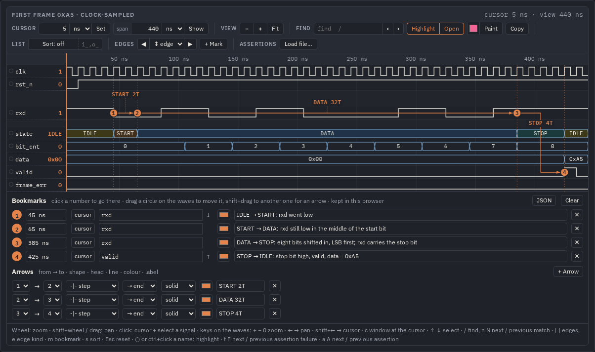

### Colours per signal, per group, per module

Colour is the quickest way to read a bus. Give every **channel** of a protocol its own colour — for AXI4-Lite the
address-write, write-data, write-response, address-read and read-data channels, for AXI4 the same plus the IDs and
bursts, for AXI-Stream the `TVALID TREADY TDATA TLAST` group of each port — or one colour per **module** of a generated
page. A group's colour goes to its signals (trace, bus outline, name) and to its name; a signal with its own colour keeps
it.

```json
"group":  { "aw": ["AWVALID", "AWREADY", "AWADDR"], "w": ["WVALID", "WREADY", "WDATA", "WSTRB"], "b": ["BVALID", "BREADY", "BRESP"],
            "ar": ["ARVALID", "ARREADY", "ARADDR"], "r": ["RVALID", "RREADY", "RDATA", "RRESP"] },
"config": { "groupColors": { "aw": "#339af0", "w": "#37b24d", "b": "#f59f00", "ar": "#ae3ec9", "r": "#1098ad" } }
```

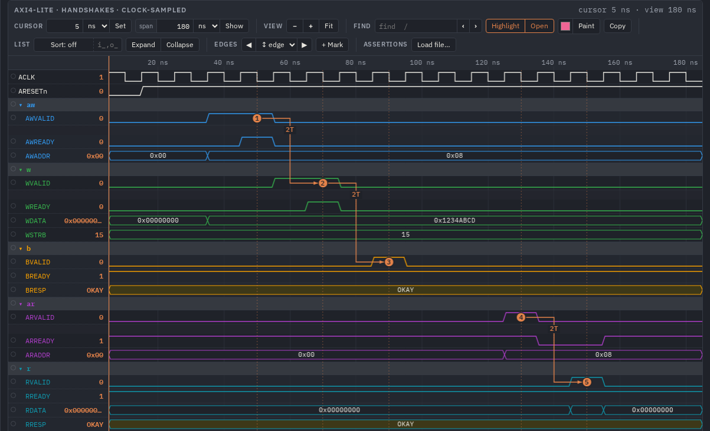

`groupColors` keys are group names, full paths or `*` patterns, and the nearest matching group wins:
`{"s_axis": "#339af0", "m_axis": "#37b24d"}` for two stream ports, `{"tb.dut.u_rx": "#37b24d", "*fifo*": "#f59f00"}`
for modules of a generated config (the hierarchy picture below). One signal: `"color"` in its entry of a generated config,
`"color"` / `"stroke"` and `"fill"` in WaveJSON. Many signals by name: a rule in `tools/base.config.json`, e.g.
`{"match": ["*_valid", "*_ready"], "width": 1, "color": "#f59f00"}`, colours them in every config `mkconfig.py` writes.
Interactively: find the signals and **Paint** them (see *Fuzzy find*).

### Settings

Colours, sizes, fonts, line widths, sorting, folding and highlight are *settings*, merged in this order (later wins):

1. built-in defaults (`WaveFW.defaults`)
2. global: [`wavefw/wavefw.config.js`](../wavefw/wavefw.config.js) loaded before `wavefw.js` (every key with its default),
   or `WaveFW.configure({…})` at run time; for a generated page, the top-level `"config"` of the config file
3. the diagram's `"config"` object in the WaveJSON (a view's `"config"`)
4. the element: `data-config='{…}'`, `data-sort`, `data-theme`, `data-colors`, …, or the constructor options

| Key | Default | Meaning |
|---|---|---|
| `theme`, `colors` | auto, `{}` | `light`, `white`, `dark`; colour tokens (see *Themes*) |
| `rowHeight`, `groupHeight`, `spaceHeight`, `headerHeight` | 26, 22, 14, 24 | row heights, px |
| `nameWidth`, `fontSize`, `labelSize` | 200, 11.5, 11 | name column, name text, bus labels, px |
| `fontMono`, `fontBody` | IBM Plex | CSS font-family lists |
| `traceWidth`, `busWidth` | 1.4, 1.2 | line widths, px |
| `sort`, `sortIgnore` | `none`, `[]` | `none \| asc \| desc`; name prefixes skipped when sorting (`["i_", "o_"]`) |
| `sortButton`, `hint` | true, true | show the Sort controls / the help line |
| `style` | `auto` | edges: `wavedrom` (slanted), `questa` (vertical, narrow bus crossings), `square`; `auto` slants wave strings and draws exact `tv` transitions vertically |
| `radix` | `auto` | bus values from `tv`: `auto` (≤ 6 bits decimal, else hex) `hex dec signed bin oct ascii` |
| `fold` | none | groups folded at start: `true`, a nesting depth (`2`), or group paths |
| `groupOrder` | `file` | inside a group: `last` = signals first, then sub-modules; `first`; `file` |
| `moduleShading` | true | neighbouring modules alternate between two backgrounds; module rows bold |
| `maxHeight` | none | e.g. `"80vh"`: the rows scroll inside the viewer (any number of rows) |
| `groupColors` | none | one colour per group: `{"aw": "#339af0", "tb.dut.u_rx": "#37b24d"}` (names, paths, `*` patterns) |
| `highlight`, `dim` | none, 0.3 | instances in front at start (paths, names, `*` patterns) and the opacity of the rest |
| `findHighlight`, `findOpen` | true, true | starting state of the find options |
| `arrowLabels`, `laneHeight` | `lane`, 16 | arrow labels in a lane of their own between the signals, or `overlay` |
| `svaSignals`, `svaShow` | `view`, all | assertion groups: repeat the bound signals under the steps (`view`: in viewers, `true`: also in static SVGs, `false`); which assertions are drawn (labels, `*` patterns) |

### Themes

Three themes — `light` (warm paper), `white` (black traces, for print and slides) and `dark` — chosen by
`prefers-color-scheme` or set with `<html data-theme="white">`, `WaveFW.setTheme('dark')`, the page's theme button, or
`"config": {"theme": …}`. Every colour is a CSS custom property: `WaveFW.setColors({trace: '#c00', bus: 'navy'})` for all
waves, `data-colors` / `"config": {"colors": …}` for one wave, `"color"` / `"fill"` for one signal. Details:
[`docs/index.html` § Themes](index.html#themes). The pictures in this guide are dark; the same APB view in `light`:

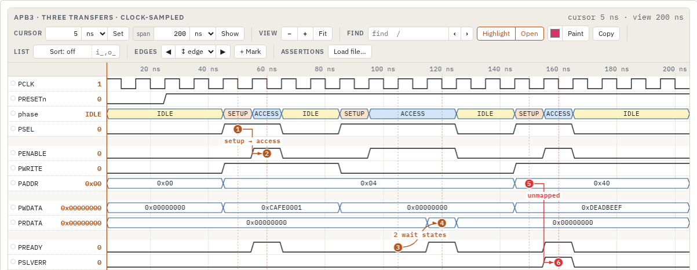

### Static SVG for documents

A view with `"render": "svg"` (or `data-mode="svg"`, `<script type="WaveDrom">`, `WaveSVG.toString(model)` for a file)
is drawn as an inline SVG in the WaveDrom look, with the same bookmarks and arrows and a legend of the bookmark texts.
It follows the page theme, or paints its own background when it has one.

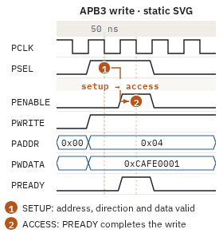

### Large dumps

`test_stream_video.vcd` (24 MB, 3520 signals in 214 scopes, 4.9 M value changes): the config in 2.7 s, a page with every
changing signal (1526 signals, all 9 scope levels) in 25 s and 6.3 MB; it opens in 2 s and redraws in 4 ms. The viewer's
canvas only covers the visible rows, so any number of rows scrolls smoothly. Above `select.budget` value changes
(6 M) `mkconfig.py` hides the deepest levels first and says which depth it kept.

## Assertions (SVA)

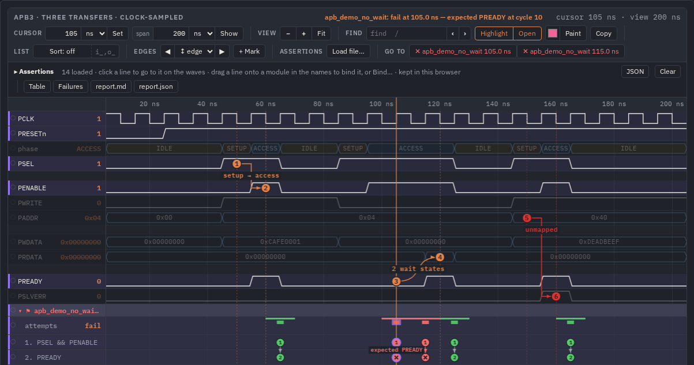

SystemVerilog assertions are checked against the waves of a page: bind an assertion to an instance of the waveform and
it is evaluated over the dump, in the page (WebAssembly) or when the page is built (the `sva` CLI, Rust). Every attempt
is drawn under that instance — a bar from its start to its end, a numbered circle per sequence step, arrows between the
steps, a red ✕ where it failed — and the panel above the waves counts them. The same numbers come out as Markdown,
JSON, JUnit XML or an HTML section for CI and documents.

**The subset.** Concurrent `assert` / `assume` / `cover property` with clocking (`@(posedge clk)`, `default clocking`),
`disable iff`, implications `|->` `|=>`, delays and ranges `##n` `##[m:n]` `##[m:$]`, repetitions `[*n]` `[*m:n]`
`[->n]` `[=n]`, `and or intersect within throughout first_match`, `not`, `if`/`else`, `nexttime always eventually
s_eventually`, the sampled-value functions (`$rose $fell $stable $past $changed`, `$onehot $onehot0 $isunknown
$countones`), named `sequence` / `property` with arguments, packages, enums, parameters, macros, `` `ifdef `` — in
modules, checkers, interfaces and programs. Values are 4-state; signedness is unsigned (with a warning). Not in it:
`until` and friends, local variables, multi-clock properties, `accept_on` / `reject_on`, immediate assertions. The
full list: [`docs/sva/LANGUAGE.md`](sva/LANGUAGE.md); the evaluator:
[`docs/sva/ENGINE.md`](sva/ENGINE.md).

**Load and bind.** List the files in the config and bind assertions to instances (`"assert"` may be a pattern):

```json
"sva": ["rtl/checks_pkg.sv", "checks/apb.sva"],
"bind": [{ "assert": "a_req_ack", "scope": "tb.dut.u_apb" }, { "assert": "apb_*", "scope": "tb.dut.u_apb" }]
```

or on the command line: `make html WAVES=x.vcd SVA="checks/*.sv" BIND="a_req_ack@tb.dut,apb_*@tb.u_apb"`.
`make config WAVES=x.vcd SVA="checks/*.sv"` (`mkconfig.py --sva`) writes the `"bind"` lines for you: one per assertion and
instance in which every signal resolves, `"show": true` when there is only one such instance (else choose); run again,
it keeps your choices, the lines and keys you wrote and the other files of `"sva"` (a mistyped `SVA=` stops `make`).
`mkhtml.py` parses the files (`sva parse --json`; errors become a note in the page, not a failed build) and evaluates
every binding over the dump, so the page opens with them bound and drawn. In the page every viewer has an **assertions**
group in its bar (**Load file…** reads more `.sv` / `.sva` files into this browser) and a panel under the bar: one line
per assertion with its label, kind, property, signals and binding — *unbound*, *bound to tb.dut.u_apb* with its counts,
or *cannot bind* with what is missing. Drag a line onto a module in the names column (the modules that have all its
signals turn green; the others fade and say what they miss), or press **Bind…** for the list. Names resolve by one rule
everywhere (the page, `mkconfig.py --sva`, `sva eval --resolve scope`): the exact name in the instance, then the shown
name (`alias`), then the name without the `sortIgnore` prefixes (`valid` finds `s_valid`), `u_fifo.full` below it; only
the clock may come from a scope above; a select wider than the signal does not bind; two signals equal without the
prefixes (`i_valid`, `o_valid` for `valid`) are an error naming both, not a guess (the build passes the view's shown
names to `sva eval --alias`, so the three really agree). **Evaluate** runs it again (in a
Web Worker when it is long), **Unbind** and **✕** remove things. Loaded files, bindings and small results are kept in this
browser (**Clear** forgets them); the panel's **JSON** button gives the `"bind"` list for the config. `"sva": false` or
`mkhtml.py --no-sva` leaves the engine (`sva.js` + `sva.wasm.js`, ~330 kB) out of a page and evaluates nothing. A
loaded file the engine cannot read is an error line in the panel and is not kept; the page's own assertions go on.

**On the waves**, every bound assertion is a group directly under its instance (the top of the diagram for the view's
own scope): **⚑ a_req_ack · 40 pass · 2 fail**, red when it fails, foldable, found by its name and step labels,
highlighted and copied (`a_req_ack@tb.dut`) like a module. Inside:

- **attempts**: a bar per attempt — green pass, red fail, grey disabled, striped active, hatched grey capped (no
  verdict); three rows, more merged with a count — under a thin strip with one mark per cycle, so failures are red
  ticks even with the whole dump in view. The value column shows the attempt at the cursor; a tooltip its start → end times, cycles and note.
- one row per **step** of the sequence (`1. req`, `2. ##[1:3] ack`): a numbered circle at every match (a dot where they crowd), a red ✕ where an
  attempt failed. The step's role (antecedent, consequent, condition) is in the static figure's legend.
- **arrows** along an attempt's steps with the cycles between them (`2T`), a dashed red one to the failure with the
  reason (`no ack within [1:3]`): for every attempt on screen when there are fewer than 20, else for the selected one; a long trace kept in part
  shows its cut as a grey dashed `… nT (trace cut)`.
- the **bound signals** again (`= req`; `"svaSignals": false` leaves them out).

**Click a line of the panel** to go to that assertion: its group opens on the waves with its first failure (else its
first pass) selected at the zoom you have, the attempt in the middle of the window; click again for its next one,
`a` / `A` on the waves for the next / previous assertion. Click a bar or a circle, a failure in the panel, one of the failure buttons in **go to** (at most six) or press `f` /
`F`: the attempt is **selected** — the cursor at its start, the view moved to it at the same zoom, its circles and arrows in front, the
signals it read highlighted; Esc clears it. With more than three assertions at one place the ones without failures
start folded; `"svaShow": ["apb_*"]` limits which are drawn. A `"render": "svg"` view draws the same rows with every
attempt's arrows and a legend of the steps.

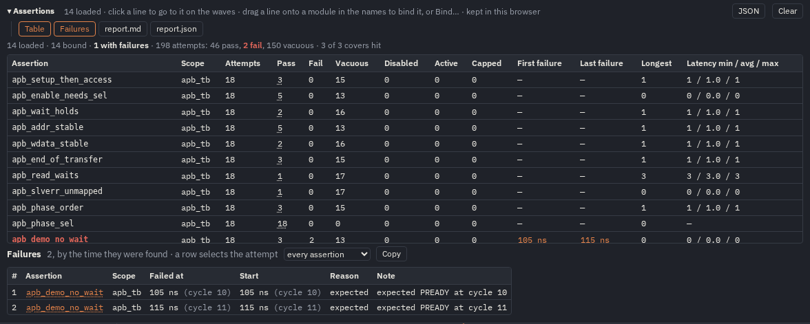

**Numbers.** The panel's totals line counts the view's bindings (loaded, bound — evaluated ones, with the ones that
cannot bind or failed —, with failures, attempts, pass, fail …).
**Table**: one row per binding — attempts, pass, fail, vacuous, disabled, active, capped, first and last failure (links),
the longest attempt and the antecedent → consequent latency (min / avg / max cycles over the passing attempts; what a
handshake check is about), cover hits, the notes (thread limit, values cut to 64 bits). **Failures**: every failed attempt by the time it was
found, with its reason, filtered by assertion, **Copy** as text; a row selects the attempt; the first 500 are listed
(the filter and the downloads have the rest). A click on a count (*2 fail*) shows only those attempts in the lane and
lists them under the line (the first 200). **report.md** and **report.json** download the tables and the results of every binding.

**Reports.** The page built by `mkhtml.py` ends with a printable **Assertions** section (the bindings over the whole
dump). From the command line:

```sh
sva eval --waves x.fst --scope tb.dut --sva checks.sva --report report.md --junit report.xml   # exit 1 on a failure
sva eval --waves x.fst --scope tb.dut --sva checks.sva --report nightly.json                   # results + meta
sva report report.json nightly.json --md report.md --junit report.xml --html report.html        # several runs
make sva-eval WAVES=x.fst SVA="pkg.sv checks.sva" SCOPE=tb.dut ARGS="--junit report.xml"         # a CI gate
```

`--report` writes Markdown (`.md`), HTML (`.html`), JUnit (`.xml`) or the results with the meta (`.json`, the form of a
page's report.json; `sva report --json` writes the summary) by its extension. JUnit has one test case per assertion:
a failure, an error when attempts had no verdict (capped: the thread limit, `--max-threads N`), skipped when not
evaluated or a cover never hit. The texts list at most 20 failures per assertion (`--max-failures N`, 0 = all; the
JSON has every one); over several files a Source column tells the runs apart. Exit status: 0 everything evaluated
passed, 1 a failure or an attempt without verdict, 2 nothing checked as asked (a syntax error, no assertion, a signal
or a file that is not there). Colours of the
drawing: `sva-pass`, `sva-fail`, `sva-disabled`, `sva-active`, `sva-capped`, `hl8` in `colors`. The results of a binding
are in `view.sva.bindings[i].results` (the results JSON of [`docs/sva/ENGINE.md`](sva/ENGINE.md)).

## The viewer

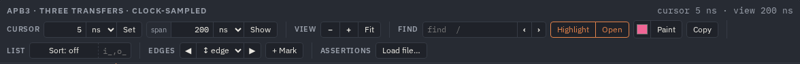

The bar has a title line (title, short messages, cursor and view span) and the tools in groups: **cursor** (a time and
its unit, **Set**; a span, **Show** = that window around the cursor), **view** (− + Fit), **find** (field, count, ‹ ›,
Highlight / Open, colour + Paint, Copy), **list** (Sort and the ignored prefixes, Expand / Collapse, clear highlight),
**edges** (◀ edge kind ▶, + Mark) and **go to** (marker jumps). Keys work once the waves have the focus (a click on the
waves or on a name); with ctrl, alt or ⌘ held they stay the browser's (ctrl+S saves the page, it does not sort), except
ctrl+C:

| Key | Action | Key | Action |
|---|---|---|---|
| wheel, pinch, `+ − 0` | zoom by how far the wheel turned (a notch ×1.22, a trackpad smoothly), fit | shift+wheel, a sideways swipe, drag, `← →` | pan by the pixels moved |
| click | cursor (on a round time at the zoom) + select the signal | `↑ ↓` | select the previous / next signal (in the names column too) |
| shift+`← →` | move the cursor a hundredth of the view | the pointer on a signal | its value there, the change into it and the next one (tooltip) |
| `c` | window of the current span at the cursor | `[ ]`, `e` | previous / next edge, edge kind |
| `/`, `n N` | find, next / previous match | `m` | bookmark at the cursor |
| `s` | sort off → A→Z → Z→A | ctrl+C | while searching: end the search; else copy the selected signal (or the highlighted ones) |
| ○ or ctrl+click a name | highlight the signal or instance | Esc | reset: no search, highlight or selection |
| `f F` | next / previous assertion failure (`sva.js`) | click a bar or circle | select an assertion attempt |
| `a A` | next / previous assertion: its first failure, else its first pass | click a line of the assertions panel (again: its next attempt) | go to an assertion |

**Hierarchy and module shading.** With `"hierarchy": true` (generated configs) every scope is a group: module rows are
bold on a darker band, the signals of neighbouring modules alternate between two backgrounds, a click on a module folds
it, **Expand** / **Collapse** open or fold all. Hover a name for its full path. With `groupColors` each module has its
own colour (here `u_master`, `u_slave`, `u_regfile`; the clocks keep the green of a `*clk` rule).

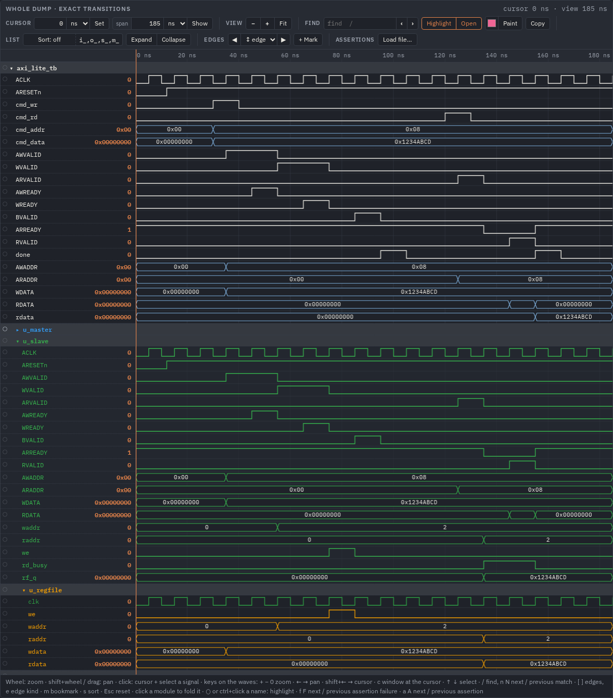

**Highlight.** The ○ mark in front of a name (or ctrl+click) puts that signal or whole instance in front in its own
colour; the rest is dimmed but stays visible. Several instances at once; **Highlight: N ✕** or Esc clears it.
`"highlight": ["tb.dut.u_tx"]` in `"config"` starts a page that way.

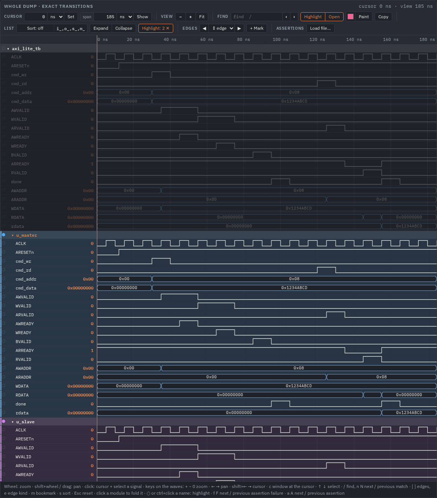

**Fuzzy find.** The find field (`/`) matches the typed letters in order anywhere in a name, as fzf does: `awvd` finds
`AWVALID`. A word with a `.` runs over the full path (`dev.fifo`), words separated by spaces must all match. Matched
letters are underlined; Enter, ‹ › or `n N` step through the matches, each scrolled to the middle of the waves. **Highlight** dims the rest, **Open** folds every
module without a match, **Paint** colours the found signals (kept in the browser), **Copy** copies their paths.

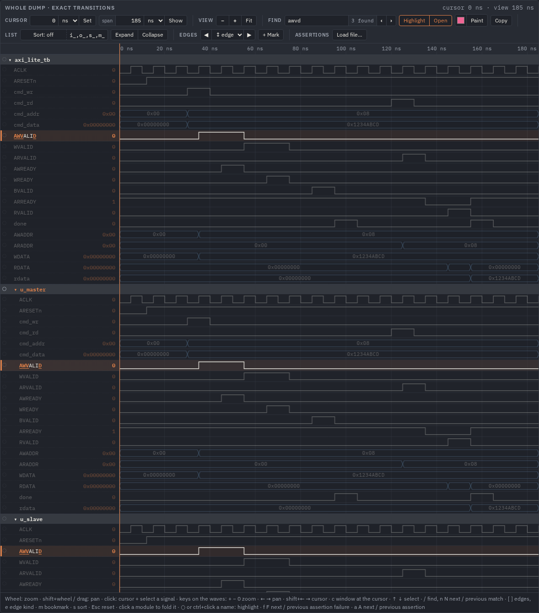

**Edges and the cursor fields.** Select a signal (click its name or its row), then ◀ ▶ (`[ ]`) jump to its previous /
next edge of the kind chosen between them (any, rising, falling; every value change on a bus). The cursor field takes a
time (`1.2us` wins over the unit list) and **Set** moves the cursor there; the span field and **Show** give a window of
that width around the cursor. Cycle diagrams count in cycles.

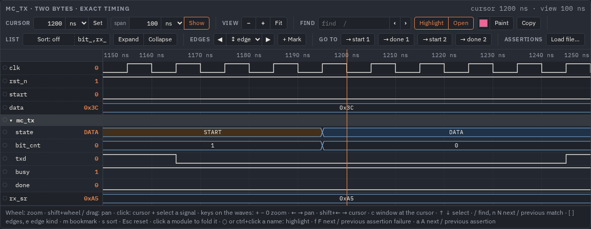

**Bookmarks and arrows.** **+ Mark** (`m`) puts a numbered bookmark on the selected signal at the cursor, snapped to an
edge. Below the waves each bookmark has a time, a signal, a colour and a text; drag a circle to move it, shift+drag from
one circle to another to draw an arrow (shape `- ~ -~ ~- -| |- -|-`, head, line, colour, label). Labels get a thin
lane of their own between the signals. Bookmarks are kept in the browser; **JSON** gives the `"bookmarks"` and
`"arrows"` lists to paste into a config, so the built page (and its static SVG) carries them. The AXI-Lite picture
above shows arrows between handshakes with the latency as the label.

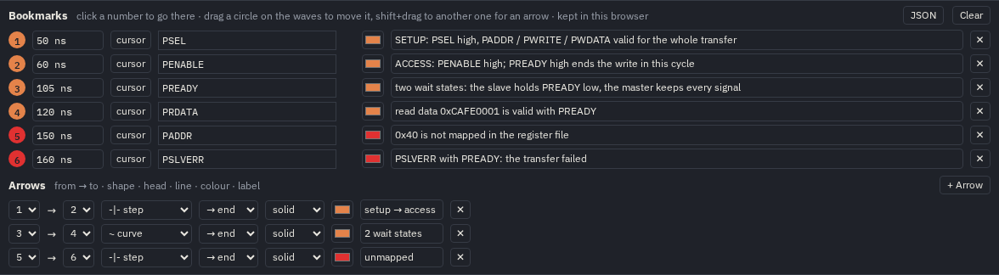

**Sorting.** **Sort** (`s`) cycles off → A→Z → Z→A; the prefixes in the field next to it (`i_,o_`) are skipped when
names are compared and drawn dimmed. Groups move as a block and are sorted inside.

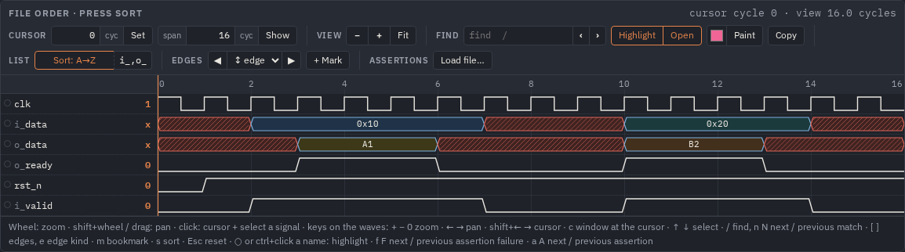

**Copying names and Esc.** Names selected with the mouse copy as full paths, one per line; the find group's **Copy**
copies the found rows. With no search running, ctrl+C on the waves copies the selected signal (or the highlighted
ones); during a search it ends the search. Esc anywhere in the viewer clears the search, the highlight and the
selection; the time window stays, and after a search with **Open** the modules are folded as they were before it, with
the way to the match you stepped to kept open and that row where it was on the screen (if you folded or opened a module
during the search, your folding stays instead).

**The cursor and the readouts.** The cursor reads exactly at any zoom (`cursor 1.234567 µs`), and a click puts it on a
round time of about a pixel at the zoom you have; bookmark times show every digit too. A long value (a 32-bit bus in
`bin`) is cut to half the names column, its tooltip has it all. **Print** draws every row of every viewer (not only the
part in view) with its title and cursor readout; the bar's tools are left out.

## Examples

Each directory in [`examples/`](../examples) has a testbench, a hand-written config and a README; `make example EX=<ex>`
builds its VCD, FST and two pages: `<ex>.html` from the config and `<ex>_all.html` from a config that `mkconfig.py` makes
from the dump (the whole hierarchy).

| Example | What it shows | Picture |
|---|---|---|
| [`apb`](../examples/apb) | APB3 write, read with two wait states, `PSLVERR` on an unmapped address; enum `phase`; a static-SVG view | [hero](img/hero.png), [light](img/light.png), [svg](img/svg.png) |
| [`axi_lite`](../examples/axi_lite) | AXI4-Lite write (`AWREADY` a cycle late) and read; channel groups with a colour each, highlight from the config, latency arrows; three module levels in `_all` | [axi](img/axi.png), [hierarchy](img/hierarchy.png) |
| [`fsm`](../examples/fsm) | UART receiver with `typedef enum` states in a package: names from the FST and, for the VCD, from the sources; questa edges | [fsm](img/fsm.png) |
| [`demo`](../examples/demo) | the Manchester transmitter behind [`docs/index.html`](index.html) (`make demo`) | [cursor](img/cursor.png) |

## Tools

All tools are `python3 -I tools/<tool>.py --help`; the Makefile calls them for you.

| Tool | Does | Main options |
|---|---|---|
| `mkconfig.py` | dump → editable config with every signal | `DUMP`, `--out`, `--update`, `--force`, `--base`, `--depth`, `--sv FILES`, `--sva FILES`, `--sva-bin` |
| `mkhtml.py` | config (every view) or WaveJSON files → one self-contained page | `--config`, `--view`, `--waves`, `--render`, `--out`, `--sva FILE`, `--bind NAME@SCOPE`, `--sva-bin`, `--no-sva`, `--reproducible` |
| `vcd2wavedrom.py` | one window of a dump → WaveJSON | `--config` + `--view`, or `--waves --scope --signals --clock/--exact --from --to --marker --group --enum`; `--sva FILE --bind NAME@SCOPE` |
| `svabuild.py` | the `"sva"` / `"bind"` of a config: files parsed, bindings evaluated with the `sva` CLI (used by the two above) | `--waves --sva --bind --out` |
| `embed.py` | WaveJSON → `data.js` for `file://` pages, or into an HTML placeholder | `--var NAME key=file.json`, `--html --placeholder` |
| `dumpscan.py`, `wavejson.py` | the built-in dump reader (VCD text, FST via `fst2vcd -e`) and the readable JSON writer | modules |

`vcd2wavedrom.py` has two readers with byte-identical output: the built-in one (default) and wavepeek
(`--reader wavepeek`, `READER=wavepeek`), which also takes any wavepeek `--on` expression as a marker.

A page from `mkhtml.py` carries everything it needs except its fonts: it asks Google Fonts for IBM Plex Sans and Mono.
Offline it uses a locally installed IBM Plex (Debian / Ubuntu: `fonts-ibm-plex`), else `Segoe UI` / `system-ui` and the
system monospace; the page works the same, only the letters differ. The header's **Generated** time makes every build
a different file: `mkhtml.py --reproducible` leaves it out, `SOURCE_DATE_EPOCH` (seconds, UTC) sets it, so the same
inputs give the same bytes.

## Formats

### WaveDrom subset

| Feature | Notes |
|---|---|
| `0 1` | levels with soft (slanted) edges |
| `h l` / `H L` | levels with sharp edges / plus an edge arrow |
| `p n` / `P N` | clocks (rising / falling at cell start) / plus an arrow |
| `x` | hatched, drawn in `--wave-x` (stock WaveDrom uses black) |
| `z` | mid-level line in `--wave-z` |
| `u d` | pull-up / pull-down, dashed |
| `=` `2`–`9` | bus segments with `data` labels (array or space-separated string); 3–9 use fill tokens `--wave-c3…c9` |
| `.` `\|` | extend; extend + gap mark |
| `period`, `phase` | per signal; a positive phase is clipped at cycle 0 like stock |
| `node`, `edge` | shapes `- ~ -~ ~- -\| \|- -\|-`, arrows `<` `>`, `+`; labels; lowercase nodes are labelled |
| groups `["name", …]`, `{}` | nested groups are header rows (foldable in the viewer, bracketed in SVG) rather than stock's rotated labels |
| `head.text/tick/every`, `foot.text/tock`, `config.hscale` | |

Not supported: `<…>` sub-cycles, `reg` diagrams, skins, JsonML styling inside text (only the text is used). Unknown wave
characters are treated as `.`. [`tests/conformance.html`](../tests/conformance.html) draws every case next to stock
WaveDrom 3.5.0.

### Extensions (stock WaveDrom ignores them)

| Key | Meaning |
|---|---|
| `time: {t0, cycle, t1?, skip?}` | cycle *c* starts at `t0 + c·cycle` ps, so the axis shows real time; `skip: [[k, n]]` = the `\|` cell at index *k* stands for *n* cycles |
| `signal[i].tv: [[t, v], …]` | exact transitions in model time (ps when `time` is set). 1-bit: `0 1 x z`; bus: hex. Takes precedence over `wave` |
| `signal[i].width / enum / radix / style / color / fill` | bus width, value labels (`{"0": "IDLE"}`), radix, edge style, colours |
| `signal[i].path`, `same` | full hierarchical path (the name's tooltip); `"same": "tb.clk"` = the `tv` of the signal with that `path` (one net seen at several levels is stored once) |
| `config: {…}` | the settings of this diagram (see *Settings*) |
| `bookmarks: [{n, t, signal, text, color}]` | numbered events on signal rows (`signal` = full path, `group.name` without one; `t` in model units or `"85.12us"`) |
| `arrows: [{from, to, shape, head, line, color, label}]` | arrows between bookmarks: shape `- ~ -~ ~- -\| \|- -\|-`, head `> <> <` or `""`, line `solid dashed dotted` |
| `markers: [{t \| cycle, label}]` | dashed markers; they become jump buttons when there are ≤ 6 and no `jumps` |
| `jumps: [{t \| cycle, span, label}]`, `cursor` | jump buttons and the initial cursor |
| `sva: {files?, bind, notes?}` | assertions (`wavefw/sva.js`): `files: [{name, path, source, parsed?}]` (`parsed`: `sva parse --json`, else the page parses), `bind: [{assert, scope, results?}]` (`scope` an instance path, `""` the top of the diagram; `results` from `sva eval`, else evaluated when the page opens) |
| `meta.scope` | the converter's `--scope`: the instance the top rows belong to |
| `signal[i].width`, `raw` (clock-sampled) | a bus's width, and the hex value of each `data` label when the labels do not read back as values (`bin` `signed` `oct` `ascii` radix, x digits): what the page's assertions sample |

A page made by `mkhtml.py` holds the assertion files once, in `window.SVA = {files: [...], notes: [...]}` (before
`wavefw/sva.wasm.js` and `wavefw/sva.js`); each view keeps its own `sva.bind`.
