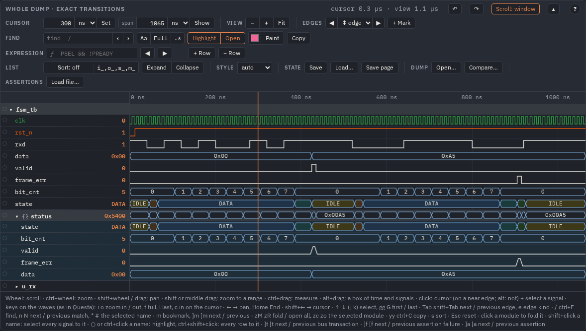
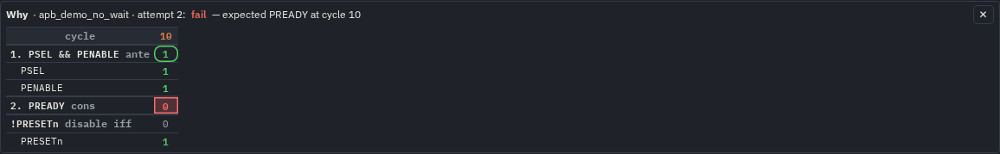
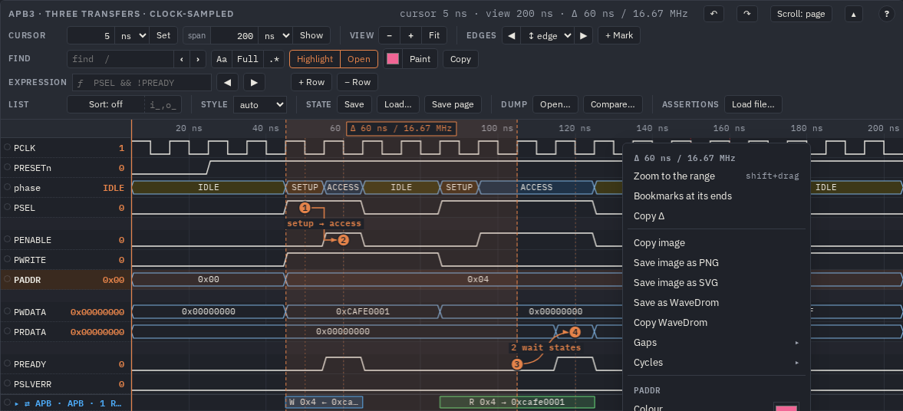
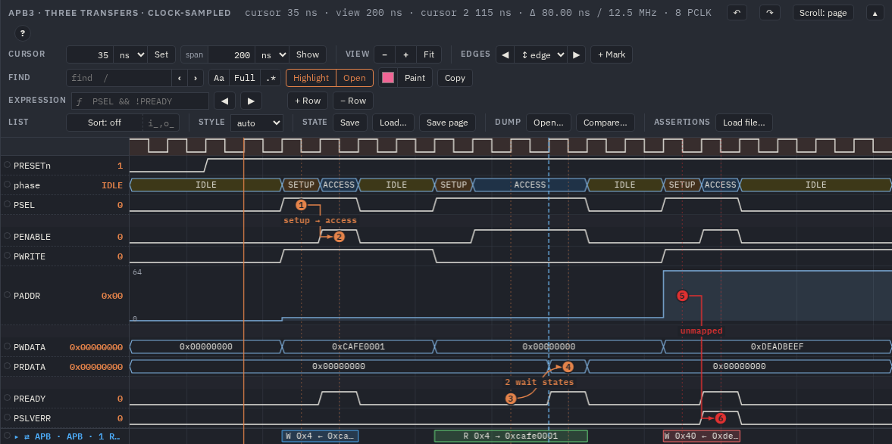
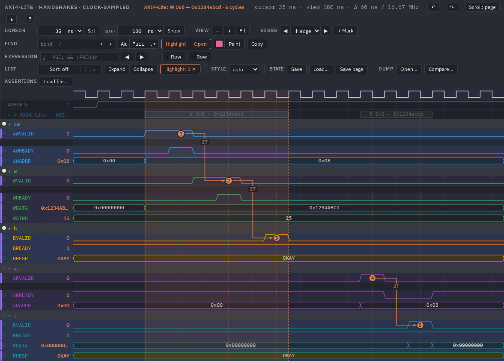

# Using wavefw

The user's guide: WaveDrom JSON in your own page, a dump to a page, the generated config, settings, themes, the static
SVG, assertions, the viewer's tools and keys, the command-line tools and the formats. The short overview is the
[README](../README.md); the reference with live examples is [`index.html`](index.html) (open it from `file://`); how the
project is built and tested is [DEVELOPMENT.md](DEVELOPMENT.md). The same features step by step, with pictures: the
[guides](guides/index.html) (the viewer, gaps, assertions, bus transactions, WaveDrom, AI agents).

Contents: [Use cases](#use-cases) · [Assertions (SVA)](#assertions-sva) · [The viewer](#the-viewer) ·
[Commands and edits](#commands-and-edits) · [AI agents (MCP)](#ai-agents-mcp) · [Tools](#tools) · [Formats](#formats)

## Use cases

### A dump straight in the browser

Open `wavefw/viewer.html` from the repository (`file://`, no build) and drop a VCD on it, or **Open…** in the **dump**
group of its bar (the last line; every viewer has it, a built page too). The VCD is read in the page: its signals by
scope (struct / union / interface scopes marked), exact transitions; a big one is cut to the `dumpBudget` setting (3 M
value changes: the scope levels nearest the top first; the toast says how many signals). **⟳** reads the file again
after a new simulation and keeps the view (window, cursor, folding, highlight, bookmarks): in Chromium the file is
picked through the File System Access API, so ⟳ reads what is on the disk now. An FST is binary: `sva vcd x.fst --out
x.vcd` (or GTKWave's `fst2vcd x.fst > x.vcd`), or a page with `make html WAVES=x.fst`. A saved state (`.view.json`) dropped on a viewer is loaded.

### WaveDrom JSON in your own page

```html
<link rel="stylesheet" href="wavefw/wavefw.css">
<script src="wavefw/wavefw.js"></script>

<script type="application/wavedrom">          <!-- interactive viewer -->
{ "signal": [ { "name": "clk", "wave": "p....." }, { "name": "d", "wave": "x.34.x", "data": ["A", "B"] } ] }
</script>
<script type="WaveDrom"> {signal: [{name: 'req', wave: '01..0'}]} </script>   <!-- static SVG -->
<div data-wave="DEMO_WAVES.exact" data-lazy></div>                           <!-- from a data .js file, built on demand -->
```

Every element is upgraded when the page loads. `data-mode="svg"` picks the static renderer, `data-from` / `data-to` /
`data-cursor` / `data-title` set the window, `data-lazy` builds the viewer when its `<details>` opens (*lazy cards*, for
pages with many diagrams), `data-config='{"rowHeight": 30}'` sets any setting. JSON from files goes into a data script
with `tools/embed.py` (a page from `file://` cannot `fetch()` it). Attributes and the JavaScript API:
[`docs/index.html` § API](index.html#api).

### A dump to a page in one command

```sh
make html WAVES=work/my.vcd               # makes work/my.config.json if missing, then work/my.html
make html WAVES=work/my.fst               # FST (through fst2vcd, else sva vcd): FSM states named from the dump
make config WAVES=work/my.vcd             # after the dump changed: new signals added, gone ones dropped, edits kept
make html CONFIG=work/dump.config.json    # a config written by hand -> work/dump.html
```

Keep your dumps and configs under `work/`: the configs are tracked, the dumps and pages are ignored by git. The page has
every view of the config, each as a viewer or a static SVG; scopes become foldable groups.

### The generated config, and what you edit in it

`tools/mkconfig.py` lists every signal of the dump under its full path, one line each:

```json
"signals": {
    "tb_cxp_top.app_clk":    {"show": true,  "radix": "", "color": "#2f9e44", "style": "", "width": 1,  "changes": 32123},
    "tb_cxp_top.s_pix_data": {"show": true,  "radix": "", "color": "",        "style": "", "width": 16, "changes": 2189},
    "tb_cxp_top.cxp_device_top_i.cfg.run": {"show": false, "radix": "", "color": "", "style": "", "width": 1, "changes": 2}
}
```

Edit `show` (false = left out), `radix` (`auto hex dec signed bin oct ascii float`, fixed point `q8` / `sq15`), `color`, `style`
(`auto wavedrom questa square`), and add `alias`, `fill`, `enum` (`{"0": "IDLE"}`), `enumColors` (`{"IDLE": "#ffe066", "3": "c5"}`)
or `analog` (`true` or a number of rows: the bus as a step plot), `height` (the row's own height in px), or `fields` (`[{"name": "state", "msb": 15, "lsb": 13, "enum": {…}}, …]`:
a packed struct dumped as one vector, a row per field under a `{}` row with the whole value; `mkconfig.py --sv` writes
them from `typedef struct packed`). A struct scope of the dump (an FST written with Verilator `--trace-structs`) is a
`{}` group by itself, its row the whole value when every field is shown; `""` takes the global value from
`"config"`. `width` and `changes` are information. A VCD's `real` and `string` variables become rows of texts (their
numbers, their strings; a real can be `analog`), `event` variables are left out (no value to draw); VHDL's nine values
are folded into `0 1 x z`.



Next to `signals`: `"config"` (page settings, below), `"page"` (title,
intro), and `"views"` — named variants, each with its own `signals` (patterns such as `"tb.*_valid"`), `from` / `to`,
`clock` (one cell per clock) or `exact`, `group`, `marker`, `bookmarks`, `arrows` and `render` (`view`, `svg`, `both`).
The starting values come from `tools/base.config.json` (`BASE=`): which scope depth starts shown, which paths are hidden,
how many value changes fit on a page, and rules by path pattern and width (`python3 -I tools/mkconfig.py --help`).
The example configs in [`examples/`](../examples) are written by hand and show every key.

### FSM state names: FST, or VCD + sources

An FST written by Verilator (`--trace-fst`) carries the enum tables of the design, so state buses show `IDLE`, `START`, …
straight from the dump. A VCD has none: `make html WAVES=x.vcd SV="rtl/*.sv"` (`mkconfig.py --sv`) reads
`typedef enum {…} name_t;` from the sources and labels the signals declared with those types; or write `"enum"` into an
entry. The FSM example builds both pages.


### Colours per signal, per group, per module

Colour is the quickest way to read a bus. Give every **channel** of a protocol its own colour — for AXI4-Lite the
address-write, write-data, write-response, address-read and read-data channels, for AXI4 the same plus the IDs and
bursts, for AXI-Stream the `TVALID TREADY TDATA TLAST` group of each port — or one colour per **module** of a generated
page. A group's colour goes to its signals (trace, bus outline, name) and to its name; a signal with its own colour keeps
it.

```json
"group":  { "aw": ["AWVALID", "AWREADY", "AWADDR"], "w": ["WVALID", "WREADY", "WDATA", "WSTRB"], "b": ["BVALID", "BREADY", "BRESP"],
            "ar": ["ARVALID", "ARREADY", "ARADDR"], "r": ["RVALID", "RREADY", "RDATA", "RRESP"] },
"config": { "groupColors": { "aw": "#339af0", "w": "#37b24d", "b": "#f59f00", "ar": "#ae3ec9", "r": "#1098ad" } }
```


`groupColors` keys are group names, full paths or `*` patterns, and the nearest matching group wins:
`{"s_axis": "#339af0", "m_axis": "#37b24d"}` for two stream ports, `{"tb.dut.u_rx": "#37b24d", "*fifo*": "#f59f00"}`
for modules of a generated config (the hierarchy picture below). One signal: `"color"` in its entry of a generated config,
`"color"` / `"stroke"` and `"fill"` in WaveJSON. Many signals by name: a rule in `tools/base.config.json`, e.g.
`{"match": ["*_valid", "*_ready"], "width": 1, "color": "#f59f00"}`, colours them in every config `mkconfig.py` writes.
Interactively: find the signals and **Paint** them (see *Fuzzy find*).

### Settings

Colours, sizes, fonts, line widths, sorting, folding and highlight are *settings*, merged in this order (later wins):

1. built-in defaults (`WaveFW.defaults`)
2. global: [`wavefw/wavefw.config.js`](../wavefw/wavefw.config.js) loaded before `wavefw.js` (every key with its default),
   or `WaveFW.configure({…})` at run time; for a generated page, the top-level `"config"` of the config file
3. the diagram's `"config"` object in the WaveJSON (a view's `"config"`)
4. the element: `data-config='{…}'`, `data-sort`, `data-theme`, `data-colors`, …, or the constructor options
5. the viewer's own: the edge style picked in its bar, kept in this browser for that viewer (picking the style the
   settings give drops it)

A key that is no setting (a typo: `rowHeigth`) is an error in the tools and a console warning in the page; the plugins
add theirs (`WaveFW.registerDefaults`).

| Key | Default | Meaning |
|---|---|---|
| `theme`, `colors` | auto, `{}` | `light`, `white`, `dark`; colour tokens (see *Themes*) |
| `rowHeight`, `groupHeight`, `spaceHeight`, `headerHeight` | 26, 22, 14, 24 | row heights, px |
| `nameWidth`, `fontSize`, `labelSize` | 200, 11.5, 11 | name column, name text, bus labels, px |
| `fontMono`, `fontBody` | IBM Plex | CSS font-family lists |
| `traceWidth`, `busWidth` | 1.4, 1.2 | line widths, px |
| `sort`, `sortIgnore` | `none`, `[]` | `none \| asc \| desc`; name prefixes skipped when sorting (`["i_", "o_"]`) |
| `sortButton`, `hint` | true, true | show the Sort controls / the help line |
| `style` | `auto` | edges: `wavedrom` (slanted), `questa` (vertical, narrow bus crossings), `square`; `auto` slants wave strings and draws exact `tv` transitions vertically; the viewer's list in **view** changes it (kept in the browser) |
| `wheel` | `scroll` | the wheel scrolls the rows and ctrl+wheel zooms, as in Questa; `zoom`: the wheel zooms |
| `svaOpen` | false | the assertion list (`sva.js`) open when the page opens; folded: ▸ Assertions opens it |
| `dumpBudget` | 3000000 | a VCD opened in the page (Open…, dropped on a viewer): the signals nearest the top up to this many value changes |
| `busDetect`, `buses` | true, none | bus transactions (`bus.js`): the ports found by their names; ports of your own `[{protocol, scope, prefix, map, clock, name}]` |
| `contextMenu` | true | the right button on the waves: a range and the viewer's menu; false: the browser's |
| `menuTipDelay` | 2000 | ms before a tooltip in that menu shows (the bar's: 350 ms) |
| `cursorSnap` | 8 | px: a click on the waves puts the cursor on an edge of the signal under the pointer this near (alt+click: not); 0 = off |
| `gaps`, `gapIdle`, `gapKeep` | false, 16, 2 | the pictures and WaveDrom saved from the viewer's menu (and static SVGs) leave out the stretches where no signal but a clock changes for `gapIdle`, all but `gapKeep` after the last change and before the next one, a break `\|` in their place; lengths in clock cycles (`16`) or a time (`"2us"`); the menu's **Gaps** rows change them (kept in the browser) |
| `gapSignals`, `gapClock`, `gapAux`, `gapOnly`, `gapCount`, `gapLine` | none, none, none, false, `clock`, `dashdot` | the signals the gaps follow (paths, names, `*` patterns; none: every signal drawn); the clock whose cycles `gapIdle`, `gapKeep` and the texts count (none: the selected clock, else the nearest `*clk*`); the signals counted in a gap (none: every one but those and the clock); the viewer's picture and WaveDrom of those three kinds alone; the texts of a gap: `clock` (under the axis the time left out and the clock's cycles), `edges` (also a thin row under each signal counted with its rising and falling edges in the stretch left out, a bus its changes), `off`; the line of a gap: `dashdot`, `wave`, `waves`, `zigzag`, `double` |
| `radix` | `auto` | bus values from `tv`: `auto` (≤ 6 bits decimal, else hex) `hex dec signed bin oct ascii`, `float` (IEEE 754 of a 16-, 32- or 64-bit bus), fixed point `q<F>` / `sq<F>` (unsigned / signed, F fraction bits: `q8`, `sq15`) |
| `enumColors` | none | the fill of a bus value by its label or number, every signal: `{"ACCESS": "#d0ebff", "3": "c5"}` (a colour, a token, 3–9); a signal's own `enumColors` wins |
| `fold` | none | groups folded at start: `true`, a nesting depth (`2`), or group paths |
| `groupOrder` | `file` | inside a group: `last` = signals first, then sub-modules; `first`; `file` |
| `moduleShading` | true | neighbouring instances alternate between two backgrounds, the panel and a pale blue (`band` in `colors`); module rows bold |
| `maxHeight` | none | e.g. `"80vh"`: the rows scroll inside the viewer (any number of rows); none: with the page, the bar sticking to the top (generated configs: `"80vh"`; the bar's **Scroll** button switches) |
| `toolsFolded` | false | the bar's tools folded to its title line (**▴** / **▾ tools** in the bar) |
| `savePage` | true | the bar's **Save page**: this page as a `.view.html` with your view in it (§ Save and Load); false hides it and keeps no copy of the page's text |
| `cycles`, `cycleClock`, `cycleZero` | false, null, null | the clock cycles in a band under the time axis (§ Clock cycles): on, the clock counted (null: the `*clk*` found), the time of cycle 0 (null: the first rising edge) |
| `groupColors` | none | one colour per group: `{"aw": "#339af0", "tb.dut.u_rx": "#37b24d"}` (names, paths, `*` patterns) |
| `highlight`, `dim` | none, 0.3 | instances in front at start (paths, names, `*` patterns) and the opacity of the rest |
| `findHighlight`, `findOpen` | true, true | starting state of the find options |
| `findCase`, `findWord`, `findRegex` | false | starting state of **Aa** (match case), **Full** (whole name; `a.b`: the end of the full path), **.\*** (a regular expression) |
| `arrowLabels`, `laneHeight` | `lane`, 16 | arrow labels in a lane of their own between the signals, or `overlay` |
| `svaSignals`, `svaShow` | `view`, all | assertion groups: repeat the bound signals under the steps (`view`: in viewers, `true`: also in static SVGs, `false`); which assertions are drawn (labels, `*` patterns) |

### Themes

Three themes — `light` (warm paper), `white` (black traces, for print and slides) and `dark` — chosen by
`prefers-color-scheme` or set with `<html data-theme="white">`, `WaveFW.setTheme('dark')`, the page's theme button, or
`"config": {"theme": …}`. Every colour is a CSS custom property: `WaveFW.setColors({trace: '#c00', bus: 'navy'})` for all
waves, `data-colors` / `"config": {"colors": …}` for one wave, `"color"` / `"fill"` for one signal. Details:
[`docs/index.html` § Themes](index.html#themes). The pictures in this guide are dark; the same APB view in `light`:


### Static SVG for documents

A view with `"render": "svg"` (or `data-mode="svg"`, `<script type="WaveDrom">`, `WaveSVG.toString(model)` for a file)
is drawn as an inline SVG in the WaveDrom look, with the same bookmarks and arrows and a legend of the bookmark texts.
It follows the page theme, or paints its own background when it has one.


### Large dumps

`test_stream_video.vcd` (24 MB, 3520 signals in 214 scopes, 4.9 M value changes): the config in 2.7 s, a page with every
changing signal (1526 signals, all 9 scope levels) in 25 s and 6.3 MB; it opens in 2 s and redraws in 4 ms. The viewer's
canvas only covers the visible rows, so any number of rows scrolls smoothly. Above `select.budget` value changes
(6 M) `mkconfig.py` hides the deepest levels first and says which depth it kept.

## Assertions (SVA)


SystemVerilog assertions are checked against the waves of a page: bind an assertion to an instance of the waveform and
it is evaluated over the dump, in the page (WebAssembly) or when the page is built (the `sva` CLI, Rust). Every attempt
is drawn under that instance — a bar from its start to its end, a numbered circle per sequence step, arrows between the
steps, a red ✕ where it failed — and the panel above the waves counts them. The same numbers come out as Markdown,
JSON, JUnit XML or an HTML section for CI and documents.

**The subset.** Concurrent `assert` / `assume` / `cover property` with clocking (`@(posedge clk)`, `default clocking`),
`disable iff`, implications `|->` `|=>`, delays and ranges `##n` `##[m:n]` `##[m:$]`, repetitions `[*n]` `[*m:n]`
`[->n]` `[=n]`, `and or intersect within throughout first_match`, `not`, `if`/`else`, `nexttime always eventually
s_eventually`, the sampled-value functions (`$rose $fell $stable $past $changed`, `$onehot $onehot0 $isunknown
$countones`), named `sequence` / `property` with arguments, packages, enums, parameters, macros, `` `ifdef `` — in
modules, checkers, interfaces and programs. Values are 4-state; signedness is unsigned (with a warning). Not in it:
`until` and friends, local variables, multi-clock properties, `accept_on` / `reject_on`, immediate assertions. The
full list: [`docs/sva/LANGUAGE.md`](sva/LANGUAGE.md); the evaluator:
[`docs/sva/ENGINE.md`](sva/ENGINE.md).

**Load and bind.** List the files in the config and bind assertions to instances (`"assert"` may be a pattern):

```json
"sva": ["rtl/checks_pkg.sv", "checks/apb.sva"],
"bind": [{ "assert": "a_req_ack", "scope": "tb.dut.u_apb" }, { "assert": "apb_*", "scope": "tb.dut.u_apb" }]
```

or on the command line: `make html WAVES=x.vcd SVA="checks/*.sv" BIND="a_req_ack@tb.dut,apb_*@tb.u_apb"`.
`make config WAVES=x.vcd SVA="checks/*.sv"` (`mkconfig.py --sva`) writes the `"bind"` lines for you: one per assertion and
instance in which every signal resolves, `"show": true` when there is only one such instance (else choose); run again,
it keeps your choices, the lines and keys you wrote and the other files of `"sva"` (a mistyped `SVA=` stops `make`).
`mkhtml.py` parses the files (`sva parse --json`; errors become a note in the page, not a failed build) and evaluates
every binding over the dump, so the page opens with them bound and drawn. In the page every viewer has an **assertions**
group in its bar (**Load file…** reads more `.sv` / `.sva` files into this browser) and a panel under the bar: a table, two
lines per numbered assertion: its **name** and the instance it is **bound to** (*unbound*, the full path — `tb.dut.u_apb`
—, a long one wrapped after its dots) with its buttons, under them its **kind**, its **property** (wrapped at its
operators — `|->`, `|=>`, `##`, `intersect`, `throughout`, `and`, `or`, … — the lines after the first indented; its
tooltip: the file, the line and the signals it needs), the **results** (its counts, or *cannot bind* with what is
missing) and the binding's buttons; the path and the property copy as one line. With several bindings, one line each
under it: the instance, the results, the buttons. Drag a line onto a module in the names column (the modules that have all its
signals turn green; the others fade and say what they miss), or press **Bind…** for the list. Names resolve by one rule
everywhere (the page, `mkconfig.py --sva`, `sva eval --resolve scope`): the exact name in the instance, then the shown
name (`alias`), then the name without the `sortIgnore` prefixes (`valid` finds `s_valid`), `u_fifo.full` below it; only
the clock may come from a scope above; a select wider than the signal does not bind; two signals equal without the
prefixes (`i_valid`, `o_valid` for `valid`) are an error naming both, not a guess (the build passes the view's shown
names to `sva eval --alias`, so the three really agree). **Evaluate** runs it again (in a
Web Worker when it is long), **Unbind** and **✕** remove things. Loaded files, bindings and small results are kept in this
browser (**Clear** forgets them); the panel's **JSON** button gives the `"bind"` list for the config. `"sva": false` or
`mkhtml.py --no-sva` leaves the engine (`sva.js` + `sva.wasm.js`, ~410 kB) out of a page and evaluates nothing. A
loaded file the engine cannot read is an error line in the panel and is not kept; the page's own assertions go on.

**Edit and run again.** Every line of the panel has **✎** and **⟳**, so you can change a check and see it on the waves
without building the page again:

- **✎** opens the assertion's statement (its label to the `;`, the `else $error(…)` with it) under its line. Change it
  and press **Apply** (ctrl+Enter): its file is parsed again in the page and only the bindings of the assertions whose
  text changed are evaluated again — the others keep their results; the attempts, steps and arrows on the waves follow.
  A text that does not parse is not applied: the editor keeps it and says where it stops. The edited file is this
  browser's copy (kept over a reload, marked **edited** on the lines that differ from the page's file);
  **Revert to the page's** in the editor, or **Clear**, brings the page's file back. Copy the text into your source
  when you are happy with it.
- **⟳** reads the assertion's file from the disk again. The first time the browser asks you to pick the file (Chrome /
  Edge keep it: after a reload of the page only the permission is asked again; Firefox and Safari have no such API and
  ask every time); its changed assertions are marked **changed** and evaluated again.
- **Watch** (in the panel's header, Chrome / Edge) checks every second the files read with ⟳: save one in your editor
  and the page parses it and evaluates its bindings again by itself.

The static SVG figures of a page keep the results the page was built with.

**On the waves**, every bound assertion is a group directly under its instance (the top of the diagram for the view's
own scope): **⚑ a_req_ack · 40 pass · 2 fail**, red when it fails, foldable, found by its name and step labels,
highlighted and copied (`a_req_ack@tb.dut`) like a module. Inside:

- **attempts**: a bracket per attempt, `┌──┐` from its first to its last cycle, so its start and end are plain — green
  pass; a failure green up to its last matched step and red from there to where it failed; grey disabled; an active
  (not ended) or capped one open at its end, striped; where attempts crowd, a bar; three rows, more merged with a count — under a thin strip with one mark per cycle, so failures are red
  ticks even with the whole dump in view. The value column shows the attempt at the cursor; a tooltip its start → end times, cycles and note.
- one row per **step** of the sequence (`1. req`, `2. ##[1:3] ack`): a numbered circle at every match (a dot where they crowd), a red ✕ where an
  attempt failed. The step's role (antecedent, consequent, condition) is in the static figure's legend.
- **arrows** along an attempt's steps with the cycles between them (`2T`), a dashed red one to the failure with the
  reason (`no ack within [1:3]`): for every attempt on screen when there are fewer than 20, else for the selected one; a long trace kept in part
  shows its cut as a grey dashed `… nT (trace cut)`.
- the **bound signals** again (`= req`; `"svaSignals": false` leaves them out).
- the **selected attempt on the signals**: its numbered circles (and the ✕) on the rows each step reads — the names in
  the step's label, `1. PSEL && PENABLE` on PSEL and on PENABLE — joined by arrows, on the bound signals of the
  instance and on their copies in the group; its **start and end** as dashed lines across the rows with flags in the
  group's band: `▶ start`, and how it ended — `✓ pass`, `✕ fail`, `… not ended` (still active at the end of the dump),
  `⊘ disabled`, `… capped` (one flag, `▶ ✓ pass`, when it starts and ends in one cycle).

**Click a line of the panel** to go to that assertion: its group opens on the waves with its first failure (else its
first pass) selected at the zoom you have, the attempt in the middle of the window; click again for its next one,
`]a` / `[a` on the waves for the next / previous assertion. Click a bar or a circle, a failure in the panel, one of the failure buttons in **go to** (at most six) or press `]f` /
`[f`: the attempt is **selected** — the cursor at its start, the view moved to it at the same zoom, its circles and arrows in front, the
signals it read highlighted; Esc clears it. With more than three assertions at one place the ones without failures
start folded; `"svaShow": ["apb_*"]` limits which are drawn. A `"render": "svg"` view draws the same rows with every
attempt's arrows and a legend of the steps, and the first failure (else the first attempt) of each assertion on its
signals with its start and end flags.

**Why.** With an attempt selected the panel shows **Why**: the assertion's booleans (its steps, an `if` condition,
`disable iff`), each taken apart into its operands (`PSEL && PENABLE` → `PSEL`, `PENABLE`; `$rose(req)` → `req`), one
column per cycle of the attempt (at most 64) with the value of every part — 1 green, 0 grey, x red, buses in hex. A
cell where a step matched is ringed, the one where the attempt failed is red, so the operand that broke it is read off
directly. A cycle's header puts the cursor there; ✕ or Esc closes it.



**Expressions** (the **expression** field in the bar). Any expression of the signals, written as in an assertion —
`PSEL && !PREADY`, `state == pkg::WAIT && timeout`, `addr[7:4] == 4'h3`, `$rose(req)`; `@(posedge PCLK) …` samples it
at the clock's edges like an assertion, without a clock it is valued after every change of its signals. Names are
looked up from the selected signal's module up to the top (or give a full path); package constants come from the loaded
files.
- **Enter** / **shift+Enter**: the cursor to the next / previous time it becomes true, round the ends; the field shows
  which one of how many (`2/3`).
- **+ Row** draws it as a signal in the group **ƒ expressions** under the top (a bus when it is wider than a bit);
  click a row's name to put it back in the field, **− Row** removes it. The rows are kept in this browser, the JSON
  button lists them as `"exprs"`, and a config's `"exprs": ["…", {"expr": "…", "scope": "tb.dut"}]` (or `vcd2wavedrom
  --expr`) puts them in the page, the static SVG included.


**Numbers.** The panel's totals line counts the view's bindings (loaded, bound — evaluated ones, with the ones that
cannot bind or failed —, with failures, attempts, pass, fail …).
**Table**: one row per binding — attempts, pass, fail, vacuous, disabled, active, capped, first and last failure (links),
the longest attempt and the antecedent → consequent latency (min / avg / max cycles over the passing attempts; what a
handshake check is about), cover hits, the notes (thread limit, values cut to 64 bits). **Failures**: every failed attempt by the time it was
found, with its reason, filtered by assertion, **Copy** as text; a row selects the attempt; the first 500 are listed
(the filter and the downloads have the rest). A click on a count (*2 fail*) shows only those attempts in the lane and
lists them under the line (the first 200). **report.md** and **report.json** download the tables and the results of every binding.

**Reports.** The page built by `mkhtml.py` ends with a printable **Assertions** section (the bindings over the whole
dump). From the command line:

```sh
sva eval --waves x.fst --scope tb.dut --sva checks.sva --report report.md --junit report.xml   # exit 1 on a failure
sva eval --waves x.fst --scope tb.dut --sva checks.sva --report nightly.json                   # results + meta
sva report report.json nightly.json --md report.md --junit report.xml --html report.html        # several runs
make sva-eval WAVES=x.fst SVA="pkg.sv checks.sva" SCOPE=tb.dut ARGS="--junit report.xml"         # a CI gate
```

`--report` writes Markdown (`.md`), HTML (`.html`), JUnit (`.xml`) or the results with the meta (`.json`, the form of a
page's report.json; `sva report --json` writes the summary) by its extension. JUnit has one test case per assertion:
a failure, an error when attempts had no verdict (capped: the thread limit, `--max-threads N`), skipped when not
evaluated or a cover never hit. The texts list at most 20 failures per assertion (`--max-failures N`, 0 = all; the
JSON has every one); over several files a Source column tells the runs apart. Exit status: 0 everything evaluated
passed, 1 a failure or an attempt without verdict, 2 nothing checked as asked (a syntax error, no assertion, a signal
or a file that is not there). Colours of the
drawing: `sva-pass`, `sva-fail`, `sva-disabled`, `sva-active`, `sva-capped`, `hl8` in `colors`. The results of a binding
are in `view.sva.bindings[i].results` (the results JSON of [`docs/sva/ENGINE.md`](sva/ENGINE.md)).

## The viewer


The bar has a title line (title, short messages, cursor and view span) and the tools, one line per kind of work.
Time: **cursor** (a time and its unit, **Set**; a span, **Show** = that window around the cursor), **view** (− + Fit),
**edges** (◀ edge kind ▶, + Mark), **go to** (marker jumps, the assertions' failures). Find: the field, **Aa Full .\***,
count, ‹ ›, Highlight / Open, colour + Paint, Copy. Expression (`sva.js`): the **ƒ** field and its rows. Rows and files:
**list** (Sort and the ignored prefixes, Expand / Collapse, clear highlight, show the hidden rows), **style** (the edges:
auto, slanted, vertical, square), **state** (Save, Load…), **assertions** (Load file…). Keys work once the waves have the focus (a click on the
waves or on a name); with ctrl, alt or ⌘ held they stay the browser's (ctrl+S saves the page, it does not sort), except
ctrl+C and ctrl+F. Hover any button, field or list for what it does and its keys; **?** at the right of the title line
(key `?`) opens the box of all the keys and the mouse, the plugins' too.

**Scroll: window / page** in the title line switches where the rows scroll, on the fly (kept in this browser; the
`maxHeight` setting is the start): in a **window** of their own (`80vh` high unless the settings say otherwise), the bar
above them; or with the **page**, the browser's scroll bar — the bar then sticks to the top of the window while its rows
go by, the time axis and the names' header right under it, and leaves with the viewer's end. **▴** folds the tools to
the title line (title, cursor, the buttons), **▾ tools** opens them again; `/` and ctrl+F open them for the find
field. Navigation follows Questa's wave window, the lists and the text vim: a sequence (`gg`, `zM`, `yy`,
`]f` …) is two keys within a second.

| Key | Action | Key | Action |
|---|---|---|---|
| wheel | scroll the rows (as in Questa; `"wheel": "zoom"`: zoom) | ctrl+wheel, pinch | zoom at the pointer by how far it turned (a notch ×1.22) |
| shift+wheel, a sideways swipe, drag, `← →` | pan | shift+drag, middle-button drag | zoom into the range dragged over |
| ctrl+drag | measure a range: its ends on the edges of the signal under the pointer, Δ on the axis and in the readout; ctrl+click clears it | right button (drag or click) | the same range, then the menu: zoom, bookmarks at its ends, copy Δ, copy / save the picture (PNG, SVG); the colour, radix, highlight, hiding, folding of the row under it |
| `i` `+` / `o` `-` | zoom in / out | `f` / `l` | zoom full / last (the window before the last zoom) |
| `c` | zoom in on the cursor (half the span, the cursor in the middle) | `Home` / `End` | the start / end of the dump |
| click | cursor (on an edge of that signal within 8 px, else a round time at the zoom; alt+click: no edge) + select the signal | `↑ ↓`, `j k` | select the previous / next signal (in the names column: the arrows) |
| `gg` / `G` | select the first / last signal | `PgUp PgDn` | scroll the rows a page |
| `Tab` / shift+`Tab` | the next / previous edge of the selected signal (as in Questa; ◀ ▶, `]e [e`) | `e` | edge kind (any, rising, falling, **= value**, **X / Z**) |
| edge kind **= value** | a field: `0x40`, `'h40`, `8'd64`, `64`, `-3`, `'b101`, a literal with x / z compared bit for bit (`'b10x1`, `8'hx5`: x and z apart) or a text (an enum label: `ACCESS`); Enter / ◀ ▶ / Tab: the next / previous time the selected signal becomes it (none selected: any shown signal) | edge kind **X / Z** | the next / previous x or z (a bus with x / z bits too) of the selected signal or of any shown one: the first X after reset from the reset's edge |
| shift+`← →` | move the cursor a hundredth of the view | the pointer on a signal | its value there, the change into it and the next one (tooltip) |
| `/`, ctrl+F | find (the bar scrolled away: the find group floats over the waves; ✕ or Esc puts it back) | `n N`, `*` `#` | next / previous match; find the selected signal's name and go to its next / previous match |
| `m` | bookmark at the cursor | `]m [m` | the next / previous bookmark |
| shift+click the waves | a second cursor (dashed, on an edge): Δ to the cursor in time, its frequency (`Δ 40 ns / 25 MHz`) and in cycles of the clock (the cycles band's when it is on, else the selected signal's, else the nearest `*clk*`) on the axis and in the readout; `x` swaps the two; Esc clears it | `1` … `9` | go to that bookmark (each bookmark's line shows its Δ from the cursor) |
| `zM` / `zR` | fold / open every module | `zc` / `zo` / `za` | fold / open / toggle the module of the selected signal |
| `yy`, ctrl+C | copy the selected signal (or the highlighted ones); while searching ctrl+C ends the search | `s` | sort off → A→Z → Z→A |
| ○ or ctrl+click a name | highlight the signal or instance; ctrl+shift+click: every row from the last one to it | Esc | reset: no search, highlight or selection |
| shift+click a name | select every signal from the last one clicked to it (selected, nothing dimmed; the tint inside bus values too) | alt+drag | a box: its time the range, the signals it touches selected, then the menu |
| `]f [f` | next / previous assertion failure (`sva.js`) | click a bar or circle | select an assertion attempt |
| `]a [a` | next / previous assertion: its first failure, else its first pass | click a line of the assertions panel (again: its next attempt) | go to an assertion |

**Hierarchy and module shading.** With `"hierarchy": true` (generated configs) every scope is a group: module rows are
bold on a darker band, the signals of neighbouring modules alternate between two backgrounds, a click on a module folds
it, **Expand** / **Collapse** open or fold all. Hover a name for its full path. With `groupColors` each module has its
own colour (here `u_master`, `u_slave`, `u_regfile`; the clocks keep the green of a `*clk` rule).


**Highlight.** The ○ mark in front of a name (or ctrl+click) puts that signal or whole instance in front (the mark
filled, the background as it was); the rest is dimmed but stays visible. Several instances at once; **Highlight: N ✕** or Esc clears it.
`"highlight": ["tb.dut.u_tx"]` in `"config"` starts a page that way.


**Fuzzy find.** The find field (`/`) matches the typed letters in order anywhere in a name, as fzf does: `awvd` finds
`AWVALID`. A word with a `.` runs over the full path (`dev.fifo`), words separated by spaces must all match. Three
toggles next to the field change that, as in grep or VS Code: **Aa** (alt+C) the case matters; **Full** (alt+W) a word
is the whole name (`PSEL` finds `PSEL`, not `PSELx`; `u_slave.ready`: the end of a full path); **.\*** (alt+R) the query is a
regular expression (JavaScript, as `grep -E`: `^s_.*valid$`, `data\[3\]`, `\<ready\>` as in vim) tried on the name,
the dump's leaf and the full path (`tx_.*\.valid`); a bad one says so in the count. A signal of the dump the page left out
(`"show": false` in the config, or past the `dumpBudget` of a VCD opened in the page) is not lost silently: the count says
**no match · 1 not in the page**, and its tooltip names them and how to bring them in. Matched
letters are underlined; Enter, ‹ › or `n N` step through the matches, each scrolled to the middle of the waves. **Highlight** dims the rest, **Open** folds every
module without a match, **Paint** colours the found signals and the highlighted ones (ctrl+click or the mark; a highlighted module: its signals; neither: the selected signal; kept in the browser), **Copy** copies their paths.


**Edges and the cursor fields.** Select a signal (click its name or its row), then ◀ ▶ (`[ ]`) jump to its previous /
next edge of the kind chosen between them (any, rising, falling; every value change on a bus). The cursor field takes a
time (`1.2us` wins over the unit list) and **Set** moves the cursor there; the span field and **Show** give a window of
that width around the cursor. Cycle diagrams count in cycles.


**Bookmarks and arrows.** **+ Mark** (`m`) puts a numbered bookmark on the selected signal at the cursor, snapped to an
edge. Below the waves each bookmark has a time, a signal, a colour and a text; drag a circle to move it, shift+drag from
one circle to another to draw an arrow (shape `- ~ -~ ~- -| |- -|-`, head, line, colour, label). Labels get a thin
lane of their own between the signals; an arrow between two bookmarks of one signal is a dimension line in that lane,
above the signal. A circle dragged onto the top quarter of its row (or **↥** in its line) is **lifted** into such a lane
above the signal, with a leader down to it, so it covers no value (`"lift": true` in the JSON); dragged lower, it is
on the row again. Bookmarks are kept in the browser; **JSON** gives the `"bookmarks"` and
`"arrows"` lists to paste into a config, so the built page (and its static SVG) carries them. The AXI-Lite picture
above shows arrows between handshakes with the latency as the label.


**Markers and your groups.** The right button's **Marker here** draws a dashed line across every row with a label at
the top (yours, next to the page's own markers); its **Groups ▸** submenu puts the signal (the highlighted or selected
ones) **Into** a group of your own or a **New group** — a folder at the top of the names with its signals in your order
(they stay in their modules too; their radix, colour and values are the signal's; bookmarks and highlight of a signal
show on its row in the group) —, takes them **Out**, **Deletes** the group on its header, and **Go to** any group.
**ctrl+G** on the waves lists your groups the same way: a click or Enter opens one, brings it to the middle and
selects its first signal. Their order is yours: **alt+↑ / alt+↓** move the selected signal (a run of them) one place
in its group, **alt+shift+↑ / ↓** the group among yours; a signal of a group, or a group's header, **dragged** in the
names goes where the line shows (into another group of yours too) — each one step to undo. Under the waves the **Markers** list has each marker's time, label and colour, the
**Groups** list each group's name and colour (its signals get the colour). Both are kept in this browser and in a saved
state, as the bookmarks are; [commands](#commands-and-edits) make them too.

**Save and Load.** **Save** downloads what you did in the viewer as `<title>.view.json`: the time window and the
cursor, the order and its prefixes, the folded modules, the highlight, the paint, the selected signal, the search, the
bookmarks and arrows, your markers and groups, the assertions (the files loaded or edited in the page, with their text,
and the bindings) and the ƒ rows. **Load…** reads it back into a viewer — after a reload, in another browser, or on other waves (what they lack is
left out and counted in the bar). Its `"config"` (`sort`, `sortIgnore`, `fold`, `highlight`, `findHighlight`,
`findOpen`, `findCase`, `findWord`, `findRegex`) pastes into a config file as it is; times are model units (ps).
**Save page** downloads the page itself as `<page>.view.html` with your view in it: every viewer's state goes into the
page's edits (the block `tools/viewedit.py` writes, a new revision), so whoever opens that one file — another browser,
a colleague — sees your bookmarks, groups, colours, highlight, cursor and window, the assertions you loaded; the waves
are the page's as they were; the live link and its token are left out. It is there on a page that is all in itself (`make
html`, `mkhtml.py`); a page with `wavefw.js` beside it (`docs/index.html`), a dump opened in a page: Save keeps the view.
What you send has what you did in it — your assertion files' text, your notes, the search. The person who opens it gets
your revision once: what they change then stays theirs. `savePage: false` hides the button (and the page keeps no copy
of its text). `WaveFW.savePage()` / `WaveFW.pageText()` from a script.

**Compare two runs.** **Compare…** in the bar's dump group reads a second VCD — the same test after a change of the
RTL, another seed — over these waves, on the same time scale, signal by signal of the same path (else the same name under
the page's scope): where its value differs, a red band on the row; the name gets **≠**, a signal it lacks is struck; the
title line says how many differ and where the first one is; **]d / [d** step to the next / previous difference (of the
selected signal when it has some, else of all); **≠ N ✕** in the bar compares no more. Values are compared as values:
bit for bit (x and z apart; a bus of another width differs everywhere), a real as a number, a string as text; a packed
struct by its whole vector (≠ on its group). Over the time both dumps cover (the toast says it when that is less); a
signal B's reader left out for `dumpBudget` is said apart from one B has not got. The picture (PNG, SVG) draws the bands. It works on exact
waves (a page of `--exact`, a dump opened in the page), not on a clock-sampled view; an FST: `sva vcd x.fst --out x.vcd`.
Not kept in the saved state.

**Undo and redo.** **ctrl+Z** (or **↶** in the bar's title line) takes back the last change of what you edit: bookmarks, arrows,
markers, your groups, colours, radix, analog and hidden rows, the highlight, the edge style, the scroll and the folded
tools, the gaps and the cycles; **ctrl+shift+Z** / **ctrl+Y** (**↷**) redo. A step is what one action changed (a menu
item, a colour, a dragged bookmark, a batch of commands from a script or a live agent); the toast names it. The cursor,
the window, the selection and the search are not steps; a text typed is one step when its field is left, and in a text
field ctrl+Z is the field's. The keys go by their place on other layouts (ctrl+Я); cmd+Z / cmd+shift+Z on a Mac. 100
steps from the page as it opens; `view.undo(-1 | 1)` from a script.

**Ranges and the menu.** Shift+drag on the waves zooms into the range dragged over (as the middle button); ctrl+drag
measures a range: its ends snap to the edges of the signal under the pointer (alt: not), it is shaded with its Δ on the
axis and in the readout, counted on the signal it was measured on (else the selected one) — a bit: its rising edges, its
cycles (`Δ 20 ns / 50 MHz · 2 ↑ PCLK`: the length and the frequency of a period that long); a bus: its changes and the
values it took (`Δ 80 ns / 12.5 MHz · 7 changes of PADDR (4 values)`); a
ctrl+click or Esc clears it. The right button
does the same and opens a menu: **Zoom to the range**, **Bookmarks at its ends** (an arrow with the Δ between them),
**Copy Δ**; **Copy image** (PNG to the clipboard), **Save image as PNG / SVG** — the range (else the window) of the rows
on the screen, or of the highlighted rows when there are some, drawn as the viewer shows them (folding, colours,
bookmarks, cursor) with names and axis, the page's colours put in, so the SVG opens anywhere; **Save as WaveDrom** /
**Copy WaveDrom** — the same signals over the range as WaveJSON (`<title>.wavedrom.json`): one cell per cycle of their
clock (a 1-bit `*clk*` among them or in their modules, else the shortest time between changes; at most 2048 cycles —
a longer range is cut there, and the head, the foot and the toast say where), each cell the value
after the cycle's edge — what holds during the cycle, as `vcd2wavedrom.py --clock` writes it (the assertions and the
bus decoders read the value just before the edge, as a simulator samples: the same data, one cycle apart at a change
on the edge), buses as `=` with
their values in the radix shown, a group per module; **Gaps ▸** (a submenu: a check box, *idle*, *keep*) — the picture and WaveDrom
leave out the stretches where none of their signals (the clocks aside) changes for *idle*, all but *keep* after the
last change and before the next one: a long range of rare transfers becomes its transfers side by side with a break
`//` between them (the time axis goes on with the real time after each break), and in WaveDrom one `|` cell per break
in every wave, as stock WaveDrom draws its gaps; *idle* and *keep* are cycles of their clock (`16`, `2`) or times
(`2us`), the cycle of a change and the bookmarks are always kept, the row shows how many breaks the window has. The
gaps follow the changes of every signal drawn, or of the ones you pick: **By this signal** in the submenu (on a
selected run or the highlighted rows: all of them; again: **Not by this signal**) marks it `//` in the names, the second
row reads **by N signals ✕** (✕: every signal again) and offers **only them** — the picture and WaveDrom of those
signals alone, else of the rows as usual with the gaps by those few. **Count in cycles of this clock** on a 1-bit
signal makes it the clock the gaps count (`↑` in the names; one of several clocks, its own edges no change; **↑ name
✕** in the second row gives the clock found back). The break is a narrow column with a thin dash-dot line (a
bookmark's is dotted; `gapLine`), the rows'
backgrounds go on through it; under the axis a thin row says the time each gap leaves out and the clock's cycles in it
(`+89.0 ns · 89 clk`); with **+ changes in a gap** a signal counted gets a thin row under it with, over each gap,
what it did in the stretch left out (`6↑ 7↓`; a bus its changes, `2×`): **Count its changes in a gap** marks it `+`
(the signals the gaps follow are the ones they keep, the clock is only counted, these are the ones watched along;
none marked: every signal but those two kinds); **no texts** leaves them out. Each signal has one role; **only
them** takes the three kinds. Under the axis each part between the gaps has its clock cycles in its middle (`8 clk`,
when it has room). **Reset the gaps** at the bottom of the submenu puts every gap setting of the viewer back to the
settings (by default: no gaps). Bookmarks
and arrows draw over the parts as usual (an arrow across a gap: the latency with the idle time cut out); a bookmark's
time is never cut out (settings `gaps`, `gapIdle`, `gapKeep`, `gapSignals`, `gapClock`, `gapAux`, `gapOnly`,
`gapCount`, `gapLine`; kept in the browser and in the saved state); for the signal under the pointer
**Colour** (**Its own colour**: the
paint taken off), **Radix** (a bus of the dump:
auto, hex, dec, signed, bin, oct, ascii, float, fixed q / sq with its fraction bits), **Analog** (the bus as a step plot
three rows high between its smallest and largest value, in its radix: signed, float, fixed; **As a bus** back), **Highlight**, **Hide**, **Fold its module**, **Bookmark here**,
**Second cursor here** (and **Clear the second cursor** when there is one), **Copy the path** (on a module: fold / open, highlight, hide it all); **Fold / Open every module** and **Show the hidden**. On a
highlighted row (ctrl+click, ctrl+shift+click) the colour, the radix and Hide go to every highlighted row, on a row of
a selected run (shift+click a name, or **alt+drag** a box over time and rows) to every selected one; the picture and
WaveDrom then take the selected run (else the highlighted rows, else the screen's). Hidden
rows come back with **Hidden: N ✕** in the bar; the radix and the hidden rows are kept in the browser and in the saved
state. `"contextMenu": false` leaves the right button to the browser.





### Clock cycles

**Cycles ▸** in the right button's menu draws the cycles of a clock in a band under the time axis: a tick at each rising
edge, numbered from cycle 0 (every 1st, 2nd, 5th, 10th … as the zoom leaves room), the clock named in the header of the
names. **Show the cycles** counts the 1-bit `*clk*` / `*clock*` found, **Cycles of X** on a 1-bit row counts X, **Cycle 0 at
this edge** makes the rising edge at or before the time clicked cycle 0, **Reset the cycles** gives back the page's
settings (`cycles`, `cycleClock`, `cycleZero`). With the band on, the readout says the cursor's cycle (`cycle 6 ↑PCLK`, negative
before cycle 0) and the second cursor's Δ counts that clock. `c147`, `cycle 147` or `c-3` in the cursor field go to that
cycle's rising edge (the band off: of the clock found). Kept in the browser and the saved state; the pictures and a static
SVG with `"cycles": true` draw the band; the command `{"op": "cycles", "on": true, "clock": "PCLK", "zero": "50ns"}`
(`view.run`, `viewedit.py`, `view_edit`).

**Bus transactions.** The page finds the bus ports of every module by their signal names — the signals of one port share
a prefix (`s_axi_awvalid`, `m_axis_tdata`, `wb_cyc_o`; none: `PSEL`), a trailing `_i` / `_o` / `_in` / `_out` is ignored — and takes them
apart into transfers, sampled at the rising edges of the port's clock (its prefix + `aclk` / `hclk` / `pclk` / `clk`, else
a clock of the module or above): **AXI4 / AXI4-Lite / AXI3** (a write is AW + its W burst + B, matched by ID; a read AR +
its R beats to `rlast`; reads answered out of order by ID; SLVERR / DECERR red), **AXI4-Stream** (packets to `tlast`),
**APB** (setup, wait states, access, PSLVERR), **AHB / AHB-Lite** (pipelined address and data phases, NONSEQ + SEQ
bursts, `HREADY` waits, ERROR), **Avalon-MM** (`waitrequest`, pipelined reads by `readdatavalid`, `burstcount`),
**Avalon-ST** (`startofpacket` / `endofpacket`), **Wishbone** classic (`cyc stb` to `ack` / `err` / `rty`) and pipelined
(`stall`, the acks in order), **OBI** (`req gnt`, `rvalid`). Each port is a group `⇄ name · protocol · 3 R · 9 W · 1
err` under its module, folded with its transfers on the header row (writes blue, reads green, errors red, one not
ended dashed); open, a row of transfers stacked where they overlap, with labels (`W 0x40 ← 0xCAFE ×4`), and a row per
channel (AW, W, B, AR, R; address / data; …) where a beat runs from its valid to the handshake, so a stall shows. The
tooltip has the fields, the cycles and the times; a click selects the transfer — the cursor at its start, its range
measured, the port's signals highlighted —, `]t` / `[t` go to the next / previous one. Names of your own: the setting
`"buses": [{"protocol": "axis", "scope": "tb.dut", "map": {"tvalid": "pix_valid", "tready": "pix_ready", "tdata":
"pix_data", "tlast": "pix_eol"}}]` (protocols `axi axis apb ahb avmm avst wb obi`; or a `prefix`; `clock`, `name`);
`"busDetect": false` keeps only those. The static SVG draws the groups with their transfers.



**Sorting.** **Sort** (`s`) cycles off → A→Z → Z→A; the prefixes in the field next to it (`i_,o_`) are skipped when
names are compared and drawn dimmed. Groups move as a block and are sorted inside.


**Copying names and Esc.** Names selected with the mouse copy as full paths, one per line; the find group's **Copy**
copies the found rows. With no search running, ctrl+C on the waves copies the selected signal (or the highlighted
ones); during a search it ends the search. Esc anywhere in the viewer clears the search, the highlight and the
selection; the time window stays, and after a search with **Open** the modules are folded as they were before it, with
the way to the match you stepped to kept open and that row where it was on the screen (if you folded or opened a module
during the search, your folding stays instead).

**The cursor and the readouts.** The cursor reads exactly at any zoom (`cursor 1.234567 µs`), and a click puts it on an
edge of the signal under the pointer when one is within 8 px (`cursorSnap`; alt+click: never), else on a round time of
about a pixel at the zoom you have; bookmark times show every digit too. A long value (a 32-bit bus in
`bin`) is cut to half the names column, its tooltip has it all. **Print** draws every row of every viewer (not only the
part in view) with its title and cursor readout; the bar's tools are left out.

## Examples

Each directory in [`examples/`](../examples) has a testbench, a hand-written config and a README; `make example EX=<ex>`
builds its VCD, FST and two pages: `<ex>.html` from the config and `<ex>_all.html` from a config that `mkconfig.py` makes
from the dump (the whole hierarchy).

| Example | What it shows | Picture |
|---|---|---|
| [`apb`](../examples/apb) | APB3 write, read with two wait states, `PSLVERR` on an unmapped address; enum `phase`; a static-SVG view | [hero](img/hero.png), [light](img/light.png), [svg](img/svg.png), [range](img/range.png), [cursors](img/cursors.png), [why](img/why.png) |
| [`axi_lite`](../examples/axi_lite) | AXI4-Lite write (`AWREADY` a cycle late) and read; channel groups with a colour each, highlight from the config, latency arrows; three module levels in `_all` | [axi](img/axi.png), [hierarchy](img/hierarchy.png), [buses](img/buses.png) |
| [`fsm`](../examples/fsm) | UART receiver with `typedef enum` states in a package: names from the FST and, for the VCD, from the sources; questa edges | [fsm](img/fsm.png), [struct](img/struct.png) |
| [`demo`](../examples/demo) | the Manchester transmitter behind [`docs/index.html`](index.html) (`make demo`) | [cursor](img/cursor.png) |

## Commands and edits

What the buttons, the menus and the lists of a viewer do, a script, an agent or you from the browser's console do by
name: `view.run([{op, …}, …])` runs commands in order and returns a Promise of their results (`{op, …}`, or `{op,
error}` for one that could not run; the others still do), one redraw at the end. The viewer of an element is
`element.waveView`, every viewer `WaveFW.views()`, the list of commands `WaveFW.commands()` (also the table in
[`docs/index.html` § API](index.html#api)).

```js
const v = WaveFW.views()[0];
await v.run([
  {op: 'bookmark', t: '60ns', signal: 'PSEL', text: 'SETUP: address and data valid'},
  {op: 'bookmark', t: '80ns', signal: 'PREADY', text: 'the slave is ready', color: '#2f9e44'},
  {op: 'arrow', from: 1, to: 2, label: 'wait states', shape: '-|-'},
  {op: 'marker', t: '150ns', label: 'error'},
  {op: 'group', name: 'APB control', signals: ['PSEL', 'PENABLE', 'PWRITE', 'PREADY'], color: '#1971c2'},
  {op: 'highlight', add: ['PSLVERR']}, {op: 'paint', signals: 'P*DATA', color: '#e8590c'},
  {op: 'cursor', t: '80ns'}, {op: 'view', from: '40ns', to: '200ns'}]);
```

| Command | Arguments (`?` optional) | Does |
|---|---|---|
| `bookmark` | `n? t? signal? text? color? lift? delete?` | a numbered circle on a signal (none: the time axis) with its text: a new one (`n` free or left out, `t` the cursor by default) or bookmark `n` changed; `lift`: above its signal, in a lane; `delete`: `n` or `"all"` (its arrows go too) |
| `arrow` | `id? from? to? shape? head? line? color? label? delete?` | an arrow between bookmarks `from` → `to` with its label: new, or arrow `id` (1, 2 … as listed; or the one from → to) changed; shape `~ - -~ ~- -\| \|- -\|-`, head `> <> < ""`, line `solid dashed dotted` |
| `marker` | `id? t? label? color? delete?` | a dashed line across the rows with its label |
| `group` | `name signals? add? remove? color? rename? delete? go? move?` | your group: `signals` sets its signals in this order (a module: its signals), `add`, `remove`, `rename`, `delete`; `go`: opened, in the middle, its first signal selected (ctrl+G); `move`: its place among your groups (`up`, `down`, `top`, `bottom`, a number) |
| `layout` | `scroll? height? tools?` | where the rows scroll: `window` (`height`: `"80vh"`, `600`) or `page`; the bar's tools `fold` or `open` |
| `highlight` | `add? remove? set? clear?` | signals and modules (and your groups) in front in their colours, the rest dimmed |
| `paint` | `signals? color? clear?` | a colour (trace, outline, name) for signals; `color: null` their own again |
| `select` | `signal? signals?` | the selected signal (edges, new bookmarks), or several |
| `hide`, `show` | `signals` / `signals?` | rows out of the view and back (none given: every one) |
| `fold`, `unfold` | `groups? all?` | modules and your groups folded or opened |
| `radix`, `analog` | `signals radix` / `signals rows` | the radix of buses (`null`: the page's), a bus as a step plot |
| `cursor`, `cursor2`, `view`, `fit`, `range` | `t` / `t` / `from? to? at? span?` / — / `from? to? signal?` | the cursors, the window, the measured range |
| `sort`, `style`, `find`, `gaps` | | the order of the names, the edge style, the find field and its options, the gaps of the picture |
| `cycles` | `on? clock? zero? reset?` | the clock cycles under the time axis: on, the clock counted (a 1-bit signal), the time of cycle 0 (`null`: the first edge), `reset`: the page's; answers the clock and the cursor's cycle |
| `edge`, `reset` | `dir? kind? value? signal?` / — | the cursor to the next / previous edge; what Esc does |
| `state`, `set_state`, `rows`, `picture` | / `state` / `pattern? limit? offset?` / `format? from? to? rows?` | read: the state (Save), a state back (Load…), the signals of the page, the screen as PNG (base64), SVG or WaveDrom |

Times are model units (ps of timed waves, else cycles) or a text with a unit (`"2.5us"`). A signal is its full path,
its name, the end of its path (`u_regs.PSEL`), the dump's longer path of a row the page names shorter, or a `*`
pattern, alone, in a list or a text with commas. A name of several signals takes the one nearest the top when that is
one (one net seen at several levels), else it is an error, as is a name that matches nothing (the answer names similar
ones).

**The same commands on a file.** `tools/viewedit.py` runs them on a page made by `mkhtml.py` (`make html`, `wave_page`)
or on a saved state (`.view.json`): from a shell, a script, a CI job.

```sh
python3 -I tools/viewedit.py out/examples/apb/apb.html --view exact \
    --ops '[{"op": "bookmark", "t": "60ns", "signal": "PSEL", "text": "setup"}, {"op": "highlight", "add": "PSEL"}]'
python3 -I tools/viewedit.py page.html --views        # the views of a page (their keys), the revision of their edits
python3 -I tools/viewedit.py page.html --get          # the edits as JSON
python3 -I tools/viewedit.py saved.view.json --model page.html --ops @ops.json
```

A page carries its edits per view (a JSON block next to its data, a new revision with every change). The viewer applies
them when it is opened: what this browser keeps of a viewer (bookmarks, arrows, markers, groups, colours, radix, hidden
rows, edge style, gaps) once per revision — what you change afterwards stays yours until a newer revision replaces the
parts it names; the rest (cursor, window, highlight, selection, folding, order, search) every time it is opened, as the
page's own settings. The commands that need the waves' values or the screen (`edge`, `fit`, `picture`) run only in the
page. The smoke test checks that a page with these edits and the same commands run in it give the same state.

**Live.** A page connected to an agent's `tools/wavemcp.py` (below) takes its commands as they come: a bookmark the
agent puts appears on the waves at once, and what you change is what the agent reads next. The page connects to the
server on `127.0.0.1` (server-sent events; the commands' results go back), with a key the server keeps in
`~/.cache/wavefw/live-token`: only pages that have it (written into them by `view_live`, or opened with
`#wavefw-live=<port>:<key>`) are let in. **● live** in the bar's state group: connected (a click disconnects); **○
live**: no agent there (a click tries again). From the console: `WaveFW.live('8742:<key>')`, `WaveFW.live(null)`.

## AI agents (MCP)

`tools/wavemcp.py` gives an AI agent (Claude Code, Codex, any MCP client) the tools of wavefw as an MCP server over
stdio: it asks questions of a dump and gets short JSON answers instead of reading the dump or writing a parser for it.
Standard library only; the assertions and the expression search need the `sva` CLI (found as `svabuild.py` finds it),
an FST needs `fst2vcd` or the `sva` CLI.

```sh
claude mcp add wavefw -- python3 -I /path/to/wavefw/tools/wavemcp.py     # Claude Code (--scope user: every project)
codex mcp add wavefw -- python3 -I /path/to/wavefw/tools/wavemcp.py      # Codex CLI
python3 -I tools/wavemcp.py --call wave_info '{"dump": "out/examples/apb/apb.vcd"}'   # one tool from the shell
```

| Tool | Answers |
|---|---|
| `wave_info` | the time span, the number of signals and changes, the scopes (three levels), the clocks with their period, the resets |
| `wave_signals` | the signals by a substring or a `*` / `?` pattern, under a scope, to a depth: path, width, number of changes |
| `wave_values` | the values of signals at one or more times (after the changes at that time, or `side: "before"`) |
| `wave_changes` | the value at the start of a window and the changes in it, `limit` per signal (`more`, `next_from`: how to go on) |
| `wave_sample` | a table per clock cycle (`cycle`, `t`, the values sampled just before the edge, as SVA samples), by default only the cycles where a value changes |
| `wave_find` | `expr`: an SV expression or sequence matched on every clock cycle by the sva engine (`req && !ack`, `req ##[1:3] ack`, `$rose(x)`); or a signal's edges (`rise`, `fall`, `change`) or value (a number, `'h40`, `'b10x1` bit for bit, an enum label) at their exact times; the count and the first matches |
| `wave_stats` | over a window: a bit's rises, falls, high time, pulse widths and period; a bus's changes, distinct values, the longest-held ones, minimum and maximum |
| `sva_check` | assertion files and / or text evaluated over the dump in a scope: the failed ones with their first failures (`cycle`, `t`, `start_cycle`, `start_t`, the reason), passed, vacuous, not evaluated (names missing), the covers |
| `wave_page` | a viewer page (`out` `.html`) or WaveJSON (`.json`) of signals over a window, assertions bound, to show a person |
| `view_edit` | marks up a page for a person with the [commands](#commands-and-edits) (`ops`): bookmarks with a text, arrows, markers, groups, highlight, colours, hidden and folded rows, radix, cursor, window — live in their browser when the page is connected, else into the page's file (they see it when they open or reload it); `save`: a live page's state into its file too |
| `view_get` | what a page shows: bookmarks, arrows, markers, groups, highlight, colours, hidden, cursor and window (live: with what the person changed); `rows`: its signals; `picture`: a PNG of the screen (live) |
| `view_live` | connects a page to this server: the link is written into it, the person opens or reloads it (`open`: in their browser); `off`: disconnects; without a page: the pages connected |

The conventions are in the server's `instructions`: times are ns (a number) or a text with a unit (`"2.5us"`); a
signal is its full path, its path under `scope`, or the unique tail of a path (`PSEL`, `u_regs.PSEL`; of several
matches the one nearest the top is taken and named in `notes`, two at the same depth are an error naming them; of
several signals asked for, one not found is left out and named in `missing`); `x[7:4]` and `x[3]` select bits; the cycle numbers are the clock's rising edges from the start of the dump, as `sva_check`
counts them. A dump is read once per server and kept (again when the file changes); the transitions of a signal when a
tool first needs it.

**Marking up for a person.** `wave_page` makes a page; `view_live` with it connects it (the person opens it: **● live**
in its bar); `view_edit` puts bookmarks with explanations, arrows between them, markers, a group of the signals that
matter, highlight and colours on it, and the person sees them appear; `view_get` reads what is there, the person's own
bookmarks and texts too, and with `picture` what the screen shows. Without a live page the same edits go into the
page's file. Times are ns here too (the tools turn them into the viewer's units). The link listens on 127.0.0.1 from
port 8742 on (`WAVEFW_LIVE_PORT`); a page that carries it can be handed to no one else before `view_live` with `off`.

**What it saves.** `make mcp-bench AGENT=claude MODEL=sonnet REPS=2` (or `AGENT=codex`) runs eight tasks with known
answers — two on the APB example, one on the FSM example's FST, five on a generated 3.5 MB dump of 40 000 cycles — by
an agent with the server and without it (the shell and the wavefw command-line tools, named in the same prompt), and
counts the tokens; `make mcp-bench` alone solves them through the tools by a script (16 calls, 3.3 KB returned, every
answer right). Measured on 21 October 2026, two runs of each task in each mode, every one of the 128 answers right
(the tokens are every token the model read or wrote, the context read again from the cache included; the medians per
task summed):

| Agent | without the tools | with the MCP server | the same tools from the shell (`wavemcp.py --call`) |
|---|---:|---:|---:|
| Claude Code, Sonnet 5.5 | 343 k tokens, $0.53, 147 s | 261 k (−24 %), $0.38 (−28 %), 96 s | 339 k (−1 %), $0.49 (−8 %), 170 s |
| Codex CLI, its default model | 558 k tokens, 232 s | 741 k (+33 %), 179 s | 540 k (−3 %), 159 s |

Where it saves: assertions (`sva_check`: one call instead of reading the CLI's help and its JSON — Claude −71 %) and
an FST with enum names (−49 %, Codex −37 % through the shell); a question answered by a few searches on a dump too big
to read. Where it does not: one number from a dump whose signals the task names, which the agent gets by writing one
Python parser — the tools' schemas, read again with every request, cost more than the parser. Codex defers MCP tools
(it looks them up while it works), about 5 k tokens more per request: for Codex the same tools through `--call` in its
shell are the cheaper way. Answers came faster with the tools (the sums of the medians above). The per-task numbers are
in [DEVELOPMENT.md § Measured](DEVELOPMENT.md#measured).

## Tools

All tools are `python3 -I tools/<tool>.py --help`; the Makefile calls them for you.

| Tool | Does | Main options |
|---|---|---|
| `mkconfig.py` | dump → editable config with every signal | `DUMP`, `--out`, `--update`, `--force`, `--base`, `--depth`, `--sv FILES`, `--sva FILES`, `--sva-bin` |
| `mkhtml.py` | config (every view) or WaveJSON files → one self-contained page | `--config`, `--view`, `--waves`, `--render`, `--out`, `--sva FILE`, `--bind NAME@SCOPE`, `--sva-bin`, `--no-sva`, `--reproducible` |
| `vcd2wavedrom.py` | one window of a dump → WaveJSON | `--config` + `--view`, or `--waves --scope --signals --clock/--exact --from --to --marker --group --enum`; `--gap A:B` / `--auto-gap IDLE[:KEEP]` (`--clock`: a window, or every stretch of IDLE cycles where nothing but a clock changes, as one `\|` cell); `--sva FILE --bind NAME@SCOPE` |
| `svabuild.py` | the `"sva"` / `"bind"` of a config: files parsed, bindings evaluated with the `sva` CLI (used by the two above) | `--waves --sva --bind --out` |
| `embed.py` | WaveJSON → `data.js` for `file://` pages, or into an HTML placeholder | `--var NAME key=file.json`, `--html --placeholder` |
| `dumpscan.py`, `wavejson.py` | the built-in dump reader (VCD text, FST via `fst2vcd -e` or `sva vcd`; `WAVEFW_FST=sva` / `fst2vcd` picks one) and the readable JSON writer | modules |
| `wavemcp.py` | the tools as an MCP server for an AI agent (stdio), or one tool from the shell ([§ AI agents](#ai-agents-mcp)) | `--list`, `--call TOOL JSON` |
| `viewedit.py` | the viewer's [commands](#commands-and-edits) on a page's edits or a saved state (`.view.json`) | `PAGE --ops JSON\|@file`, `--view`, `--get`, `--views`, `--model`, `--commands` |
| `svaverify.py` | the examples' checkers in Verilator `--assert` against `sva eval` (`make sva-verify`) | `--build`, `--only`, `--keep`, `--sva-bin` |
| `sva` (the engine's CLI, Rust: `make sva-build`, or `bin/linux-x86_64/sva`) | `sva parse` an assertion file, `sva eval` assertions over a dump, `sva report` results, `sva --waves DUMP --info` a dump's scopes and variables, `sva vcd DUMP [--out x.vcd]` an FST as VCD text (as `fst2vcd -e` writes it, enum tables included) | `sva <command> --help`; eval: `--waves --scope --sva [--assert NAME] [--from --to] [--out] [--json] [--attempts] [--x fail\|false] [--vacuous] [--no-lane] [--resolve up\|scope] [--ignore-prefix] [--alias] [--max-threads] [--report] [--junit] [-D]`; parse: `--json --expand -D` |

`sva eval --attempts` adds a line per attempt under an assertion's summary: its cycles, the time it started, the result
and its trace (the elements `s1`, `s2` … and the cycle each matched at), a failure's reason after `--`:

```
apb_demo_no_wait assert 19 attempts: 3 pass, 2 fail, 14 vacuous, 0 active, 0 disabled · first fail at cycle 10 (105 ns): expected PREADY at cycle 10
  @6..6 (65 ns) Pass [s1@6 s2@6]
  @10..10 (105 ns) Fail [s1@10]  -- expected PREADY at cycle 10
```

A page from `mkhtml.py` carries everything it needs except its fonts: it asks Google Fonts for IBM Plex Sans and Mono.
Offline it uses a locally installed IBM Plex (Debian / Ubuntu: `fonts-ibm-plex`), else `Segoe UI` / `system-ui` and the
system monospace; the page works the same, only the letters differ. The header's **Generated** time makes every build
a different file: `mkhtml.py --reproducible` leaves it out, `SOURCE_DATE_EPOCH` (seconds, UTC) sets it, so the same
inputs give the same bytes.

## Formats

### WaveDrom subset

| Feature | Notes |
|---|---|
| `0 1` | levels with soft (slanted) edges |
| `h l` / `H L` | levels with sharp edges / plus an edge arrow |
| `p n` / `P N` | clocks (rising / falling at cell start) / plus an arrow |
| `x` | hatched, drawn in `--wave-x` (stock WaveDrom uses black) |
| `z` | mid-level line in `--wave-z` |
| `u d` | pull-up / pull-down, dashed |
| `=` `2`–`9` | bus segments with `data` labels (array or space-separated string); 3–9 use fill tokens `--wave-c3…c9` |
| `.` `\|` | extend; extend + gap mark |
| `period`, `phase` | per signal; a positive phase is clipped at cycle 0 like stock |
| `node`, `edge` | shapes `- ~ -~ ~- -\| \|- -\|-`, arrows `<` `>`, `+`; labels; lowercase nodes are labelled |
| groups `["name", …]`, `{}` | nested groups are header rows (foldable in the viewer, bracketed in SVG) rather than stock's rotated labels |
| `head.text/tick/every`, `foot.text/tock`, `config.hscale` | |

Not supported: `<…>` sub-cycles, `reg` diagrams, skins, JsonML styling inside text (only the text is used). Unknown wave
characters are treated as `.`. [`tests/conformance.html`](../tests/conformance.html) draws every case next to stock
WaveDrom 3.5.0.

### Extensions (stock WaveDrom ignores them)

| Key | Meaning |
|---|---|
| `time: {t0, cycle, t1?, skip?}` | cycle *c* starts at `t0 + c·cycle` ps, so the axis shows real time; `skip: [[k, n]]` = the `\|` cell at index *k* stands for *n* cycles |
| `signal[i].tv: [[t, v], …]` | exact transitions in model time (ps when `time` is set). 1-bit: `0 1 x z`; bus: hex (`x` / `z` a nibble all unknown, one letter the whole bus), or `'b` and the bus's binary digits when a nibble mixes x / z with known bits (`'b10x1`: hex would make bit 0 unknown; labels still show the hex, `x` for that nibble, and radix `bin` the bits). Takes precedence over `wave` |
| `signal[i].width / enum / radix / style / color / fill` | bus width, value labels (`{"0": "IDLE"}`), radix, edge style, colours |
| `signal[i].path`, `same` | full hierarchical path (the name's tooltip); `"same": "tb.clk"` = the `tv` of the signal with that `path` (one net seen at several levels is stored once) |
| `config: {…}` | the settings of this diagram (see *Settings*) |
| `bookmarks: [{n, t, signal, text, color}]` | numbered events on signal rows (`signal` = full path, `group.name` without one; `t` in model units or `"85.12us"`) |
| `arrows: [{from, to, shape, head, line, color, label}]` | arrows between bookmarks: shape `- ~ -~ ~- -\| \|- -\|-`, head `> <> <` or `""`, line `solid dashed dotted` |
| `markers: [{t \| cycle, label}]` | dashed markers; they become jump buttons when there are ≤ 6 and no `jumps` |
| `jumps: [{t \| cycle, span, label}]`, `cursor` | jump buttons and the initial cursor |
| `sva: {files?, bind, notes?, exprs?}` | assertions (`wavefw/sva.js`): `files: [{name, path, source, parsed?}]` (`parsed`: `sva parse --json`, else the page parses), `bind: [{assert, scope, results?}]` (`scope` an instance path, `""` the top of the diagram; `results` from `sva eval`, else evaluated when the page opens), `exprs: ["expr" \| {expr, scope}]` (rows ƒ, valued in the page) |
| `meta.scope` | the converter's `--scope`: the instance the top rows belong to |
| `meta.omitted` | `{why, paths: {scope: [names]}}`: the dump's signals not in the page (`why`: `config`, its `"show": false`; `dumpBudget`, a VCD opened in the page); the find names them |
| `signal[i].width`, `raw` (clock-sampled) | a bus's width, and the hex value (or `'b` and the bits, as in `tv`) of each `data` label when the labels do not read back as values (`bin` `signed` `oct` `ascii` radix, x digits): what the page's assertions sample |

A page made by `mkhtml.py` holds the assertion files once, in `window.SVA = {files: [...], notes: [...]}` (before
`wavefw/sva.wasm.js` and `wavefw/sva.js`); each view keeps its own `sva.bind`.
